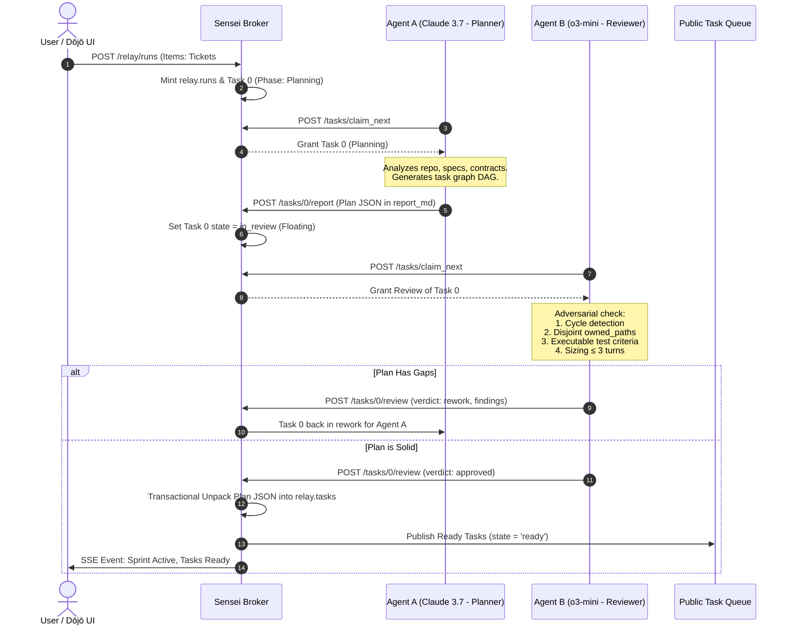
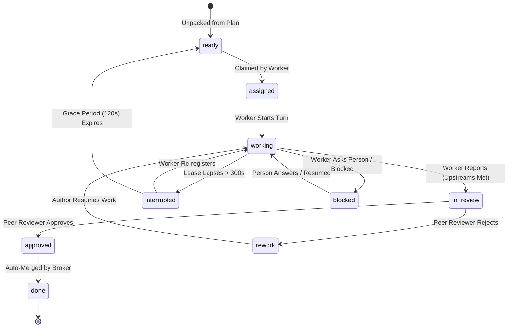

# Relay Autonomous Queue & Adversarial Planning
### Self-Service Task Execution, Multi-Model Peer Planning & One-Stop Sprint Management

> **Executive Summary:** This design transitions the Sensei Relay broker from a push-based, coordinator-bottlenecked workflow to a **resilient, self-service queue-driven execution engine**. The user manages the entire delivery lifecycle from a single Relay screen: registering assistant workers, grouping backlog items into a Sprint Run, auto-dispatching adversarial planning, and overseeing self-service execution. Workers autonomously claim ready tasks and peer reviews via strict First-Come-First-Served (FCFS) mechanics. Dependency DAGs support early claiming with hard-gating at report time. Concurrently, all twelve systemic defects identified in the Broker Deep Review (F01–F12)—including read-starts-work, NULL-reviewer wedges, quota erasure, and leak-guard gaps—are definitively resolved.

---

## Deviations (implemented 2026-11-12)

Built as planned in `docs/plan/2026-11-10-relay-autonomous-queue/` (phases 1–4 shipped on
`lane/relay-autonomous-queue`; the daemon live, the MCP tools installed, the Relay screen's sprint band and form
e2e-green). Where this document's claims about existing code were wrong, the plan's *Grounding corrections*
section in its README rules, and each phase file records its "Executed" notes. The ones a reader of this document
should know: the gate task carries no `deps` (its precondition is met at the mint); `claim_next` still offers a
floating review to a lane holding a worker task; a limit pause ends only by the sweeper at `resumes_at` or by
`limit_resume`; the person's `POST /relay/runs` names its crew from the screen; 13 planned-but-unassigned live
tasks became `ready` at the converge.

## 1. Problem Statement & Motivation

### 1.1 The Operational Bottleneck in Slice-1 (Coordinator Push)
The initial Relay implementation modeled the coordinator as an active dispatcher responsible for continually inspecting worker availability and pushing individual task assignments (`POST /api/relay/tasks/{id}/assign`). During intensive multi-lane runs (`coord/` operations, Nov 2026), this topology exhibited severe failure modes:
1. **Single Point of Failure (SPOF):** If the coordinator assistant session crashed, stalled, hit token rate limits, or context-compacted, all contributor lanes idled indefinitely, even when the queue contained unblocked backlog items.
2. **Review Wedging & Task Starvation:** When tasks were reported (`POST /api/relay/tasks/{id}/report`), they were hardwired to a single assigned reviewer or defaulted to the coordinator (`reviewer_lane_id`). When that reviewer lagged or disconnected, the task was trapped in `in_review` forever, blocking dependent work down the DAG.
3. **High Cognitive & Manual Load:** The operator was forced to watch multiple terminal tabs, manually kick the coordinator, relay status out-of-band, and manually unwedge stuck leases.

### 1.2 Broker Deep Review Findings (F01–F12)
An exhaustive, independent review of the broker implementation revealed 12 critical semantic and protocol deficiencies that must be rectified:
* **F01 (HIGH — Read-Starts-Work Antipattern):** Calling `GET /api/relay/tasks` executed `UPDATE relay.tasks SET state = 'working'` as an implicit side-effect. Mere polling by an external observer or heartbeat check falsely transitioned tasks to active work without an explicit claim lease.
* **F02 (HIGH — NULL-Reviewer Wedge & Coordinator Loop):** Tasks reported with `reviewer_lane_id IS NULL` wedged permanently. Simultaneously, if the coordinator died, `in_review` tasks became deadlocks because the broker lacked a public review pool.
* **F03 (HIGH — Routine Heartbeat Erases Quota Pause):** Calling `POST /api/relay/heartbeat` unconditionally executed `limit_paused_at = NULL`, erasing an assistant's declared rate-limit backoff (`limit_pause`) and causing immediate thrashing against LLM provider quotas.
* **F04 (HIGH — Credential Leak Guard Coverage Gap):** Leak scrubbing was enforced on actions, but `report_md` and review feedback strings bypassed secret scanners, allowing bearer tokens and API keys to leak into Postgres.
* **F05 (MEDIUM — Interrupted Task Orphanage on Re-register):** Reconnecting lanes failed to resume interrupted tasks cleanly, stranding tasks in orphaned states without re-offering them to the pool.
* **F06 (MEDIUM — Missing Waiting Records & Automated 15-Minute Nudges):** Lanes held long-polling connections (`wait_for_task`) without a formal database waiting table, preventing the sweeper from waking idle workers or nudging stalled tasks.
* **F07 (MEDIUM — Absence of In-Turn Checkpointing):** Tasks could only persist intermediate findings by completing or reporting, lacking a lightweight `checkpoint_task` endpoint for multi-turn tasks.
* **F08 (LOW — Lack of Crew Scoping on Messages):** Actions lacked rigorous `(user_id, crew_id)` compound index scoping, risking cross-crew message leakage.
* **F09 (LOW — Telemetry Ingestion Schema Crash):** Telemetry payload parsing crashed when encountering extended assistant metadata (`family`, `version`, `model`).
* **F10 (LOW — Sweeper Grants Leases to Dead Waiters):** Resource scheduling granted build slots to lanes whose heartbeats had already expired.
* **F11 (LOW — Loose Deserialization on Wait Query):** `WaitQuery` lacked `#[serde(deny_unknown_fields)]`, allowing silently ignored malformed parameters.
* **F12 (LOW — Liveness Renewal Ambiguity):** Discrepancy between spec and code regarding lease renewal during task reporting.

---

## 2. Core Architecture & Operating Model

The re-architected Relay replaces coordinator-push with **Autonomous Self-Service Pull + Adversarial Peer Planning**.

```
                ┌────────────────────────────────────────────────────────┐
                │             ONE-STOP RELAY MANAGEMENT SCREEN           │
                │   • Register Assistants (Default: Contributor)         │
                │   • Create Sprint Run from Backlog Items (Tickets)     │
                │   • Monitor DAG Execution, Review Flow, & Blockers     │
                └──────────────────────────┬─────────────────────────────┘
                                           │ Create Run
                                           ▼
                ┌────────────────────────────────────────────────────────┐
                │               TASK 0: ADVERSARIAL PLANNING             │
                │                                                        │
                │   [Agent A (Frontier)] ──────► Drafts Plan DAG         │
                │                                    │                   │
                │   [Agent B (Peer Model)] ◄─────────┘ Review & Critique │
                │            │                                           │
                │            ├──► Approved: Deterministic DAG Unpack     │
                │            └──► Rework: Feedback Loop to Agent A       │
                └──────────────────────────┬─────────────────────────────┘
                                           │ Unpacks into
                                           ▼
┌──────────────────────────────────────────────────────────────────────────────────────────────────┐
│                                 PUBLIC SELF-SERVICE QUEUE                                        │
│                                                                                                  │
│   [Priority 1: Floating Reviews] ──► Pure FCFS (Excludes Task Author; Never Self-Review)        │
│   [Priority 2: Ready Tasks]      ──► Unblocked Tasks (All Upstream Deps Done)                    │
│   [Priority 3: Claim-Early DAG]  ──► Upstream Working (Scaffold & Test Now; Gated at Report)     │
└───────────────┬──────────────────────────────────────────────────┬───────────────────────────────┘
                │ Claim Next / Claim Review                        │ Claim Next / Claim Review
                ▼                                                  ▼
     ┌───────────────────────┐                          ┌───────────────────────┐
     │  Contributor Lane L1  │                          │  Contributor Lane L2  │
     │  (Claude Code / Muse) │                          │  (Freebuff / Cowork)  │
     └───────────────────────┘                          └───────────────────────┘
```

### 2.1 The Five Pillars
1. **One-Stop Management Surface:** The user conducts all operations from the Relay UI. No terminal switching, no manual out-of-band JSON relaying.
2. **Simplified Join (Zero-Config Registration):** All incoming assistant sessions register as `contributor` by default. The broker provides a structured guidance block containing protocol rules, cadence, and polling instructions.
3. **Adversarial Multi-Model Planning:** When a Sprint Run is minted, Task 0 is automatically generated as a Planning task. It is drafted by one agent and reviewed by an adversarial peer (preferably a different model family, e.g., Claude 3.7 vs. OpenAI o3-mini or Gemini 1.5 Pro). The plan cannot unpack into the execution queue until verified.
4. **Self-Service Pull Queue (FCFS):** Workers pull tasks using atomic transactions (`FOR UPDATE SKIP LOCKED`). The coordinator does not manually push assignments.
5. **Review-First Dispatch with Claim-Early DAGs:**
   * **Review-First:** Workers prioritize reviewing peer tasks over starting new work, preventing review backpressure and guaranteeing fast PR turnaround.
   * **Claim-Early DAGs:** Workers can claim dependent tasks early to read specs, examine code, and write tests, but cannot submit completion reports (`report_task`) until all upstream dependencies reach `approved` or `done`.

---

## 3. End-to-End User Experience & Journey

### Step 1: Agent Registration (The Roster)
The user opens terminal windows or kicks off worker agents (Claude Code, Muse, Freebuff, Cursor, etc.). Each agent runs a standard register command:
```bash
POST /api/relay/register
{
  "suggested_name": "worker-alpha",
  "family": "claude-code",
  "version": "2.1.0",
  "model": "claude-3-7-sonnet",
  "capabilities": ["rust", "sql", "testing"]
}
```
* **Broker Response:** Returns `lane_id`, lane token, assigned code (e.g., `L1`), and the standard **Guidance Block** specifying heartbeat interval (300s), polling endpoints, and role rules.
* **Default Role:** Every lane joins as `contributor`. There is no need for the user to nominate a dedicated coordinator agent; coordination logic is embedded deterministically in the broker daemon.

### Step 2: One-Stop Sprint Run Creation
From the Sensei Relay Screen, the user views their backlog items (`relay.items`) and selects 1 to N tickets to form a **Sprint Run**:
1. User clicks **"Create Sprint"** in the Relay UI.
2. User provides:
   * **Sprint Goal:** E.g., *"Implement self-service queue and database schema delta for Relay v2"*.
   * **Selected Items:** Checkbox selection of tickets/backlog items.
   * **Target Repositories & Workspaces:** Root repo and working branch.
3. The UI issues:
   ```http
   POST /relay/runs
   {
     "title": "Sprint 42: Autonomous Relay Queue",
     "goal": "Implement self-service queue and database schema delta",
     "item_ids": ["01931560-7000-7000-8000-000000000001", "01931560-7000-7000-8000-000000000002"]
   }
   ```
4. The broker automatically inserts a new `relay.runs` record and immediately schedules **Task 0: Planning**.

### Step 3: Adversarial Planning Workflow
The Planning task is placed into the queue with `phase = 'planning'`:
1. **Drafting (Agent A):** The first available contributor with planning capabilities claims Task 0.
   * Agent A analyzes the backlog items, codebase structure, and existing tests.
   * Agent A produces a structured decomposition: a directed acyclic graph (DAG) of technical tasks with explicit `owned_paths`, `acceptance` criteria, `phase`, and `deps`.
   * Agent A reports completion via `POST /api/relay/tasks/{id}/report`.
2. **Adversarial Review (Agent B — Different Model Preferred):**
   * The planning task enters `in_review` and floats on the review queue.
   * Agent B claims the review via `POST /api/relay/tasks/{id}/claim_review`.
   * The broker enforces `Agent B != Agent A` and prioritizes a distinct model family.
   * Agent B evaluates:
     * *DAG Sanity:* Are there cycles? Are dependencies complete?
     * *File Conflict Analysis:* Do parallel tasks have overlapping `owned_paths` that will trigger merge conflicts?
     * *Acceptance Rigor:* Does every task have concrete, executable test criteria?
     * *Task Sizing:* Is each task scoped to 1–3 turns without unbounded scope creep?
   * If Agent B rejects the plan: Task 0 transitions to `rework` with structured critique for Agent A.
   * If Agent B approves the plan: Task 0 transitions to `approved` -> `done`.
3. **Deterministic Unpack:**
   * Upon approval of Task 0, the broker daemon executes an internal transaction that parses the approved plan JSON and unpacks all child tasks directly into `relay.tasks` with `state = 'ready'` and `lane_id = NULL`.
   * Sprint Run status transitions from `planning` to `active`.

### Step 4: Self-Service Execution (FCFS)
Once tasks are unpacked, contributor lanes pull work automatically:
```
Turn Cycle for Any Worker Lane:
1. Poll/Wait: Call POST /api/relay/tasks/claim_next
   ├── Priority 1: Check for open Floating Reviews (excluding tasks authored by self)
   ├── Priority 2: Check for unblocked Ready Tasks (deps fully satisfied)
   └── Priority 3: Check for Claim-Early DAG Tasks (deps in progress; early scaffolding allowed)
2. Execute Work in isolated worktree.
3. Checkpoint Progress: POST /api/relay/tasks/{id}/checkpoint (saves step status without altering state).
4. Finish Turn: POST /api/relay/tasks/{id}/report.
   └── Gating Check: If upstream deps are NOT merged/approved, report is REJECTED with 409 Conflict.
5. Task transitions to state = 'in_review', review_claimed_by = NULL (floats to review queue).
```

### Step 5: Pure FCFS Peer Review & Auto-Merge
* Any idle worker calls `claim_next` and immediately receives the floating review (Priority 1).
* The reviewer inspects diffs, verifies test execution logs, and checks acceptance criteria.
* Reviewer submits `POST /api/relay/tasks/{id}/review` with verdict `approved` or `rework`:
  * If `rework`: Task transitions to `rework`, re-claimed by original author.
  * If `approved`: Task transitions to `approved`.
* **Deterministic Auto-Merge:** The broker tests merge clean-apply. If successful, it stamps the task `done` and clears the dependency from all downstream waiting tasks.
* Once all tasks in the Sprint Run reach `done`, the Sprint Run marks itself `completed`.

---

## 4. Addressing Broker Review Findings (F01–F12)

The table below details how the new design resolves each finding from the deep review:

| ID | Finding Title | Severity | Root Cause in Slice 1 | Architectural Fix in Autonomous Model |
|---|---|---|---|---|
| **F01** | Read-Starts-Work Antipattern | **HIGH** | `GET /api/relay/tasks` updated task state from `assigned` to `working`. | **Decouple read from state mutation.** `GET /api/relay/tasks` and `GET /relay/queue` are strictly idempotent and read-only. State transition to `working` occurs ONLY via explicit `POST /api/relay/tasks/{id}/claim` or `POST /api/relay/tasks/claim_next`. |
| **F02** | NULL-Reviewer Wedge & Coordinator Deadlock | **HIGH** | `reviewer_lane_id` was mandatory and fixed. If NULL or coordinator stalled, review halted. | **Floating Review Queue.** Replace fixed `reviewer_lane_id` with `review_claimed_by` and `review_claimed_at`. Reviews float in a public queue. Any contributor (except task author) claims reviews via pure FCFS. Sweeper clears abandoned review claims after 60s of reviewer lease lapse. |
| **F03** | Routine Heartbeat Erases Quota Pause | **HIGH** | `POST /api/relay/heartbeat` unconditionally executed `limit_paused_at = NULL`. | **Coherent Quota Pause Semantics.** Heartbeats renew lane liveness leases ONLY. `limit_paused_at` remains intact until either: (a) `limit_resumes_at` wall-clock time expires, or (b) lane explicitly issues `POST /api/relay/limit_resume`. |
| **F04** | Credential Leak Guard Coverage Gap | **HIGH** | Leak scrubbers checked action bodies but skipped `report_md` and review feedback strings. | **Ubiquitous Scrubbing Gate.** The `scrub_secrets()` guard is applied at the handler boundary to `report_md`, `review_md`, and all `props` before touching Postgres. |
| **F05** | Interrupted Task Orphanage on Re-register | **MEDIUM** | Reconnecting lane with valid token did not automatically resume interrupted tasks. | **Automatic Task Re-attachment.** `reregister` inspects `relay.tasks` for tasks in `state = 'interrupted'` belonging to the lane, restoring them to `state = 'working'` with the latest checkpoint. |
| **F06** | Missing Waiting Queue & 15-Min Nudges | **MEDIUM** | `wait_for_task` held an HTTP connection without persisting a wait record in DB. | **Explicit Waiter Registration.** Long-pollers insert a transient row into `relay.lane_waiters`. Sweeper tracks wait duration and issues automated nudges to idle workers after 15 minutes of inactivity. |
| **F07** | Absence of In-Turn Checkpointing | **MEDIUM** | Lanes had no way to save intermediate steps without reporting task completion. | **New Checkpoint Endpoint.** Add `POST /api/relay/tasks/{id}/checkpoint` allowing agents to save steps, files, and scratchpad data without triggering phase or state transitions. |
| **F08** | Lack of Crew Scoping on Messages | **LOW** | Message queries filtered on `user_id` without validating `crew_id`. | **Compound Scoping.** All message and action endpoints require and enforce compound `(user_id, crew_id)` matching. |
| **F09** | Telemetry Ingestion Schema Crash | **LOW** | Assistant metadata fields were rejected by rigid telemetry deserializer. | **Permissive Telemetry Types.** Telemetry payload accepts optional `family`, `version`, and `model` fields with serde defaults. |
| **F10** | Sweeper Grants Leases to Dead Waiters | **LOW** | Resource sweeper did not filter out lapsed lanes before granting queued slots. | **Liveness Filter on Resource Grants.** Leases are granted only to lanes with active, unexpired lane leases (`expires_at > current_timestamp`). |
| **F11** | Loose Deserialization on Wait Query | **LOW** | Missing `deny_unknown_fields` on `WaitQuery`. | **Strict Serde Attributes.** Add `#[serde(deny_unknown_fields)]` to `WaitQuery` and all relay query structures. |
| **F12** | Liveness Renewal Ambiguity | **LOW** | Contradiction on whether task reporting implicitly renewed lane leases. | **Explicit Separation.** Lease renewal is strictly the responsibility of `heartbeat`. Task endpoints do not touch `leases.expires_at`. |

---

## 5. Concrete Database Schema Delta

This section provides the exhaustive, production-grade schema specification. Per repository governance (`AGENTS.md` and `dbd` guidelines), DDL definitions represent **full standalone declarations (no raw `ALTER TABLE` in final schema files)** alongside unified diffs and an atomic migration script.

---

### 5.1 Schema Invariant & Relationship Matrix

```
┌────────────────────────────────────────────────────────────────────────┐
│                              relay.runs                                │
│   id, crew_id, title, goal, state ('planning'|'active'|'completed')    │
└──────────────────────┬─────────────────────────────────────────────────┘
                       │ 1:N
                       ▼
┌────────────────────────────────────────────────────────────────────────┐
│                              relay.tasks                               │
│   id, run_id, lane_id (NULL when ready), review_claimed_by (NULL)      │
│   state ('ready'|'assigned'|'working'|'in_review'|'approved'|'done')   │
│   deps (uuid[]), checkpoint (jsonb), steps (jsonb)                     │
└──────────┬─────────────────────────────────┬───────────────────────────┘
           │ N:1 (Author)                    │ N:1 (Reviewer)
           ▼                                 ▼
┌────────────────────────────────────────────────────────────────────────┐
│                              relay.lanes                               │
│   id, crew_id, code ('L1'..), title, suggested_name, role              │
│   limit_paused_at, limit_scope, limit_resumes_at                       │
└────────────────────────────────────────────────────────────────────────┘
```

#### Core Database Invariants
1. **Ready Unassigned Invariant:** `(state = 'ready') = (lane_id IS NULL)`. A task in the public pool must not be tied to any lane.
2. **Strict No-Self-Review:** `(review_claimed_by IS NULL OR lane_id IS NULL OR review_claimed_by <> lane_id)`. An authoring lane cannot claim review for its own task under any circumstance.
3. **One Active Worker Task Per Lane:** `UNIQUE (user_id, lane_id) WHERE lane_id IS NOT NULL AND state IN ('assigned', 'working', 'rework', 'blocked')`. When a task transitions to `in_review`, the author lane is freed to review peers or claim-early new work.
4. **One Active Review Per Reviewer:** `UNIQUE (user_id, review_claimed_by) WHERE review_claimed_by IS NOT NULL AND state = 'in_review'`. Prevents a single reviewer lane from hoarding multiple floating reviews.
5. **Quota Pause Coherence:** `(limit_paused_at IS NULL) = (limit_scope IS NULL)`. Heartbeats renew lease liveness without clearing this pause before `limit_resumes_at`.

---

### 5.2 Complete Full DDL Definitions (`dbd`-Compliant)

#### 1. `database/ddl/enum/relay/task_state.ddl`
```sql
set search_path to relay, extensions;

-- Where a task stands in the autonomous lifecycle.
-- 'ready' is unassigned in the public pool.
-- 'assigned', 'working', 'rework', 'blocked' occupy the lane.
-- 'in_review' floats or holds a review claim, freeing the author lane.
-- 'approved', 'done', 'cancelled', 'interrupted' release the task.
create type relay.task_state as enum (
  'ready',
  'assigned',
  'working',
  'in_review',
  'rework',
  'approved',
  'done',
  'blocked',
  'interrupted',
  'cancelled'
);

comment on type relay.task_state is
'Autonomous queue task states: ready (in queue), working (holding lane), in_review (floating/claimed review), terminal (approved/done/cancelled).';
```

#### 2. `database/ddl/enum/relay/task_phase.ddl`
```sql
set search_path to relay, extensions;

-- Which phase of work a task is in.
-- 'planning' added for Task 0 adversarial decomposition.
create type relay.task_phase as enum (
  'planning',
  'analysis',
  'tests',
  'impl',
  'docs',
  'mockup'
);

comment on type relay.task_phase is
'The phase of work. Planning is Task 0 decomposition; approved moves to next phase.';
```

#### 3. `database/ddl/enum/relay/action_kind.ddl`
```sql
set search_path to relay, extensions;

-- Events recorded in relay.actions.
-- Adds 'claimed', 'review_claimed', and 'checkpointed'.
create type relay.action_kind as enum (
  'assigned',
  'claimed',
  'review_claimed',
  'checkpointed',
  'brief_updated',
  'started',
  'reported',
  'reviewed',
  'asked',
  'answered',
  'message',
  'delivered',
  'read',
  'merged',
  'interrupted',
  'reoffered',
  'compacted',
  'handed_over'
);

comment on type relay.action_kind is
'Event kinds in relay.actions including autonomous claims and checkpoints.';
```

#### 4. `database/ddl/table/relay/runs.ddl`
```sql
set search_path to relay, extensions;

-- A Sprint Run: groups backlog items and owns the planning-to-completion lifecycle.
create table if not exists relay.runs (
  user_id          uuid        not null,
  id               uuid        not null,
  crew_id          uuid        not null,
  title            text        not null,
  goal             text        not null,
  state            text        not null default 'planning',
  config           jsonb       not null default '{}',
  created_at       timestamptz not null default current_timestamp,
  started_at       timestamptz,
  completed_at     timestamptz,
  constraint runs_pkey primary key (user_id, id),
  constraint runs_id_v7 check (substring(id::text from 15 for 1) = '7'),
  constraint runs_crew_fk foreign key (user_id, crew_id) references relay.crews (user_id, id)
);

create index if not exists runs_crew_active_idx
  on relay.runs (user_id, crew_id) where state in ('planning', 'active');

alter table relay.runs enable row level security;

comment on table relay.runs is
'Sprint runs. Created from one or more backlog items; dispatches Task 0 planning then tracks queue completion.';
```

#### 5. `database/ddl/table/relay/run_items.ddl`
```sql
set search_path to relay, extensions;

-- Junction linking backlog items/tickets to a sprint run.
create table if not exists relay.run_items (
  user_id          uuid        not null,
  run_id           uuid        not null,
  item_id          uuid        not null,
  position         int         not null default 0,
  added_at         timestamptz not null default current_timestamp,
  constraint run_items_pkey primary key (user_id, run_id, item_id),
  constraint run_items_run_fk foreign key (user_id, run_id) references relay.runs (user_id, id) on delete cascade,
  constraint run_items_item_fk foreign key (user_id, item_id) references relay.items (user_id, id) on delete cascade
);

alter table relay.run_items enable row level security;

comment on table relay.run_items is
'Backlog items assigned to a sprint run.';
```

#### 6. `database/ddl/table/relay/tasks.ddl`
```sql
set search_path to relay, extensions;

-- What a lane works on. Supports self-service queueing, floating reviews,
-- in-turn checkpointing, dependency DAGs, and broker-executed deterministic tasks.
create table if not exists relay.tasks (
  user_id            uuid              not null,
  id                 uuid              not null,
  crew_id            uuid              not null,
  run_id             uuid,
  item_id            uuid,
  repo_key           text              not null,
  workspace_id       uuid,
  lane_id            uuid,
  review_claimed_by  uuid,
  review_claimed_at  timestamptz,
  title              text              not null,
  phase              relay.task_phase  not null,
  state              relay.task_state  not null default 'ready',
  round              int               not null default 1,
  executor           text              not null default 'agent',
  deterministic      jsonb             not null default '{}',
  owned_paths        text[]            not null default '{}',
  acceptance         text[]            not null default '{}',
  resources          text[]            not null default '{}',
  deps               uuid[]            not null default '{}',
  blocked_from_state relay.task_state,
  assigned_at        timestamptz,
  state_changed_at   timestamptz       not null default current_timestamp,
  completed_at       timestamptz,
  checkpoint         jsonb             not null default '{}',
  steps              jsonb             not null default '[]',
  constraint tasks_pkey primary key (user_id, id),
  constraint tasks_id_v7 check (substring(id::text from 15 for 1) = '7'),
  constraint tasks_crew_fk foreign key (user_id, crew_id) references relay.crews (user_id, id),
  constraint tasks_run_fk foreign key (user_id, run_id) references relay.runs (user_id, id),
  constraint tasks_item_fk foreign key (user_id, item_id) references relay.items (user_id, id),
  constraint tasks_lane_fk foreign key (user_id, lane_id) references relay.lanes (user_id, id),
  constraint tasks_reviewer_fk foreign key (user_id, review_claimed_by) references relay.lanes (user_id, id),
  constraint tasks_no_self_review check
    (review_claimed_by is null or lane_id is null or review_claimed_by <> lane_id),
  constraint tasks_round_from_1 check (round >= 1),
  constraint tasks_blocked_memory check ((state = 'blocked') = (blocked_from_state is not null)),
  constraint tasks_ready_lane_coherence check
    ((state = 'ready') = (lane_id is null)),
  constraint tasks_executor_check check
    (executor in ('agent', 'broker')),
  constraint tasks_broker_deterministic check
    (executor <> 'broker' or deterministic <> '{}')
);

-- Partial index: A lane holds at most ONE actively worked task.
create unique index if not exists tasks_one_active_worker_per_lane
  on relay.tasks (user_id, lane_id) where lane_id is not null
  and state in ('assigned', 'working', 'rework', 'blocked');

-- Partial index: A lane holds at most ONE active review claim.
create unique index if not exists tasks_one_active_review_per_lane
  on relay.tasks (user_id, review_claimed_by) where review_claimed_by is not null
  and state = 'in_review';

-- High-performance queue lookup index for FCFS claim queries (cognitive agent tasks).
create index if not exists tasks_ready_queue_idx
  on relay.tasks (user_id, crew_id, state, state_changed_at)
  where executor = 'agent' and state in ('ready', 'in_review');

-- Queue lookup index for deterministic broker actions.
create index if not exists tasks_broker_queue_idx
  on relay.tasks (user_id, crew_id, state, state_changed_at)
  where executor = 'broker' and state = 'ready';

alter table relay.tasks enable row level security;

comment on table relay.tasks is
'Self-service tasks table. state=ready indicates unclaimed task in public queue; review_claimed_by tracks floating peer reviews.';
comment on column relay.tasks.executor is 'Who executes this task: agent (cognitive LLM turn) or broker (deterministic machine operation).';
comment on column relay.tasks.deterministic is 'When executor=broker: spec {action, manifest, target, timeout_seconds} scheduled by planner or broker.';
comment on column relay.tasks.run_id is 'Optional sprint run container this task belongs to.';
comment on column relay.tasks.review_claimed_by is 'The lane currently reviewing this task. Null while floating in review queue.';
comment on column relay.tasks.review_claimed_at is 'When the reviewer claimed the review lease. Used for sweeper timeout recovery.';
comment on column relay.tasks.checkpoint is 'In-turn checkpoint data (files, scratchpad, notes) saved via POST /tasks/{id}/checkpoint.';
```

#### 7. `database/ddl/table/relay/lanes.ddl`
```sql
set search_path to relay, extensions;

-- A registered lane: one assistant session in a crew.
create table if not exists relay.lanes (
  user_id          uuid            not null,
  id               uuid            not null,
  crew_id          uuid            not null,
  code             text            not null,
  title            text,
  suggested_name   text,
  role             relay.lane_role not null default 'contributor',
  family           text            not null,
  version          text,
  model            text,
  capabilities     text[]          not null default '{}',
  repo             text,
  worktree         text,
  token_hash       text            not null,
  checkpoint       jsonb,
  registered_at    timestamptz     not null default current_timestamp,
  unregistered_at  timestamptz,
  limit_paused_at  timestamptz,
  limit_scope      relay.limit_scope,
  limit_resumes_at timestamptz,
  limit_note       text,
  constraint lanes_pkey primary key (user_id, id),
  constraint lanes_pause_coherent check (
    (limit_paused_at is null) = (limit_scope is null)),
  constraint lanes_id_v7 check (substring(id::text from 15 for 1) = '7'),
  constraint lanes_crew_fk foreign key (user_id, crew_id) references relay.crews (user_id, id),
  constraint lanes_code_per_crew unique (user_id, crew_id, code)
);

create unique index if not exists lanes_one_coordinator
  on relay.lanes (user_id, crew_id) where role = 'coordinator';

alter table relay.lanes enable row level security;

comment on table relay.lanes is
'Registered lanes. Role defaults to contributor; suggested_name records assistant-proposed alias.';
comment on column relay.lanes.suggested_name is 'Assistant-proposed lane name passed at register time.';
```

#### 8. `database/ddl/table/relay/lane_waiters.ddl`
```sql
set search_path to relay, extensions;

-- Explicit waiter registry for long-polling workers (Resolves F06).
create table if not exists relay.lane_waiters (
  user_id          uuid        not null,
  lane_id          uuid        not null,
  crew_id          uuid        not null,
  waiting_since    timestamptz not null default current_timestamp,
  last_poll_at     timestamptz not null default current_timestamp,
  constraint lane_waiters_pkey primary key (user_id, lane_id),
  constraint lane_waiters_lane_fk foreign key (user_id, lane_id) references relay.lanes (user_id, id) on delete cascade
);

alter table relay.lane_waiters enable row level security;

comment on table relay.lane_waiters is
'Active long-poll waiters. Sweeper inspects waiting_since to trigger 15-min nudges.';
```

---

### 5.3 Unified Git Diffs (Line-by-Line Changes from Slice 1)

#### `diff --git a/database/ddl/enum/relay/task_state.ddl b/database/ddl/enum/relay/task_state.ddl`
```diff
--- a/database/ddl/enum/relay/task_state.ddl
+++ b/database/ddl/enum/relay/task_state.ddl
@@ -5,6 +5,7 @@ set search_path to relay, extensions;
 -- lane; approved, done, cancelled and interrupted release it.
 create type relay.task_state as enum (
+  'ready',
   'assigned',
   'working',
   'in_review',
```

#### `diff --git a/database/ddl/enum/relay/task_phase.ddl b/database/ddl/enum/relay/task_phase.ddl`
```diff
--- a/database/ddl/enum/relay/task_phase.ddl
+++ b/database/ddl/enum/relay/task_phase.ddl
@@ -5,6 +5,7 @@ set search_path to relay, extensions;
 -- an action the coordinator takes on an approved task.
 create type relay.task_phase as enum (
+  'planning',
   'analysis',
   'tests',
   'impl',
```

#### `diff --git a/database/ddl/enum/relay/action_kind.ddl b/database/ddl/enum/relay/action_kind.ddl`
```diff
--- a/database/ddl/enum/relay/action_kind.ddl
+++ b/database/ddl/enum/relay/action_kind.ddl
@@ -5,6 +5,9 @@ set search_path to relay, extensions;
 -- daemon validates and which fold of the task view reads them.
 create type relay.action_kind as enum (
   'assigned',
+  'claimed',
+  'review_claimed',
+  'checkpointed',
   'brief_updated',
   'started',
   'reported',
```

#### `diff --git a/database/ddl/table/relay/lanes.ddl b/database/ddl/table/relay/lanes.ddl`
```diff
--- a/database/ddl/table/relay/lanes.ddl
+++ b/database/ddl/table/relay/lanes.ddl
@@ -9,7 +9,8 @@ create table if not exists relay.lanes (
   code            text            not null,
   title           text,
-  role            relay.lane_role not null,
+  suggested_name  text,
+  role            relay.lane_role not null default 'contributor',
   family          text            not null,
   version         text,
   model           text,
```

#### `diff --git a/database/ddl/table/relay/tasks.ddl b/database/ddl/table/relay/tasks.ddl`
```diff
--- a/database/ddl/table/relay/tasks.ddl
+++ b/database/ddl/table/relay/tasks.ddl
@@ -8,16 +8,19 @@ create table if not exists relay.tasks (
   user_id            uuid              not null,
   id                 uuid              not null,
   crew_id            uuid              not null,
+  run_id             uuid,
   item_id            uuid,
   repo_key           text              not null,
   workspace_id       uuid,
   lane_id            uuid,
-  reviewer_lane_id   uuid,
+  review_claimed_by  uuid,
+  review_claimed_at  timestamptz,
   title              text              not null,
   phase              relay.task_phase  not null,
-  state              relay.task_state  not null default 'assigned',
+  state              relay.task_state  not null default 'ready',
   round              int               not null default 1,
   owned_paths        text[]            not null default '{}',
   acceptance         text[]            not null default '{}',
   resources          text[]            not null default '{}',
   deps               uuid[]            not null default '{}',
   blocked_from_state relay.task_state,
-  assigned_at        timestamptz       not null default current_timestamp,
+  assigned_at        timestamptz,
   state_changed_at   timestamptz       not null default current_timestamp,
   completed_at       timestamptz,
+  checkpoint         jsonb             not null default '{}',
   steps              jsonb             not null default '[]',
   constraint tasks_pkey primary key (user_id, id),
   constraint tasks_id_v7 check (substring(id::text from 15 for 1) = '7'),
   constraint tasks_crew_fk foreign key (user_id, crew_id) references relay.crews (user_id, id),
+  constraint tasks_run_fk foreign key (user_id, run_id) references relay.runs (user_id, id),
   constraint tasks_item_fk foreign key (user_id, item_id) references relay.items (user_id, id),
   constraint tasks_lane_fk foreign key (user_id, lane_id) references relay.lanes (user_id, id),
-  constraint tasks_reviewer_fk foreign key (user_id, reviewer_lane_id) references relay.lanes (user_id, id),
+  constraint tasks_reviewer_fk foreign key (user_id, review_claimed_by) references relay.lanes (user_id, id),
   constraint tasks_no_self_review check
-    (reviewer_lane_id is null or lane_id is null or reviewer_lane_id <> lane_id),
+    (review_claimed_by is null or lane_id is null or review_claimed_by <> lane_id),
   constraint tasks_round_from_1 check (round >= 1),
-  constraint tasks_blocked_memory check ((state = 'blocked') = (blocked_from_state is not null))
+  constraint tasks_blocked_memory check ((state = 'blocked') = (blocked_from_state is not null)),
+  constraint tasks_ready_lane_coherence check ((state = 'ready') = (lane_id is null))
 );
 
-create unique index if not exists tasks_one_active_per_lane
-  on relay.tasks (user_id, lane_id) where lane_id is not null
-  and state in ('assigned', 'working', 'in_review', 'rework', 'blocked');
+create unique index if not exists tasks_one_active_worker_per_lane
+  on relay.tasks (user_id, lane_id) where lane_id is not null
+  and state in ('assigned', 'working', 'rework', 'blocked');
+
+create unique index if not exists tasks_one_active_review_per_lane
+  on relay.tasks (user_id, review_claimed_by) where review_claimed_by is not null
+  and state = 'in_review';
+
+create index if not exists tasks_ready_queue_idx
+  on relay.tasks (user_id, crew_id, state, state_changed_at)
+  where state in ('ready', 'in_review');
```

---

### 5.4 Complete View DDLs

#### 1. Complete `database/ddl/view/relay/now.ddl`
```sql
set search_path to relay, extensions;

-- The Now screen grain: six sections providing complete single-pane-of-glass observability:
-- 1. 'lane': registered lanes, active task, active review, lease status, quota pause.
-- 2. 'sprint_summary': current sprint run state, progress bars, queue depths.
-- 3. 'floating_reviews': tasks waiting for peer review pickup.
-- 4. 'open_asked': escalations/questions waiting on person input.
-- 5. 'person_message': direct messages addressed to person.
-- 6. 'completed_today': completed & auto-merged tasks.
create or replace view relay.now with (security_invoker = true) as
select l.user_id, 'lane'::text as section, l.crew_id, l.id,
  jsonb_build_object(
    'code', l.code, 'title', l.title, 'suggested_name', l.suggested_name,
    'role', l.role, 'family', l.family, 'version', l.version, 'model', l.model,
    'limit_scope', l.limit_scope, 'limit_resumes_at', l.limit_resumes_at,
    'limit_note', l.limit_note,
    'lease', case when ls.id is null then null
      else jsonb_build_object('state', ls.state, 'expires_at', ls.expires_at) end,
    'task', case when t.id is null then null
      else jsonb_build_object(
        'id', t.id, 'title', t.title, 'repo_key', t.repo_key, 'workspace_id', t.workspace_id,
        'phase', t.phase, 'state', t.state, 'round', t.round,
        'state_changed_at', t.state_changed_at,
        'needs_answer', exists (
          select 1 from relay.actions a
           where a.user_id = l.user_id and a.kind = 'asked'
             and a.props->>'asked_of' = 'person'
             and (a.task_id = t.id or a.props->'blocks' @> to_jsonb(t.id::text))
             and not exists (
               select 1 from relay.actions an
                where an.user_id = l.user_id and an.kind = 'answered' and an.reply_to = a.id))) end,
    'reviewing', case when tr.id is null then null
      else jsonb_build_object(
        'id', tr.id, 'title', tr.title, 'phase', tr.phase,
        'claimed_at', tr.review_claimed_at) end
  ) as payload
from relay.lanes l
left join lateral (
  select * from relay.leases ll
   where ll.user_id = l.user_id and ll.crew_id = l.crew_id and ll.lane_id = l.id and ll.kind = 'lane'
   order by ll.id desc limit 1
) ls on true
left join relay.tasks t on t.user_id = l.user_id and t.lane_id = l.id
  and t.state in ('assigned', 'working', 'rework', 'blocked')
left join relay.tasks tr on tr.user_id = l.user_id and tr.review_claimed_by = l.id
  and tr.state = 'in_review'
union all
select r.user_id, 'sprint_summary'::text as section, r.crew_id, r.id,
  jsonb_build_object(
    'run_id', r.id, 'title', r.title, 'goal', r.goal, 'state', r.state,
    'total_tasks', count(t.id),
    'ready_tasks', count(t.id) filter (where t.state = 'ready'),
    'working_tasks', count(t.id) filter (where t.state in ('assigned', 'working', 'rework')),
    'in_review_tasks', count(t.id) filter (where t.state = 'in_review'),
    'floating_reviews_count', count(t.id) filter (where t.state = 'in_review' and t.review_claimed_by is null),
    'approved_tasks', count(t.id) filter (where t.state = 'approved'),
    'done_tasks', count(t.id) filter (where t.state = 'done'),
    'blocked_tasks', count(t.id) filter (where t.state = 'blocked')
  ) as payload
from relay.runs r
left join relay.tasks t on t.user_id = r.user_id and t.run_id = r.id
where r.state in ('planning', 'active')
group by r.user_id, r.crew_id, r.id
union all
select t.user_id, 'floating_reviews'::text as section, t.crew_id, t.id,
  jsonb_build_object(
    'task_id', t.id, 'title', t.title, 'phase', t.phase, 'round', t.round,
    'author_lane_code', l.code, 'author_lane_title', l.title,
    'state_changed_at', t.state_changed_at)
from relay.tasks t
left join relay.lanes l on l.user_id = t.user_id and l.id = t.lane_id
where t.state = 'in_review' and t.review_claimed_by is null
union all
select a.user_id, 'open_asked', a.crew_id, a.id,
  jsonb_build_object(
    'task_id', a.task_id, 'task_title', t.title, 'question', a.body_md,
    'context', a.props->'context', 'options', a.props->'options',
    'recommended', a.props->'recommended', 'asked_at', a.created_at)
from relay.actions a
left join relay.tasks t on t.user_id = a.user_id and t.id = a.task_id
where a.kind = 'asked' and a.props->>'asked_of' = 'person'
  and not exists (
    select 1 from relay.actions an
     where an.user_id = a.user_id and an.kind = 'answered' and an.reply_to = a.id)
union all
select m.user_id, 'person_message', m.crew_id, m.id,
  jsonb_build_object(
    'task_id', m.task_id, 'task_title', t.title,
    'from_lane_code', l.code, 'text', m.body_md, 'sent_at', m.created_at)
from relay.actions m
left join relay.tasks t on t.user_id = m.user_id and t.id = m.task_id
left join relay.lanes l on l.user_id = m.user_id and l.id = m.lane_id
where m.kind = 'message' and m.props->'to'->>'kind' = 'person'
  and not exists (
    select 1 from relay.actions r
     where r.user_id = m.user_id and r.kind = 'read' and r.reply_to = m.id
       and r.lane_id is null)
union all
select t.user_id, 'completed_today', t.crew_id, t.id,
  jsonb_build_object(
    'task_id', t.id, 'crew_id', t.crew_id, 'repo_key', t.repo_key, 'title', t.title,
    'lane_code', l.code, 'lane_title', l.title,
    'outcome', case
      when exists (
        select 1 from relay.actions m
         where m.user_id = t.user_id and m.task_id = t.id and m.kind = 'merged')
      then 'merged'
      when t.state = 'approved' then 'approved'
      else 'done' end,
    'completed_at', coalesce(t.completed_at, t.state_changed_at))
from relay.tasks t
left join relay.lanes l on l.user_id = t.user_id and l.id = t.lane_id
where t.state in ('approved', 'done')
  and coalesce(t.completed_at, t.state_changed_at) >= date_trunc('day', current_timestamp);

comment on view relay.now is
'Now grain: lanes (with active work + active reviews), sprint progress summary, floating reviews, open questions, person messages, and completions.';
```

#### 2. `database/ddl/view/relay/queue.ddl`
```sql
set search_path to relay, extensions;

-- The Queue view: pure read-only inspection of claimable work and DAG readiness.
create or replace view relay.queue with (security_invoker = true) as
select
  t.user_id,
  t.crew_id,
  t.run_id,
  t.id as task_id,
  t.title,
  t.phase,
  t.state,
  t.round,
  t.repo_key,
  t.owned_paths,
  t.acceptance,
  t.lane_id as author_lane_id,
  t.review_claimed_by,
  case
    when t.state = 'in_review' and t.review_claimed_by is null then 'review_floating'
    when t.state = 'ready' and not exists (
      select 1 from relay.tasks d
       where d.user_id = t.user_id and d.id = any(t.deps) and d.state <> 'done')
      then 'ready_unblocked'
    when t.state = 'ready' then 'ready_claim_early'
    else 'claimed'
  end as claim_eligibility,
  coalesce(
    array_agg(d.id) filter (where d.id is not null and d.state <> 'done'),
    '{}'
  ) as unmet_deps,
  t.state_changed_at
from relay.tasks t
left join relay.tasks d on d.user_id = t.user_id and d.id = any(t.deps)
where t.state in ('ready', 'in_review')
group by t.user_id, t.crew_id, t.run_id, t.id;

comment on view relay.queue is
'Read-only view of queue items classified into review_floating, ready_unblocked, and ready_claim_early.';
```

---

### 5.5 Row Level Security (RLS) Policies

```sql
-- database/policies/relay/runs.sql
alter table relay.runs enable row level security;
drop policy if exists runs_owner_read on relay.runs;
create policy runs_owner_read on relay.runs
    for select to authenticated
    using (user_id::text = (nullif(current_setting('request.jwt.claims', true), '')::json ->> 'sub'));
grant select on relay.runs to authenticated;

-- database/policies/relay/run_items.sql
alter table relay.run_items enable row level security;
drop policy if exists run_items_owner_read on relay.run_items;
create policy run_items_owner_read on relay.run_items
    for select to authenticated
    using (user_id::text = (nullif(current_setting('request.jwt.claims', true), '')::json ->> 'sub'));
grant select on relay.run_items to authenticated;

-- database/policies/relay/lane_waiters.sql
alter table relay.lane_waiters enable row level security;
drop policy if exists lane_waiters_owner_read on relay.lane_waiters;
create policy lane_waiters_owner_read on relay.lane_waiters
    for select to authenticated
    using (user_id::text = (nullif(current_setting('request.jwt.claims', true), '')::json ->> 'sub'));
grant select on relay.lane_waiters to authenticated;
```

---

### 5.6 In-Place Atomic Migration Script

For environments upgrading from slice-1 without resetting the database via `dbd reset`, the following transactional migration is applied:

```sql
-- database/migrations/20261110_relay_autonomous_queue.sql
begin;

-- 1. Extend enums
alter type relay.task_state add value if not exists 'ready' before 'assigned';
alter type relay.task_phase add value if not exists 'planning' before 'analysis';
alter type relay.action_kind add value if not exists 'claimed' after 'assigned';
alter type relay.action_kind add value if not exists 'review_claimed' after 'claimed';
alter type relay.action_kind add value if not exists 'checkpointed' after 'review_claimed';

-- 2. Create runs and run_items
create table if not exists relay.runs (
  user_id          uuid        not null,
  id               uuid        not null,
  crew_id          uuid        not null,
  title            text        not null,
  goal             text        not null,
  state            text        not null default 'planning',
  config           jsonb       not null default '{}',
  created_at       timestamptz not null default current_timestamp,
  started_at       timestamptz,
  completed_at     timestamptz,
  constraint runs_pkey primary key (user_id, id),
  constraint runs_id_v7 check (substring(id::text from 15 for 1) = '7'),
  constraint runs_crew_fk foreign key (user_id, crew_id) references relay.crews (user_id, id)
);

create table if not exists relay.run_items (
  user_id          uuid        not null,
  run_id           uuid        not null,
  item_id          uuid        not null,
  position         int         not null default 0,
  added_at         timestamptz not null default current_timestamp,
  constraint run_items_pkey primary key (user_id, run_id, item_id),
  constraint run_items_run_fk foreign key (user_id, run_id) references relay.runs (user_id, id) on delete cascade,
  constraint run_items_item_fk foreign key (user_id, item_id) references relay.items (user_id, id) on delete cascade
);

create table if not exists relay.lane_waiters (
  user_id          uuid        not null,
  lane_id          uuid        not null,
  crew_id          uuid        not null,
  waiting_since    timestamptz not null default current_timestamp,
  last_poll_at     timestamptz not null default current_timestamp,
  constraint lane_waiters_pkey primary key (user_id, lane_id),
  constraint lane_waiters_lane_fk foreign key (user_id, lane_id) references relay.lanes (user_id, id) on delete cascade
);

-- 3. Alter lanes
alter table relay.lanes
  add column if not exists suggested_name text,
  alter column role set default 'contributor';

-- 4. Alter tasks
alter table relay.tasks
  add column if not exists run_id uuid references relay.runs(user_id, id),
  add column if not exists review_claimed_by uuid,
  add column if not exists review_claimed_at timestamptz,
  add column if not exists checkpoint jsonb not null default '{}',
  alter column state set default 'ready',
  alter column assigned_at drop not null;

-- Populate review_claimed_by from legacy reviewer_lane_id if in_review
do $$
begin
  if exists (select 1 from information_schema.columns where table_schema = 'relay' and table_name = 'tasks' and column_name = 'reviewer_lane_id') then
    update relay.tasks set review_claimed_by = reviewer_lane_id where state = 'in_review';
    alter table relay.tasks drop column reviewer_lane_id;
  end if;
end $$;

-- Add updated constraints
alter table relay.tasks
  drop constraint if exists tasks_no_self_review,
  add constraint tasks_no_self_review check
    (review_claimed_by is null or lane_id is null or review_claimed_by <> lane_id);

alter table relay.tasks
  drop constraint if exists tasks_ready_lane_coherence,
  add constraint tasks_ready_lane_coherence check
    ((state = 'ready') = (lane_id is null));

-- Update partial indexes
drop index if exists relay.tasks_one_active_per_lane;
create unique index if not exists tasks_one_active_worker_per_lane
  on relay.tasks (user_id, lane_id) where lane_id is not null
  and state in ('assigned', 'working', 'rework', 'blocked');

create unique index if not exists tasks_one_active_review_per_lane
  on relay.tasks (user_id, review_claimed_by) where review_claimed_by is not null
  and state = 'in_review';

create index if not exists tasks_ready_queue_idx
  on relay.tasks (user_id, crew_id, state, state_changed_at)
  where state in ('ready', 'in_review');

-- 5. Refresh views
-- (Apply full relay.now and relay.queue definitions above)

commit;
```

---

## 6. API Surface & Protocol Specification

### 6.1 Authentication & Authorization
* **Lane Calls:** Authenticate via `Authorization: Bearer <lane_token>`. The caller's `lane_id` is validated against the token hash.
* **Person / UI Calls:** Ride the local daemon trust (`relay_current_user`).

### 6.2 Endpoint Reference Table

| Caller | Method & Path | Purpose & Semantics |
|---|---|---|
| **Person** | `POST /relay/runs` | **Create Sprint Run:** Groups backlog items into a run and immediately schedules Task 0 (Planning). |
| **Person** | `GET /relay/now` | **One-Stop Dashboard:** Returns lanes, active tasks, sprint progress, floating reviews, and open questions. |
| **Lane** | `POST /api/relay/register` | **Join Roster:** Registers lane as `contributor`; returns token, lane code, and protocol guidance. |
| **Lane** | `GET /api/relay/queue` | **Inspect Queue:** Pure read-only view of ready tasks, floating reviews, and claimed tasks. *(Idempotent, resolves F01)* |
| **Lane** | `POST /api/relay/tasks/claim_next` | **Atomic Self-Service Claim:** Claims the highest priority available item (Floating Review > Ready Task > Claim-Early DAG). |
| **Lane** | `POST /api/relay/tasks/{id}/claim` | **Claim Specific Task:** Atomically transitions a `ready` task to `assigned`/`working` for the calling lane. |
| **Lane** | `POST /api/relay/tasks/{id}/claim_review` | **Claim Floating Review:** Atomically claims an `in_review` task for peer review (`review_claimed_by = lane_id`). |
| **Lane** | `POST /api/relay/tasks/{id}/checkpoint` | **Persist In-Turn State:** Saves intermediate step progress and notes without changing task state. *(Resolves F07)* |
| **Lane** | `POST /api/relay/tasks/{id}/report` | **File Completion Report:** Transitions task from `working` to `in_review`. **Hard-gated on upstream dependencies!** |
| **Lane** | `POST /api/relay/tasks/{id}/review` | **Submit Review Verdict:** Submits `approved` or `rework` verdict with structured findings. |
| **Lane** | `POST /api/relay/tasks/{id}/release` | **Surrender Claim:** Releases a claimed task back to `ready` or a review back to floating pool. |
| **Lane** | `POST /api/relay/heartbeat` | **Renew Lease:** Renews lane liveness lease. **Preserves quota pause!** *(Resolves F03)* |
| **Lane** | `POST /api/relay/limit_pause` | **Report Quota Exhaustion:** Puts lane into backoff until `resumes_at`. |
| **Lane** | `POST /api/relay/limit_resume` | **Explicit Resume:** Clears quota pause ahead of timer. |

---

### 6.3 Detailed Request & Response Contracts

#### `POST /relay/runs` (Create Sprint Run)
```json
// Request
{
  "title": "Sprint 14: Broker Hardening",
  "goal": "Resolve all high-severity broker review findings and add self-service claim queue",
  "item_ids": [
    "01931560-7000-7000-8000-000000000001",
    "01931560-7000-7000-8000-000000000002"
  ]
}

// Response: 201 Created
{
  "run_id": "01931560-8000-7000-8000-000000000001",
  "planning_task_id": "01931560-8000-7000-8000-000000000002",
  "status": "planning",
  "message": "Sprint run created. Planning task dispatched to queue."
}
```

#### `POST /api/relay/tasks/claim_next` (Atomic Pull)
The core self-service primitive. The database selects the best candidate using `SELECT ... FOR UPDATE SKIP LOCKED`.

```json
// Request Header: Authorization: Bearer <token>
// Request Body
{
  "capabilities": ["rust", "sql"]
}

// Response (Scenario A: Claimed a Floating Review)
{
  "claim_type": "review",
  "task": {
    "id": "01931560-9000-7000-8000-000000000010",
    "title": "Implement DDL for relay.runs and relay.tasks delta",
    "author_lane_code": "L1",
    "phase": "impl",
    "round": 1,
    "report_md": "Added relay.runs table, updated relay.tasks with review_claimed_by...",
    "artifacts": ["lanes/merge/database/ddl/table/relay/runs.ddl"]
  }
}

// Response (Scenario B: Claimed a Ready Task)
{
  "claim_type": "task",
  "task": {
    "id": "01931560-9000-7000-8000-000000000015",
    "title": "Write unit tests for claim_next endpoint",
    "phase": "tests",
    "round": 1,
    "deps_status": "satisfied",
    "owned_paths": ["crates/senseid/tests/relay_claim.rs"],
    "acceptance": ["Tests pass under cargo test --test relay_claim"]
  }
}

// Response (Scenario C: Claim-Early DAG Task)
{
  "claim_type": "task",
  "task": {
    "id": "01931560-9000-7000-8000-000000000020",
    "title": "Wire claim_next handler into Axum router",
    "phase": "impl",
    "round": 1,
    "deps_status": "early_claim_gated",
    "unmet_deps": ["01931560-9000-7000-8000-000000000015"],
    "guidance": "Upstream task is currently in progress. You may scaffold interfaces and write mocks, but POST /report will be blocked until upstream dependencies are approved."
  }
}
```

#### `POST /api/relay/tasks/{id}/checkpoint` (In-Turn Progress Save)
```json
// Request
{
  "current_step": "running_clippy",
  "notes": "Fixed 3 warnings in pg_store/relay.rs, running cargo test next",
  "steps": [
    {"key": "ddl", "title": "Apply DDL schema", "state": "done"},
    {"key": "clippy", "title": "Run cargo clippy", "state": "open"}
  ]
}

// Response: 200 OK
{
  "task_id": "01931560-9000-7000-8000-000000000015",
  "checkpointed_at": "2026-11-10T14:40:00Z"
}
```

#### `POST /api/relay/tasks/{id}/report` (Completion Submission with Upstream Gate)
```json
// Request
{
  "report_md": "All claim_next tests passing with 100% assertion coverage.",
  "files": [
    {"path": "crates/senseid/tests/relay_claim.rs", "action": "created"}
  ]
}

// Response: 200 OK (When all upstream dependencies are satisfied)
{
  "task_id": "01931560-9000-7000-8000-000000000015",
  "state": "in_review",
  "review_status": "floating_in_queue"
}

// Error Response: 409 Conflict (If upstream dependencies remain unmet)
{
  "error": "relay_upstream_deps_unmet",
  "message": "Cannot report completion: upstream dependency 01931560-9000-7000-8000-000000000010 is currently in_review. Await upstream approval before reporting."
}
```

---

## 7. Adversarial Multi-Model Planning Details

### 7.1 Why Multi-Model Adversarial Planning?
Single-model planning often suffers from blind spots: missing edge cases, improper task sizing, underestimating file merge conflicts, or omitting test verification. By forcing **Task 0** through an adversarial loop where a peer model (e.g., Claude 3.7 vs. o3-mini or Gemini 1.5 Pro) must formally critique and approve the plan, we catch specification flaws *before* multiple workers write code.



### 7.2 The Plan Schema Unpack Algorithm
The planning agent outputs a structured JSON block inside `report_md`:
```json
{
  "tasks": [
    {
      "key": "t1",
      "title": "Apply schema deltas for relay.runs and relay.tasks",
      "phase": "impl",
      "owned_paths": [
        "database/ddl/table/relay/runs.ddl",
        "database/ddl/table/relay/tasks.ddl"
      ],
      "acceptance": ["psql -f database/ddl/table/relay/runs.ddl succeeds"],
      "deps": []
    },
    {
      "key": "t2",
      "title": "Add claim_next and claim_review handlers to senseid",
      "phase": "impl",
      "owned_paths": [
        "crates/senseid/src/api/handlers/relay.rs",
        "crates/senseid/src/db/pg_store/relay.rs"
      ],
      "acceptance": ["cargo check --bin senseid succeeds"],
      "deps": ["t1"]
    }
  ]
}
```
When approved, the broker daemon executes an atomic Postgres transaction:
1. Translates task keys (`t1`, `t2`) into UUIDv7 identifiers.
2. Resolves dependency references: `deps: ["t1"]` maps to `deps: [uuid(t1)]`.
3. Inserts rows into `relay.tasks` with `state = 'ready'`, `lane_id = NULL`.
4. Marks Task 0 as `done`.

---

## 8. Broker State Machine & Sweeper Daemon Semantics

### 8.1 State Transitions


### 8.2 Sweeper Daemon Background Loop (`relay_lease_sweep.rs`)
The background sweeper runs every 5 seconds and enforces self-healing invariants:

1. **Floating Review Abandonment Recovery (Fixes F02):**
   * Condition: A task has `state = 'in_review'` and `review_claimed_by IS NOT NULL`.
   * Check: If the reviewer lane's lease has expired (`expires_at < current_timestamp`), wait 60s grace.
   * Action: Reset `review_claimed_by = NULL` and `review_claimed_at = NULL`. The review immediately floats back to the top of the queue for any other contributor to claim.
2. **Worker Crash & Abandonment Recovery (Fixes F05):**
   * Condition: A task has `state = 'working'` and the worker's lane lease has expired.
   * Action: Transition task to `state = 'interrupted'`.
   * If the lane does not re-register within 120s: Reset task to `state = 'ready'`, `lane_id = NULL`, preserving the last `checkpoint` in the task record.
3. **Quota Pause Protection (Fixes F03):**
   * The sweeper inspects lanes where `limit_paused_at IS NOT NULL`.
   * If `limit_resumes_at` has passed: Clears `limit_paused_at`, `limit_resumes_at`, and notifies the lane.
   * Routine heartbeats from the lane do NOT touch `limit_paused_at`.
4. **Dead Waiter Eviction (Fixes F10):**
   * Purges entries from `relay.lane_waiters` where the associated lane lease is expired or unregistered.

---

## 9. Measurable Benefits & Architecture Comparison

| Dimension | Slice-1 (Coordinator Push) | Proposed Architecture (Autonomous Self-Service) |
|---|---|---|
| **User Operational Effort** | High. Operator monitors multiple terminals, manually nudges coordinator, tracks missing reviews out-of-band. | **Zero / One-Stop.** User sets up agents once, selects backlog tickets to start a Sprint, and watches progress in the Relay UI. |
| **Resilience & Fault Tolerance** | Fragile. If the coordinator crashes or rate-limits, all worker lanes idle. Trapped in NULL-reviewer wedges. | **High Self-Healing.** No coordinator SPOF. Dropped reviews and crashed workers are automatically returned to the queue by the sweeper. |
| **Queue & Review Latency** | High review latency. Tasks queued behind a single coordinator or busy designated reviewer. | **Zero Review Backpressure.** Reviews are prioritized (Priority 1) across the entire pool of contributors via pure FCFS. |
| **Concurrency & Pipeline Utilization** | Sequential. Workers wait for upstream tasks to fully merge before claiming dependent work. | **Pipelined Claim-Early.** Workers claim downstream DAG tasks early to scaffold, inspect codebase, and write tests, gated only at final report. |
| **Quality & Defect Prevention** | Single-agent blind spots. Plans drafted without peer review; code divergence discovered late. | **Adversarial Peer Planning.** Plans vetted by multi-model peer review upfront. Disjoint file boundaries and tests enforced before coding. |
| **Protocol Rigor & Correctness** | 12 critical findings (read-starts-work, quota erasure on beat, leak guard gaps, loose serde). | **Rigorous Formal Semantics.** All 12 findings resolved with clean DB constraints, atomic queries, and scrubbed inputs. |

---

## 10. Broker-Managed Deterministic Operations: Maintenance, Health & Shared Builds

A critical architectural distinction in Relay v2 is the separation of **cognitive agent work** (handled by LLMs: analysis, design, implementation, and peer review) from **deterministic machine operations** (handled natively by the Sensei Daemon / Broker: disk space monitoring, workspace cleanup, centralized builds, and pre-merge gates). 

Cognitive workers must never waste LLM tokens, context windows, or turn budgets on routine host maintenance. Standard project manifests—such as `Makefile`, `package.json`, and `Cargo.toml`—define the canonical, deterministic lifecycle of the codebase. The broker invokes these tools directly on the host with full process isolation, telemetry capture, and resource lease control.

```
┌────────────────────────────────────────────────────────────────────────────────────────┐
│                               SENSEI BROKER (DAEMON)                                   │
│                                                                                        │
│   ┌────────────────────────┐  ┌────────────────────────┐  ┌────────────────────────┐   │
│   │   Disk & Host Health   │  │  Automated Janitor &   │  │  Shared Build Manager  │   │
│   │   Sentinel (statvfs)   │  │  Cleanup (Worktrees)   │  │  (Makefile / Cargo)    │   │
│   └───────────┬────────────┘  └───────────┬────────────┘  └───────────┬────────────┘   │
└───────────────┼───────────────────────────┼───────────────────────────┼────────────────┘
                │ Free < 15GB: Block Claims │ Prune Dead Worktrees &    │ Cap: 1 Heavy Build
                ▼                           ▼ Caches                    ▼ Machine-Wide
┌────────────────────────────────────────────────────────────────────────────────────────┐
│                              LOCAL MACHINE / OPERATING SYSTEM                          │
│   • Host Storage & Memory (168 GB SSD, Swap Monitoring)                                │
│   • Shared Build Caches (CARGO_TARGET_DIR / sccache / pnpm-store)                      │
│   • Repository Manifests (Makefile, package.json, Cargo.toml)                          │
└────────────────────────────────────────────────────────────────────────────────────────┘
```

---

### 10.1 Proactive Disk & Resource Health Sentinel (`disk_health_check`)

During multi-lane operations (observed 2026-11-03 to 11-05), uncontrolled parallel checkouts and builds caused disk free space to plunge from **168 GB to 17 GB** while memory swap reached **40/42 GB**, terminating a reviewer mid-run. The broker natively monitors host health to prevent catastrophic OOM or disk-full lockups.

#### Operation & Health Watermarks
The broker sweeper executes a health probe every 15 seconds using OS syscalls (`statvfs` on macOS/Linux, `sysinfo` for swap and memory):
* **Normal Operating State (`disk_free > 25 GB`, `swap_used < 60%`):** All queue operations, claims, and builds proceed normally.
* **Warning Watermark (`15 GB ≤ disk_free ≤ 25 GB` or `60% ≤ swap_used ≤ 80%`):** 
  * The broker emits a `health_warning` event via SSE to the Relay screen.
  * Triggers an asynchronous, non-blocking janitor cleanup run (see §10.2).
* **Critical Watermark (`disk_free < 15 GB` or `swap_used > 80%`):**
  * **Claim Throttling:** `POST /api/relay/tasks/claim_next` and `POST /tasks/{id}/claim` are immediately halted, returning `HTTP 503 Service Unavailable` with error `relay_host_disk_exhausted`.
  * **Emergency Janitor Run:** Synchronously invokes aggressive cache and worktree pruning.
  * **Operator Escalation:** If emergency cleanup fails to recover ≥ 20 GB free space, the broker posts an urgent question to the Relay screen (`open_asked` with `asked_of = 'person'`) prompting the operator to free host storage before execution resumes.

---

### 10.2 Automated Janitor & Disk Space Reclaim (`maintenance_cleanup`)

To maintain workspace hygiene over multi-day sprints, the broker runs a deterministic cleanup cascade triggered on three events:
1. When a task transitions to `done` or `cancelled`.
2. Hourly on a background cron schedule.
3. Reactively when the disk health sentinel hits the warning watermark.

#### The Four-Stage Cleanup Cascade
1. **Dangling Worktree Pruning:** Runs `git worktree prune` and deletes unreferenced worktree directories in `lanes/*/` corresponding to unregistered or retired lanes.
2. **Intermediate Build Artifact Scavenging:**
   * Removes stale incremental compilation directories (`target/debug/incremental/*`) older than 24 hours.
   * Cleans scratch test artifacts in `/tmp` and `.sensei/scratch/`.
3. **Project Manifest Clean Targets:**
   The broker inspects the repository root for standardized clean entrypoints:
   * **`Makefile`:** Invokes `make clean-temp` or `make clean-test` if defined.
   * **`package.json`:** Executes `pnpm store prune` or `npm cache verify`.
   * **`Cargo.toml`:** Runs `cargo clean -p <crate>` for localized crates rather than blowing away the whole cache.
4. **Log & Action History Compaction:** Purges raw stdout/stderr attachments for tasks completed more than 7 days ago while preserving structured action metadata in `relay.actions`.

---

### 10.3 Shared Build Coordinator & Compilation Leases (`shared_build`)

#### The Parallel Compiler Stampede
When three or more assistant lanes independently execute `cargo build`, `npm run build`, or `make build` inside their respective worktrees, the machine suffers severe thrashing:
* **Duplicate CPU Work:** Each worker compiles the exact same foundational dependencies in parallel.
* **Memory Exhaustion:** Linking multiple large binaries simultaneously exceeds available RAM, driving swap to the ceiling.
* **Cache Lock Contention:** Compilers lock cache directories, leading to spurious build failures.

#### The Broker Solution: Resource Leases & Centralized Build
The broker coordinates heavy compilation using the machine-wide `relay.leases` table (`kind = 'resource'`, `resource = 'shared-build'`):

```sql
-- Machine-wide single-grant invariant already enforced in database:
create unique index if not exists leases_one_grant_per_resource
  on relay.leases (resource) where kind = 'resource' and state = 'granted';
```

1. **Serialized Resource Access:** Before running any build or test command requiring more than 2 GB of memory or full CPU saturation, an agent lane requests the lease:
   ```http
   POST /api/relay/resources/request
   {"resource": "shared-build", "timeout_ms": 120000}
   ```
   If another lane is actively compiling, the requesting lane is queued in `relay.leases` with `state = 'queued'`.
2. **Deterministic Broker Execution Option (`/resources/execute`):**
   Alternatively, lanes can offload the compilation entirely to the broker:
   ```http
   POST /api/relay/resources/execute
   {
     "manifest": "Makefile",
     "target": "build",
     "worktree": "lanes/L1"
   }
   ```
   The broker executes the command directly in a supervised child process, streaming stdout/stderr back to the lane, recording memory and duration in `props`, and automatically releasing the slot upon completion.
3. **Shared Target Directory & Caching:**
   The broker configures all worktrees to utilize a unified shared cache:
   * For Rust: `CARGO_TARGET_DIR=<repo-root>/target/shared` with `sccache` enabled.
   * For Node/TypeScript: Shared `pnpm` virtual store with hardlinked dependencies.
   Once Lane L1 compiles common dependencies, Lane L2 inherits the precompiled artifacts instantaneously with zero CPU overhead.

---

### 10.4 Deterministic Pre-Merge Gate Check (`broker_gate_check`)

When a peer review approves a task (`POST /api/relay/tasks/{id}/review` with `verdict = 'approved'`), the task does not immediately merge into the parent branch. Instead, the broker acts as the final deterministic gatekeeper:

1. **Clean-Merge Simulation:** The broker checks if the task's worktree branch merges into `origin/develop` without merge conflicts (`git merge-tree` or scratch dry-run merge).
2. **Deterministic Verification Pipeline:**
   The broker runs the repository's configured verification target:
   * **`Makefile`:** `make test` or `make verify`
   * **`Cargo.toml`:** `cargo test --workspace` and `cargo clippy --workspace -- -D warnings`
   * **`package.json`:** `npm test` and `npm run typecheck`
3. **Gate Outcomes:**
   * **Pass:** The broker commits the merge, stamps the task `state = 'done'`, sets `completed_at = current_timestamp`, and clears dependencies for downstream tasks.
   * **Fail (Compiler or Test Error):** The broker rejects the merge, transitions the task to `state = 'rework'`, and files an automated review finding with class `build_failure`, attaching the raw compiler error. The original author lane is immediately notified on its next turn.

---

## 11. Implementation Plan & Migration Strategy

### Phase 1: Database DDL & Schema Migration
1. Apply `database/ddl/enum/relay/task_state.ddl` (add `'ready'`).
2. Apply `database/ddl/enum/relay/task_phase.ddl` (add `'planning'`).
3. Create `database/ddl/table/relay/runs.ddl` and `run_items.ddl`.
4. Update `database/ddl/table/relay/tasks.ddl` (nullable `lane_id`, `review_claimed_by`, `checkpoint`).
5. Update `database/ddl/table/relay/lane_waiters.ddl`.
6. Update `database/ddl/view/relay/now.ddl`.

### Phase 2: Domain Engine & Store Updates (`crates/senseid`)
1. Implement `claim_next`, `claim_task`, `claim_review`, and `release_task` in `crates/senseid/src/db/pg_store/relay.rs`.
2. Decouple `GET /api/relay/tasks` from state mutation (pure read-only).
3. Implement `checkpoint_task` endpoint in `crates/senseid/src/api/handlers/relay.rs`.
4. Add `scrub_secrets()` checks to `report` and `review` payload handlers.
5. Update `crates/senseid/src/tasks/relay_lease_sweep.rs` with floating review recovery and quota pause preservation.

### Phase 3: UI & One-Stop Sprint Integration (`app`)
1. Add "Create Sprint" modal to Relay screen allowing multi-select of backlog items.
2. Render Sprint DAG progress chart showing `planning`, `ready`, `working`, `in_review`, and `done` counts.
3. Show floating review counter and active claim indicators.

---

## 12. Verification & Testing Strategy

1. **Red-First TDD Suite:**
   * `test_claim_next_prioritizes_reviews`: Verifies that a worker claiming next work always receives open reviews before ready tasks.
   * `test_claim_next_no_self_review`: Verifies that an author cannot claim review for their own task.
   * `test_claim_early_gated_at_report`: Verifies that early-claimed tasks allow intermediate checkpoints but return 409 Conflict when reported before upstream dependencies merge.
   * `test_read_does_not_start_work`: Verifies that calling `GET /api/relay/tasks` leaves task state unchanged.
   * `test_heartbeat_preserves_quota_pause`: Verifies that sending heartbeats to a paused lane leaves `limit_paused_at` intact.
   * `test_sweeper_clears_abandoned_review`: Verifies that if a reviewer lane expires, its claimed review floats back to the queue within 60s.
2. **Multi-Model Simulation:**
   * Execute an automated end-to-end dry run with 3 simulated contributor lanes (Claude Code, o3-mini, and Gemini 1.5 Pro).
   * Verify: Plan drafted -> Plan reviewed & approved -> Tasks unpacked -> Parallel implementation -> Cross-peer reviews -> Auto-merge.
