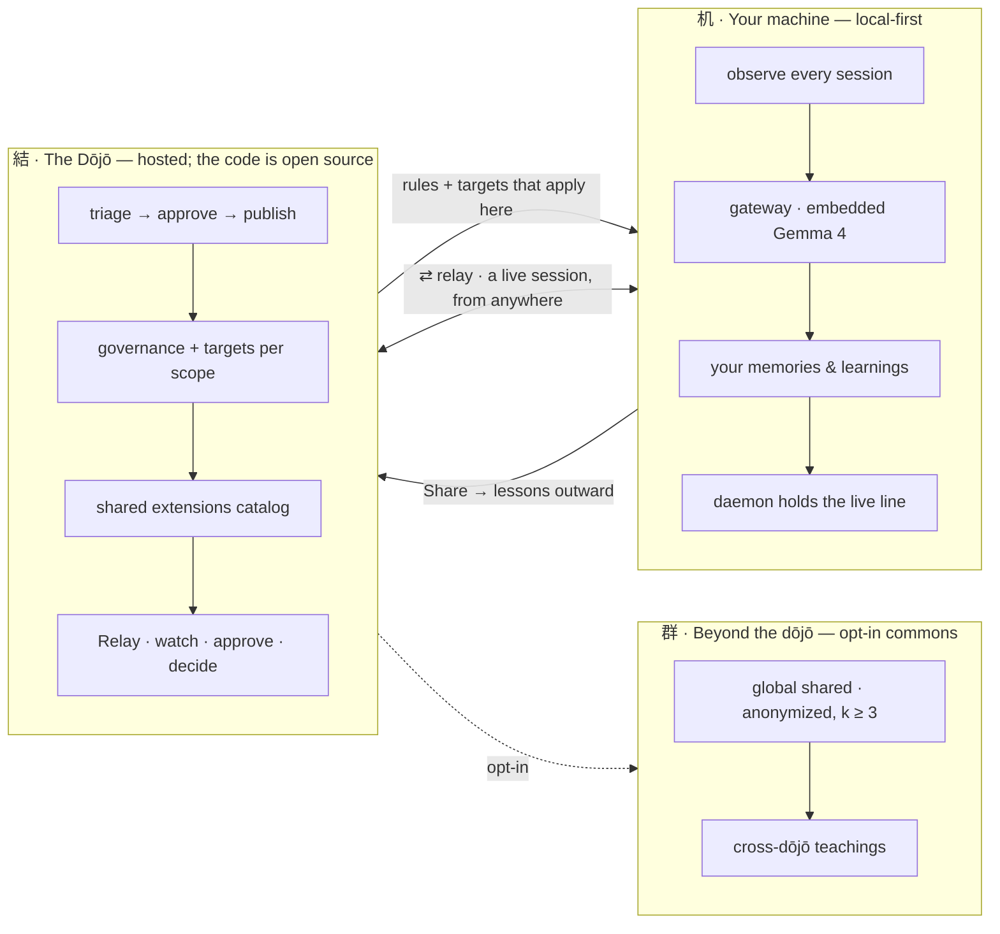
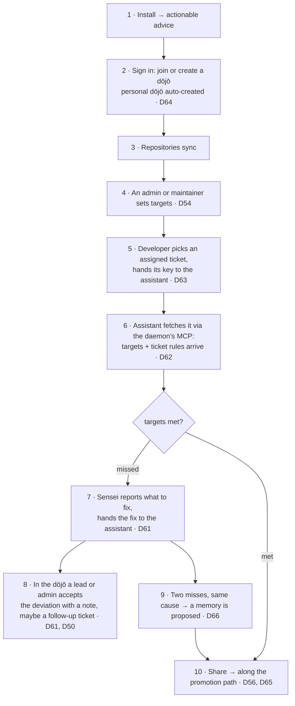
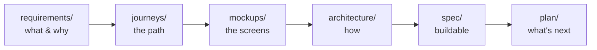

# Journeys

> **The visual perspective.** The flows a human walks through sensei — drawn as
> diagrams so the shape is obvious at a glance. Journeys sit between the
> [requirements](../prd/README.md) (what/why) and the
> [mockups](../mockups/) (pixel-level screens): they show *how the segments
> connect into a path*.

## The whole loop — machine → Dōjō → beyond

The personal journey ([`sensei.md`](sensei.md)) and the team journey
([`dojo.md`](dojo.md)) are **two halves of one loop**, not two products. Knowledge
travels **outward** (you share a lesson, D56), governed practice comes back **in**
(the rules and targets that apply where you work), and a **live** line lets you
approve/decide/steer a running session from anywhere — all through the same Dōjō.
Full narrative:
[`../mockups/Sensei/Sensei End-to-End Journey.html`](../mockups/Sensei/Sensei%20End-to-End%20Journey.html).

The code is open source, so anyone can run it themselves (D24), but there is no
self-hosting product or tier (D17): the Dōjō is the hosted service.

Why it's worth building as one loop — the value case, who benefits, defensibility
and risks — is in [vision → Why it's worth building](../prd/01-vision.md#why-its-worth-building--one-loop-not-two-products).

## The spine — one path that must work end to end

This is the canonical path through both halves (orientation §3, as amended by
D61–D69, user 2026-11-03). The other journeys hang off it. Status was checked
in code on 2026-11-03: **built** = shipped on `develop`; **partial** = some of
the step exists; **not built** = nothing yet.

| # | Step | Status | What exists / what is missing (how checked) |
|---|---|---|---|
| 1 | **Install → actionable advice** | partial | Bootstrap, the 5-step setup (`app/src/routes/(config)/stages.ts`), Health + Remedy, Insights are built. Metric action items carry no action yet (orientation §2). |
| 2 | **Sign in: join or create a dōjō; personal dōjō auto-created (D64)** | partial | The personal dōjō is created at sign-in: `dojo.ensure_personal_tenant`, called from `dojo/src/lib/server/provisioning.ts`. The skippable **"Join your dōjō"** setup step (D70) is not built: `stages.ts` has five steps and none is the dōjō. Today you sign in from Settings › Dōjō. |
| 3 | **Repositories sync** | partial | WP1–WP5 are committed (verdicts, status screen, graph branches, the repository-metric read, per-repository metrics on the dōjō workspace page). WP8 (D46), WP9A (batch registration) and the #314 production check remain. |
| 4 | **An admin or maintainer sets targets (D54)**: Dōjō and Workspace levels admin; Repository, Sprint, Task type, Task maintainer+. A lead sets them only if also a maintainer (D58) | not built | No target store: no target table in `database/ddl/table/dojo/`, no target route under `dojo/src/routes/v1/t/[origin]/[org]/`. |
| 5 | **Developer picks an assigned ticket, hands the key to the assistant (D63)** | partial | The workspace Tickets screen lists Jira tickets with AI time, matched from branch or prompt (the D63 fallback). There is no "assigned to me" list. |
| 6 | **Assistant fetches the ticket via the daemon's MCP; that marks start of work; targets + ticket rules arrive (D62, D63)** | not built | `crates/mcp/src/lib.rs` has no ticket tool. Resolved rules do reach the assistant (`get_rules`); targets and ticket rules do not. |
| 7 | **A miss is reported with what to fix, handed to the assistant (D61)** | not built | Depends on step 4. |
| 8 | **A lead or admin accepts the deviation with a note; drafts or opens a follow-up ticket (D61, D50)** | not built | Tracker writeback exists only for usage comments (ac7822d2b), and D50 makes it opt-in per workspace. With writeback off, Sensei drafts the ticket for the lead to file. |
| 9 | **Two misses of a blocking target on the same cause propose a memory (D66)** | not built | The memory store exists (`propose_memory` MCP tool); nothing triggers it on a miss. |
| 10 | **Share → along the promotion path: user → repository → workspace → dōjō → global shared (D56, D65)** | partial | Share review, Sharing and k ≥ 3 promotion to global shared are built. There is no single "Share →" verb yet, and `memory_scope` lacks the `user`, `repository` and `dojo` steps (`database/ddl/enum/sensei/memory_scope.ddl`). |

**Side tracks off the spine:**

| Track | Status | Notes |
|---|---|---|
| **Viewer: metrics first, "is the workflow healthy?" (D68)** | not built | Viewer grants and invites are built (`workspace_viewers`, `/you/invites/accept`). There is no viewer shell: a viewer lands in the personal menu. |
| **Lead/admin hear about it in the dōjō Home "needs you" queue (D69)** | partial | Org Home has a "needs you" band (`ScrOrgHome.svelte`), but it lists only the open triage queue. Missed targets awaiting acceptance and a stopped sync are not in it. No email or Slack this week. |

Per-role detail is in [`dojo.md`](dojo.md); the developer's desktop path is in
[`sensei.md`](sensei.md).

## Navigation

The journeys run first run → daily solo → connect → team. The menus follow that
order (D51, D70, orientation §5):

- **Desktop main rail:** Today · Workspaces · **Act** (Insights · Upgrades ·
  Traceability · Memories · Impact) · **Dōjō** (one entry: connection, Sharing,
  Share review, what applies here) · **Review** (Sessions · Instruments ·
  Consolidation · Libraries · Sources · Logs) · Settings. *Not built:* today's
  rail (`app/src/routes/(observatory)/observatory-nav.ts`) reads Today ·
  Workspaces · Needs you · Review · Settings, and puts Dōjō, Sharing and Share
  review inside Review.
- **Dōjō org:** Home (the "needs you" queue) · Workspaces (Targets · Sprints ·
  Metrics) · Teams · **Govern** (Constitution · Triage · Approvals · Knowledge) ·
  Admin, plus a lead view and the viewer shell. *Partial:* today
  (`dojo/src/lib/nav.ts`) Constitution sits under Overview, and there is no lead
  view or viewer shell.

## Contents

- [`sensei.md`](sensei.md) — the personal journey: the core retrospective loop,
  the four segments (Bootstrap → First run → Observatory → Workspace window), the
  module lifecycles inside the daily app, and where the spine touches the desktop.
- [`dojo.md`](dojo.md) — the team journey: the Dōjō roles (developer ·
  maintainer · admin · lead · viewer), the workspace-maintainer, viewer and sync
  tracks, the contribute→distribute lifecycle, **Relay** (folded in — reach a
  live session through the Dōjō), the principles, and the business model.
- [`relay.md`](relay.md) — **folded into the Dōjō** (a pointer). Relay is no
  longer a separate pair-once app; it reaches a live session *through* the Dōjō
  over realtime. See [`dojo.md` → Relay](dojo.md#relay--away-from-keyboard-through-the-dōjō).

## Visual sources of truth (mockups)

The diagrams here distill these interactive mockups — open them for the full
narrative. Where a mockup and these journeys disagree, the decisions D47–D70
(`docs/plan/2026-11-03-parallel-lanes.md` §0) win: the mockups still say
"project" in places and still show client engagements (retired, D34/D53).

- [`../mockups/Sensei/Sensei Journey Map.html`](../mockups/Sensei/Sensei%20Journey%20Map.html) — the personal journey + module lifecycles.
- [`../mockups/Sensei/Sensei Dōjō Journey Map.html`](../mockups/Sensei/Sensei%20D%C5%8Dj%C5%8D%20Journey%20Map.html) — the Dōjō role journeys, workspace delivery and the viewer track.
- [`../mockups/Sensei/Sensei Flow Walkthrough.html`](../mockups/Sensei/Sensei%20Flow%20Walkthrough.html) — a step-by-step click-through of the app.
- [`../mockups/Sensei/Sensei End-to-End Journey.html`](../mockups/Sensei/Sensei%20End-to-End%20Journey.html) — the whole loop (machine → Dōjō → beyond), Rin's + Keiko's journeys, and the "is it worth building?" case.

## Reading position

