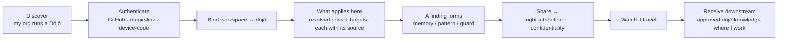
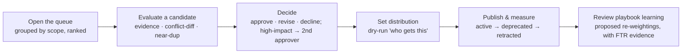
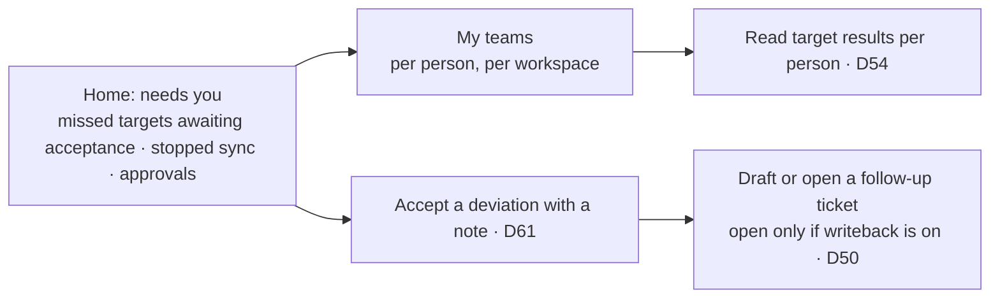
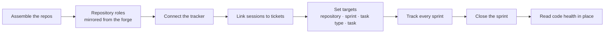
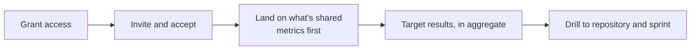
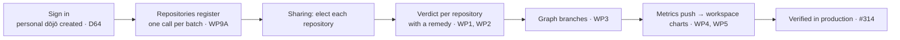
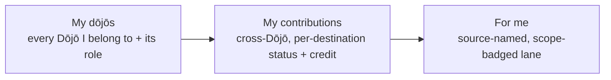
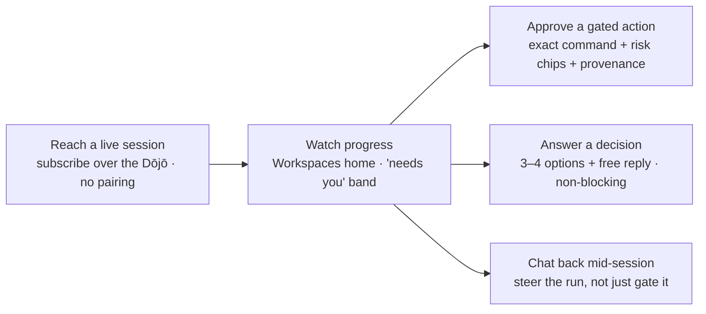
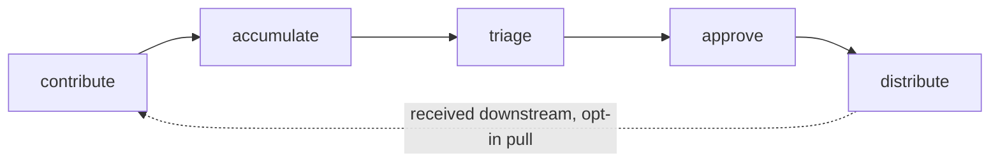

# The Dōjō journey

> The team's shared brain — and the surface for supervising it from anywhere.
> Distilled from `../mockups/Sensei/Sensei Dōjō Journey Map.html`.
> Traces to [objectives DJ1–DJ5](../prd/02-objectives.md#dōjō--the-cross-cutting-team-layer);
> the layer design is [architecture/dojo](../architecture/dojo.md). The org lead's
> end-to-end path — Keiko, creating the company Dōjō — is in
> `../mockups/Sensei/Sensei End-to-End Journey.html`
> (see [journeys → the whole loop](README.md#the-whole-loop--machine--dōjō--beyond)).
> The path every role below must serve is
> [the spine](README.md#the-spine--one-path-that-must-work-end-to-end).

The Dōjō is the **one shared tier** between the local, private device and global
shared knowledge — a **hosted, responsive site** that holds an organisation's
private hive-mind. The code is open source (D24); there is no self-hosting
product (D17). It is a **cross-cutting layer**, not a fifth segment: the
developer's flows live **in the desktop app**, plus the web **dōjō app**, plus
**[Relay](#relay--away-from-keyboard-through-the-dōjō)** — the away-from-keyboard
surface, folded into the Dōjō and reachable on phone and in the browser.

**One account, many identities.** A person links several emails (GitHub, work
SSO, personal); memberships aggregate across them but **never cross** — a dōjō
can't see you belong to another. Dōjō URLs encode origin: `github/<org>`,
`other/<org>` (magic-link, non-GitHub), and `personal/<you>` — a **personal
Dōjō**, created at sign-in (D64), that follows the individual across every
linked email.

**The dōjō is the boundary.** A client is just another dōjō; there is no client
separation (D34, D53). A session in a repository is governed by **that
repository's dōjō** alone: its rules and its targets. Nothing from your
employer's dōjō carries into another. Your own `user`-rung rules still apply
locally, below the dōjō. Between rules, the **stronger enforcement wins**
(mandatory is never overridden); at equal enforcement the **most specific scope
wins** (general → user → dōjō → workspace → repository), so a repository can
tighten a dōjō rule but not weaken it (D57).

Statuses below were checked in code on 2026-11-03 (routes in
`dojo/src/routes` and `app/src/routes`, nav in `dojo/src/lib/nav.ts`, DDL in
`database/ddl`). The mockup's own status notes describe the mockup, not the
code.

## Navigation (dōjō app)

Org zone (orientation §5, D69, D70): **Home** (a "needs you" queue) ·
**Workspaces** (Targets · Sprints · Metrics) · **Teams** · **Govern**
(Constitution · Triage · Approvals · Knowledge) · **Admin**. Plus two role
views: a **lead** view (my teams → per person, per workspace) and a **viewer
shell** (only the workspaces granted → metrics first).

*Status: partial.* Today's org nav (`dojo/src/lib/nav.ts`) is Overview (Home ·
Constitution · Workspaces · Teams) · Govern (Triage · Approvals · Knowledge) ·
Admin. Constitution has not moved into Govern; there are no Targets or Sprints
under Workspaces, no lead view and no viewer shell. The personal zone (Inbox ·
Workspaces · My metrics · Constitution · Rule packs · My dōjōs · Sharing ·
Contributions) is built.

## Developer (in-app)

| Stage | Status | Notes |
|---|---|---|
| Discover · Authenticate | built | Sign-in (`dojo/src/routes/signin`, `/v1/auth`), personal dōjō created at sign-in (`dojo.ensure_personal_tenant`). The skippable "Join your dōjō" setup step (D70) is not built. |
| Bind workspace → dōjō | built | Workspace › About binding (`app/src/routes/(workspace)/workspace/[id]/about`). |
| **What applies here** (was "Preview what applies"; D67) | partial | Resolved rules are served (`/v1/t/[origin]/[org]/rules/resolved`) and pulled by the daemon; no desktop screen shows them with their source; targets do not exist yet. |
| A finding forms → Share → → Watch it travel | partial | Share review, Sharing and Contributions are built; the single "Share →" verb (D65) and the `user`/`repository`/`dojo` steps of the promotion path (D56) are not. |
| Receive downstream | built | Today/Upgrades in the desktop app; `downstream_inbox` in the dōjō. |

The ticket-driven part of the developer's day (fetch a ticket through MCP,
targets arrive, a miss says what to fix) is in
[`sensei.md` → A day on a ticket](sensei.md#a-day-on-a-ticket--the-spine-at-the-desk).

## Maintainer (dōjō app)

| Stage | Status | Notes |
|---|---|---|
| Open the queue · Evaluate · Decide | built | Govern › Triage and Approvals (`ScrTriage`, `ScrApprovals`, `/v1/t/[origin]/[org]/triage`). |
| Set distribution · Publish & measure | partial | Govern › Knowledge is built; the dry-run "who gets this" and the retract flow were not checked in code. |
| **Review playbook learning** | partial | Proposals exist on the daemon side as MCP tools (`list_playbook_rule_proposals`, `accept_playbook_rule`); there is no queue for them in the dōjō app or the desktop app. |

## Org admin (dōjō app)

```mermaid
flowchart LR
    a1[Create the dōjō<br/>from a git integration] --> a2[Connect identity<br/>OIDC / SAML + SCIM]
    a2 --> a3[Provision members<br/>derived from git, default read-only] --> a4[Scopes &amp; policies<br/>precedence ladder, testable]
    a4 --> a4a[Seed from the library<br/>rule packs, cherry-picked per scope]
    a4a --> a5[Author governance<br/>stance · rules · skills · agents · commands · workspace memory]
    a5 --> a6[Set dōjō + workspace targets · D54] --> a7[Monitor<br/>throughput · adoption · leak-guard] --> a8[Plan &amp; billing]
```

| Stage | Status | Notes |
|---|---|---|
| Create the dōjō | built | A dōjō comes from a git integration (D20): Admin › Integrations; forge provisioning in `dojo/src/lib/server/provisioning.ts`. |
| Connect identity · Provision members | partial | Admin › Identity & SSO and Members & Roles are built; SCIM was not checked. |
| Scopes & policies | built | Admin › Scopes & policies (`ScrScopes`, `/v1/t/[origin]/[org]/policies`). |
| **Seed from the library** | partial | Rule packs and adoption are built for the personal dōjō (`/you/packs`, `/v1/you/rule-packs`, `dojo.set_pack_adoption` keyed by user); there is no org-level packs screen. |
| Author governance | partial | Constitution screen (`ScrConstitution`, `ScrOrgLadder`) is built; it has not moved into Govern (D70). |
| Set targets | not built | No target store. Dōjō and Workspace levels are the admin's (D54). |
| Monitor · Plan & billing | partial | Admin › Health / Monitor, Audit and Plan & billing screens are built; billing has no payment provider or subscription table. |

**Author the governance model** is the linchpin admin act: define the shared mind
per scope (dōjō → workspace → repository, plus each person's own `user` rung) — a
**stance** (autonomy · sharing · review · anonymization) plus rules/guards,
shared skills/agents/commands and a workspace's memory — so a joiner **inherits
the composed bundle on connect** instead of being re-taught tribal knowledge.
*What applies here* (D67) shows exactly what lands.

## Lead — the team lead (dōjō app)

> A **lead** leads a team (D38, D58). The former client/engagement lead is
> retired (D34): a client is just another dōjō.

| Stage | Status | Notes |
|---|---|---|
| Home "needs you" queue (D69) | partial | Org Home has a "needs you" band (`ScrOrgHome.svelte`) over the open triage queue only; missed targets and stopped syncs are not in it. No email or Slack this week. |
| My teams, per person | partial | Teams with per-person rows for a lead or admin (`ScrTeams`, `/v1/t/[origin]/[org]/team-metrics`); there is no lead view of its own. |
| Target results per person | not built | Depends on targets. |
| Accept a deviation (lead or admin, D61) | not built | — |
| Draft or open a follow-up ticket (D61, D50) | not built | Writeback exists only for usage comments (ac7822d2b) and is opt-in per workspace (D50). |

A lead sets targets only if also a maintainer (D58).

## Workspace maintainer (dōjō app)

> A workspace groups many repositories. The tracker owns tasks and sprints; the
> dōjō adds only what the tracker can't: which code belongs to the work, and the
> targets it is held to.

| Stage | Status | Notes |
|---|---|---|
| Assemble the repos | partial | Repositories are filed into workspaces by the sync (`dojo.file_repository_workspace`, `repositories_in_workspaces`); no Repos tab on the dōjō workspace page. |
| Repository roles | partial | Mirrored from the forge (`repository_roles`, `reconcile_unit_members`, GitHub and Azure member sync); no People tab. |
| Connect the tracker | partial | Jira on the daemon (the solo path, D49); Azure DevOps connect/import/map in the dōjō (`/v1/t/[origin]/[org]/integrations/azure_devops`); GitHub Issues missing. Org trackers move to the dōjō (D49, needs #310). |
| Link sessions to tickets | partial | Branch/prompt key matching for Jira on the daemon (Tickets screen); the MCP ticket fetch (D63) is not built. |
| Set targets (D48, D54) | not built | Ladder: Dōjō → Workspace → Repository → Sprint → Task type → Task, most specific wins. Repository and below: maintainer+. |
| Track every sprint | partial | Sprints are read on the daemon (`crates/senseid/src/tracker/sprint.rs`); there is no sprint scorecard and nothing in the dōjō. |
| Close the sprint | not built | — |
| Read code health in place | partial | Diagrams are built in the desktop workspace window; the dōjō side (WP6/WP7) is not. |

## Viewer (dōjō app)

> A **viewer** (D8) is an outside manager, a client or a sponsor, invited into
> the dōjō and granted one or more workspaces. The question they come with: **is
> the overall workflow healthy?** (D68). They read aggregates only, never per
> person; a pool of fewer than 2 contributors is withheld (F4).

| Stage | Status | Notes |
|---|---|---|
| Grant access | built | Admin viewer grants (`dojo_viewers`, `workspace_viewers`, `/v1/t/[origin]/[org]/viewers`, `ViewersList`). |
| Invite and accept | built | `/v1/t/[origin]/[org]/invites`, `/you/invites/accept`. |
| Land on what's shared, metrics first (D68) | not built | No viewer shell: a viewer lands in the personal menu with no org view. The dōjō workspace page's per-repository metrics (WP5) are the nearest piece. |
| Target results in aggregate | not built | Depends on targets. |
| Drill to repository and sprint · Export | not built | — |

## Sync (daemon ↔ dōjō)

> How a developer's repositories reach the dōjō. Spec: `docs/plan/dojo-sync-handoff.md`.

| Stage | Status | Notes |
|---|---|---|
| Sign in, personal dōjō | built | `dojo.ensure_personal_tenant`. |
| Register repositories | partial | Registration works; the batched, changed-only registration (WP9A) is not built. |
| Sharing election | built | Sharing screens in both apps (`repository_elections`). |
| Verdicts, graph branches | built | WP1–WP3 committed. |
| Metrics to workspace charts | built | WP4 (repository-metric read) and WP5 (per-repository metrics on the dōjō workspace page) committed. |
| Plans line (D46) | not built | WP8. |
| Verified in production | not built | #314, after WP9A. A stopped sync belongs in the Home queue (D69); not built. |

## Developer console — the individual, across every Dōjō

> Every user can sign in; the benefit is for teams, but a developer belongs to
> many. A personal, read-mostly view of all of them.

*Status: built* as the personal zone (My dōjōs, Contributions, Inbox, My metrics).

## Relay — away-from-keyboard, through the Dōjō

> Relay is **no longer a separate app to pair**. The daemon holds a live line to
> the Dōjō (Supabase realtime), so a phone or the browser reaches a **running
> session** through it — no pairing, no install, no open ports. The relay acts
> only through the signed-in person's dōjō session, with explicit, revocable
> permissions (D55). Per-user across every Dōjō; a native app coexists for
> **push and offline**. Only *filtered status* + gate prompts + replies cross —
> never code or transcripts.

Identical on phone and in the browser; ranked by **what's blocked on me**, with
source-Dōjō attribution on every card. *Status: partial:* the Inbox and run
detail (`/you`, `/you/runs/[run_id]`, `/console/relay`) are built. Architecture
(realtime line · PWA + Web Push · native wrapper · the relay data model) is in
[architecture/dojo → Relay](../architecture/dojo.md#relay--through-the-dōjō).

## The lifecycle — what flows through it

Knowledge is **promoted outward** — user → repository → workspace → dōjō →
global shared — the opposite direction to the governance ladder (D56). Each step
outward is a promotion, never a precedence; leaving a dōjō for global shared
needs k ≥ 3 contributors (D26). The verbs are one **Share →** along that path,
and **Reinforce / Retire** driven by Impact's verdict (D65).

## Business model — public free, private on a subscription

The line is drawn by **whose private code it is**, not by features (D46, D52).
You never pay to use sensei, and never for tokens (inference is BYO-key and runs
locally): the plan lives only in the dōjō, and local sensei works in full on any
plan. The code is open source (D24); there is no self-hosting product (D17).

| Tier | Who | Price |
|---|---|---|
| **Personal** `己` | a solo developer's own dōjō, across every linked email; `personal/<you>` | **free, everything included**: private repositories and blocking targets (D52) |
| **Public** `公` | an organisation's public repositories; `github/<org>` | **free**, targets included (D52); an organisation's repositories sync automatically (an admin may turn one off) |
| **Org private** `組` | an organisation's **private** repositories | **subscription per org, priced by the seats who work on its private repositories** (D59), taken by an admin or owner. Contributors to public repositories and viewers are never counted. Private repositories stay hidden from the dōjō until there is one (D46). Paid: targets, integrations (trackers, CI) and consolidated metrics on private repositories (D24, D52) |

**Free in every dōjō:** SSO and the audit trail (audit is governance, D19, D59),
and Relay, including the team on-call queue (R8, D59).

*Open pricing questions:* the seat price; fair-use limits; storage caps;
non-profit / education pricing.

## The principles

From the journey map — the non-negotiables that make the boundary exact:

- **Identity is the discovery** — you learn your org runs a Dōjō by authenticating (GitHub-org match, invite code, or git-remote claim); trust runs both ways (the server proves itself; the binding is pinned after first join).
- **The dōjō is the boundary** — a session in a repository is governed by that repository's dōjō alone; a client is just another dōjō (D53).
- **Pull, never push** — downstream knowledge arrives by opt-in, never forced.
- **Never blind, always preview** — nothing leaves without showing what leaves (raw-vs-stripped redaction, the dry-run "who gets this", the conflict diff).
- **One universal strip** — the same anonymization runs on every lesson that leaves a dōjō; a lesson that can't be stripped doesn't leave.
- **Stronger enforcement wins, then specificity** — mandatory is never overridden; at equal enforcement the most specific scope wins; both rules shown, winner marked (D57).
- **A missed target is information plus a handoff** — it says what to fix and hands it to the assistant; a lead or admin may accept the deviation with a note (D61).
- **Relay lives in the Dōjō** — the daemon's live line carries away-from-keyboard work to any phone or browser over realtime, no pairing (D55); the native app stays for push + offline.
- **Your own Dōjō, your own rules** — governance scales down to one person; a personal Dōjō is the same authoring model as an org, sized for one, following you across every linked email.
- **Public and personal free, an organisation's private on a subscription** — a solo developer gets everything free; an organisation's public repositories are free, targets included; its private repositories need a subscription priced by the seats working on them, and stay hidden until then (D46, D52, D59). Local sensei is never limited by plan.
