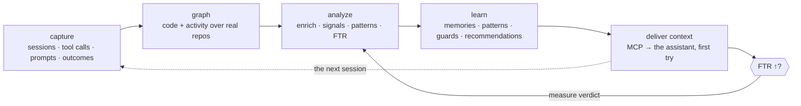
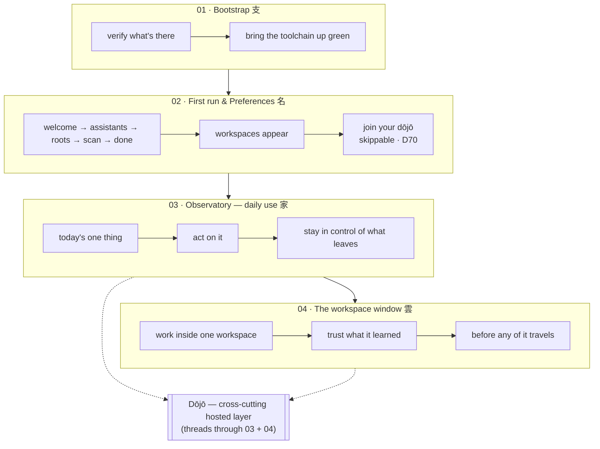
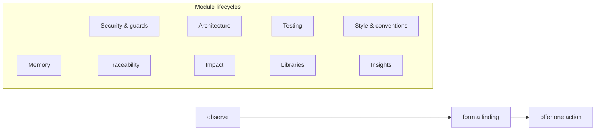
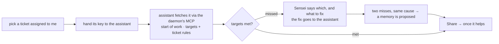

# The personal journey

> How one developer + their assistant move through sensei. Distilled from
> [`../mockups/Sensei/Sensei Journey Map.html`](../mockups/Sensei/Sensei%20Journey%20Map.html).
> Traces to [objectives](../prd/02-objectives.md). The
> end-to-end version — Rin, working across several dōjōs — is in
> [`../mockups/Sensei/Sensei End-to-End Journey.html`](../mockups/Sensei/Sensei%20End-to-End%20Journey.html)
> (see [journeys → the whole loop](README.md#the-whole-loop--machine--dōjō--beyond)).
> The path this journey must deliver end to end is
> [the spine](README.md#the-spine--one-path-that-must-work-end-to-end).

## The core loop — everything is one loop

Each layer of the [architecture](../architecture/README.md) exists to keep this
turning. The north-star, **FTR** (first-turn resolution), is the loop's scorecard.

## The four segments

**First run is five short steps** (`app/src/routes/(config)/stages.ts`):
**Welcome → Assistants** (connect the AI tools you already use) **→ Roots**
(where your work lives) **→ Scan** (the daemon finds repositories and extracts
the code graph) **→ Done**. Then *your own workspaces* appear. Tuning lives in
Preferences (Settings), reachable at any time and never blocking.

D70 adds a final, **skippable "Join your dōjō"** step right after first value:
sign in, and you land in your personal dōjō (created at sign-in, D64) or join
your organisation's. *Status: not built.* The step is not in `stages.ts`; today
you sign in from Settings › Dōjō. The personal dōjō is created at sign-in
(`dojo.ensure_personal_tenant`).

## Navigation

The desktop main rail, in journey order (D51, D70, orientation §5):

**Today · Workspaces · Act · Dōjō · Review · Settings**

- **Act**: Insights · Upgrades · Traceability · Memories · Impact (it was
  "Needs you"; it is named for the verb).
- **Dōjō**: one entry. It holds the connection status, Sharing, Share review and
  **what applies here** (D67), and links to the connection settings.
- **Review**: Sessions · Instruments · Consolidation · Libraries · Sources · Logs.

*Status: not built.* Today's rail (`app/src/routes/(observatory)/observatory-nav.ts`)
reads Today · Workspaces · Needs you · Review · Settings, and splits the dōjō
across three screens: Dōjō and Sharing inside Review (`/dojo/connections`,
`/dojo/sharing`), plus `/settings/dojo`.

**The workspace window** (orientation §5, proposed): Overview (recommendations
first) · Intake · **Metrics & targets** · Tickets · Memories · Impact ·
Traceability · Patterns · Diagrams ▸, then for reference: Sessions · Libraries ·
Instruments · Integrations · About. Every one of these exists as a route under
`app/src/routes/(workspace)/workspace/[id]/` except the targets half of
"Metrics & targets", which waits for the target store.

## The loops inside the daily app

The Observatory and workspace window aren't flat screens — each domain is its own
small retrospective loop (mockup: *"Module lifecycles"*). Each **observes →
forms a finding → offers one action** (Apply · Review · Dismiss):

## A day on a ticket — the spine at the desk

With a dōjō, tickets and targets in place, the developer's day runs through the
[spine](README.md#the-spine--one-path-that-must-work-end-to-end):

| Step | Decision | Status |
|---|---|---|
| Pick an assigned ticket | D63: the sync lists the tickets assigned to you | partial: the workspace Tickets screen lists Jira tickets, matched to sessions by branch or prompt; no "assigned to me" list |
| Assistant fetches the ticket through the daemon's MCP; that marks start of work and links the session | D63: a tracker-agnostic MCP tool served by the daemon; key matching stays as the fallback | not built: no ticket tool in `crates/mcp/src/lib.rs`; the fallback key matching is built for Jira |
| Targets and the ticket's rules arrive | D62: through MCP, at start of work | partial: resolved rules arrive through `get_rules`; targets do not exist yet |
| A missed target says what to fix and hands it to the assistant | D61: information plus a handoff, not a hard stop | not built |
| A repeated miss proposes a memory | D66: two misses on the same cause, at the user step | not built (the `propose_memory` store exists) |
| Share → | D65: one verb along the D56 promotion path | partial: Share review + Sharing are built; the single verb is not |

A missed **blocking** target does not stop the work. The developer and the
assistant fix it, or a lead or admin in the dōjō accepts the deviation with a
note (D61; see [`dojo.md`](dojo.md)).

## Where Dōjō threads in

The personal journey touches the team layer at these points. Each is opt-in and
previewed:

- **Join** at first run, or later from the Dōjō entry. A personal dōjō is created
  at sign-in (D64).
- **Bind** a workspace to a dōjō (04 · About). A session in a repository is
  governed by **that repository's dōjō** alone (D53).
- **What applies here** (D67): the resolved rules and targets for the current
  workspace, each with its source. *Status: partial.* The daemon pulls resolved
  rules (`/v1/t/[origin]/[org]/rules/resolved`), but no desktop screen lists them,
  and targets do not exist yet.
- **Share →** a finding outward along user → repository → workspace → dōjō →
  global shared (D56, D65; 04 · Memories/Patterns, and the Dōjō entry's Share
  review).
- **Receive** approved knowledge back where you work (03 · Today/Upgrades).

The full team path is in [`dojo.md`](dojo.md).
