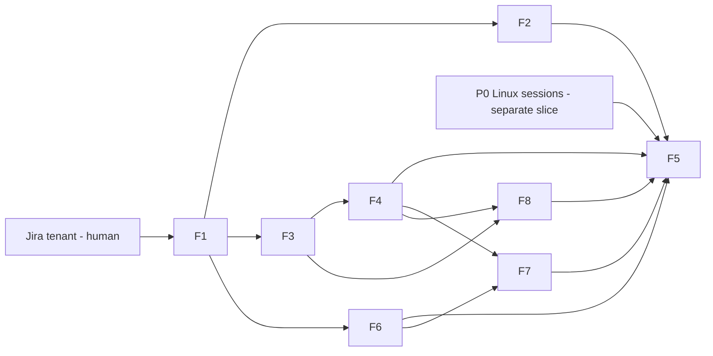

# Jira tracker linkage (local) — plan

## Objective

Implement `docs/spec/daemon/tracker-jira-linkage.md` (R1–R10). Section and gate
numbers below refer to that spec. Layers here are **DDL → daemon (pg_store +
`tracker/`) → API → CLI**. No MCP/hooks/commands layer is touched: the read API and
CLI are the v1 contract.

## Prerequisites (block build, not planning)

- **P0 — sessions exist on Linux.** A separate slice on `feature/linux_support`.
  The spec's P0 SQL must return `t`. It does **not** block F1–F4 unit work (they
  use seeded test rows); it blocks F5.
- **Jira tenant (human).** The user provides a Jira Cloud site, board id and API
  token. Without them F1 halts at task F1.1.

## Features

### Feature 1: Connect + read-only sync

- **Issue:** TBD
- **Layers:** DDL (`trackers` — one per project, `sprints`, `tracker_tasks`, `tracker_task_sprints`; enums `tracker_kind`, `tracker_error`) → daemon (`http::bounded_builder()` extracted from `federation::http_client()`; `tracker/` seam — `TrackerAdapter` trait + registry, shared `GetTransport` + URL policy, provider-neutral sync coordinator; `tracker/jira.rs` = the Jira adapter; credential via `gateway_keys`; R9 status fn; `api/origin_guard.rs` extracted from `repositories.rs` plus the Host check) → API (`GET …/trackers`, `POST …/trackers/{kind}/connect`, `DELETE …/trackers`, `POST …/trackers/sync`) → CLI (`sensei tracker connect|sync|disconnect`)
- **Depends on:** — (task F1.1 needs the tenant)
- **Tasks (in order):**
  1. **F1.1 (human-gated):** record one scrubbed response per R4 endpoint into `crates/senseid/tests/fixtures/jira/` and confirm the C11 field names. Update the spec's C11 row.
  2. DDL + enums; `dbd` deploy against the local DB.
  3. `http::bounded_builder()` extraction (federation behaviour unchanged).
  4. `origin_guard.rs` extraction; `repositories.rs` switches to it; Host check added.
  5. Transport, URL validation, sync, status, and credential, all TDD against the fake transport.
  6. Routes + `local_caller_guard`; CLI.
- **Acceptance criteria:** Done gates 1d2 (failure modes) and 2a (no SQL text in `tracker/`), 1g2 (Jira `board_url` parsing, optional `project_key`, `board_name`; used by both CLI and app), 1l (seam test with a fake non-Jira adapter) and 2b (no Jira knowledge outside `tracker/jira.rs`), plus 1b, 1c, 1d, 1e, 1f, 1g, 1h, 1i, 2, 3 and 5 pass, plus the connection parts of 1k (`board_already_connected` incl. an un-normalised URL; re-connect to a different board drops the old board's data; project delete removes the tracker and the next tick its secret).
- **Test scenarios:**
  - Given a fake transport with 2 issue pages and 2 sprints, When sync runs twice, Then the second run changes nothing but `last_seen_at`.
  - Given page 2 returns 500, When sync runs, Then no data row changes and `status` = `error`.
  - Given `base_url = https://evil.com`, When connect is called, Then 422 `invalid_base_url` and no row exists.
  - Given `Origin: https://evil.com`, When any tracker route is called, Then 403.

### Feature 2: Scheduled sync

- **Issue:** TBD
- **Layers:** data (`schedules.jsonl` row) → daemon (`tasks/tracker_sync.rs` `tick` + `spawn`; `SCHEDULABLE`; `DESCRIPTIONS`; `server.rs` spawn call)
- **Depends on:** F1
- **Acceptance criteria:** Done gate 4 passes. One tracker's failure in a tick leaves the others synced (unit test with two fake trackers, one failing).
- **Test scenarios:**
  - Given two trackers where A's transport fails, When a tick runs, Then B has `last_success_at` set and A has `last_error` set.
  - Given a manual sync holds the tracker's in-process `TrackerLocks` guard, When a tick runs, Then that tracker is skipped and not marked as an error.

### Feature 3: Session ↔ ticket linking

- **Issue:** TBD
- **Layers:** DDL (`session_task_links`, enum `link_source`) → daemon (pure `match_links` (Jira adapter); candidate query via `folder_projects` on `repo_folder_id`; relink computed with no transaction open and written in the sync's apply transaction) → API (`GET …/tracker-tasks/{key}` with its sessions)
- **Depends on:** F1
- **Acceptance criteria:** Done gate 1a passes. Relink is idempotent: syncing twice gives identical link rows. A link to a removed task survives the next sync. A session from a repo outside the project gets no link (seeded-DB test).
- **Test scenarios:**
  - Given known keys {AUTH-420, MY_PROJ-12}, When a branch is `feature_AUTH-420` and a prompt says `MY_PROJ-12 and UTF-8`, Then links = AUTH-420/branch and MY_PROJ-12/prompt only.
  - Given AUTH-420 disappears from Jira, When sync runs, Then `removed_at` is set and its links are still present.

### Feature 4: Usage metrics + read routes + CLI usage

- **Issue:** TBD
- **Layers:** daemon (R7 usage reads in `pg_store`) → API (`GET …/sprints`, `GET …/tracker-tasks`, `GET …/sessions/unlinked`, usage on `…/tracker-tasks/{key}`) → CLI (`sensei tracker usage`, `sensei tracker sprints`)
- **Depends on:** F3
- **Acceptance criteria:** Done gates 1j and the hierarchy/usage parts of 1k pass (sessions from all the project's repos count toward a ticket, with a `by_repo` breakdown summing to the total; removing a repo drops its sessions immediately; `?sprint=` returns exactly that sprint's tickets; a carried-over ticket lists both sprints).
- **Test scenarios:**
  - Given 3 sessions linked to AUTH-420, one with NULL `duration`, When ticket usage is read, Then `active_n = 2` and `sessions = 3`.
  - Given a session linked to AUTH-420 and AUTH-421 (both in sprint S), When S's usage is read, Then the session counts once in `linked_sprint` and `shared = 1`.
  - Given a future sprint, When `/sprints` is read, Then its usage is `null` with reason `not_started`.

### Feature 6: Desktop app — project Integrations screen

- **Issue:** TBD
- **Layers:** app (`project-sidebar-view.ts` section 繋 Integrations; `integrations/+page.svelte`; `api.ts` wrappers for list/connect/sync/disconnect)
- **Depends on:** F1 (routes, status, sync, `board_url` parsing). F2 is not required.
- **Acceptance criteria:** [`spec/screen/workspace-integrations.md`](../spec/screen/workspace-integrations.md) done gate 1–6.
- **Test scenarios:**
  - Given only a pasted board URL, When Connect, Then the connected card shows the daemon-derived site and board id.
  - Given a wrong token, When Connect, Then "Jira rejected the email and token…" and the token field is empty.
  - Given the daemon is stopped, When the screen loads, Then the error state is shown, not the connect form.

### Feature 7: Desktop app — project Sprints screen

- **Issue:** TBD
- **Layers:** app (`project-sidebar-view.ts` section 期 Sprints; `sprints/+page.svelte`, `sprints-state.svelte.ts`, `SprintsScreen.svelte`; `api.ts` wrappers for the four F4 read routes; the tracker error words moved to `$lib` as their second consumer appears)
- **Depends on:** F4 (routes), F6 (error words, sidebar placement)
- **Acceptance criteria:** [`spec/screen/workspace-sprints.md`](../spec/screen/workspace-sprints.md) done gate 1–7.
- **Test scenarios:**
  - Given a connected project, When the screen opens, Then the active sprint is selected and its tickets are listed with active AI time and tokens.
  - Given a future sprint, When it is selected, Then "Not started…" shows and no zero.
  - Given a ticket renamed in Jira, When it is opened, Then a session that wrote the old key shows "as <old key>".
  - Given the daemon is down, When the screen loads, Then the daemon error with Retry shows, not "no tracker connected".

### Feature 8: On-demand ticket discovery (R11)

- **Issue:** TBD
- **Layers:** DDL (`tracker_unknown_keys`; `trackers.discovered_through`) → daemon (`TrackerAdapter::unknown_keys` + `fetch_tasks`, Jira impl with the key-shape check and the 400 fallback; `tracker/discover.rs`; `apply_discovered` in `db/pg_store/trackers.rs`; `TaskKind::TrackerDiscover` enqueued from `ingest_capture`; the full apply clears negative-cache rows) → API (lookup miss runs discovery; 404 `task_not_on_board`) → CLI/app words for `task_not_on_board`
- **Depends on:** F3 (matching, links), F4 (lookup route)
- **Acceptance criteria:** Done gate 1m passes; claims C33 and C34 checked against the tenant and recorded in Evidence.
- **Test scenarios:**
  - Given a session ingested naming P-900 that isn't synced, When discovery runs, Then P-900 is inserted and the session linked within one run, and no other ticket or link changes.
  - Given P-404 is not on the board, When it is discovered twice within 6 h, Then Jira is asked once.
  - Given text `P-9x;DROP`, When keys are extracted, Then only the shape-valid `P-9` can reach JQL.
  - Given a full sync after discovery, Then the discovered ticket remains, its links are recomputed, and its negative-cache row is gone.

### Feature 5: Live verification (human)

- **Issue:** TBD
- **Layers:** none (verification only)
- **Depends on:** F1–F4, F6, P0, Jira tenant
- **Acceptance criteria:** Done gates 6–10 pass, and the spec's Evidence table is filled in (hand-SQL equality and per-source precision over ≥10 real sessions).

## Dependency graph

First task: **F1.1** — needs the user's Jira Cloud site, board id and API token.
F1.2–F1.5 can start before that against a hand-written fake that follows the
spec's R4 shapes; F1.1 then reconciles the fake with the real fixture.
