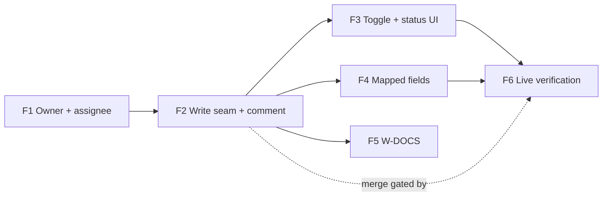

# Tracker metrics write-back — plan

## Objective

Implement `docs/spec/daemon/tracker-metrics-writeback.md` (W1–W11, W-UI, W-DOCS), which
was reviewed at `22416567d`. W/gate/C numbers below refer to that spec. The layers are
**DDL → daemon (`db::pg_store` + `tracker/`) → API → app**. No MCP, hooks or commands
layer is touched: the daemon API and the desktop screens are the contract. Each feature
adds its own DDL columns (dbd applies DDL declaratively), so each is a vertical slice that
can be tested end to end with the fake transports.

**Before starting any feature,** re-run the claims ledger checks. They're cheap, and the
tree moves. Any `FALSE` stops the build.

## Prerequisites (block build, not planning)

- **Jira tenant (human).** Gate 27 (X1–X8) needs a Jira Cloud site with a person token,
  an app token and two assignees. It doesn't block F1–F4 unit work, which uses fakes.
  It **blocks merging F2** (spec build order: "X1–X8 run against a real tenant before
  step 5 is merged").

## Features

### Feature 1: Owner and assignee

- **Issue:** TBD
- **Layers:**
  - DDL: enum `tracker_owner_state`; `trackers.owner_ref`, `owner_state`, `owner_error`;
    `tracker_tasks.assigned_to_me`; `design.dbml`; `make test-template`
  - daemon: `AccountRef` (redacting `Debug`); `OwnerLookup`; `TrackerAdapter::owner`;
    `Validated.owner`; Jira `owner()` from `/myself` (the W1 ordered rules); `assignee` added to `ISSUE_FIELDS`
    and `search_keys`; `TaskRow.assignee`; `upsert_tasks` sets `assigned_to_me`; sync
    step-1 backfill under the sync deadline, with conditional stores and `owner_error`;
    `connect_tracker` resets owner state on the connected and sibling rows (W11), and
    `NewTracker` carries the owner
  - touch points:
    - `TrackerRow` is read through a struct with a by-name `FromRow` impl (C38)
    - `owner()` on `FakeAdapter` (sync.rs:587) and `BrokenLinks` (sync.rs:969)
    - the `TaskRow` literals at link.rs:77 and sync.rs:619, and the `Validated` literal
      at jira.rs:700
    - `FakeBoard`: `/myself` gains `accountType`; responses honour the `fields` query
      (gate 4); an owner/assignee fixture builder
  - API: `GET …/tasks` and `…/tracker-tasks/{key}` gain `assigned_to_me`, through
    `TaskListRow`/`tracker_task_rows` (tracker_usage.rs) and
    `TaskDetail`/`tracker_task_detail` (trackers.rs), documented in the linkage spec's R8 route
    table and typed in `app/src/lib/types.ts`
- **Depends on:** —
- **Acceptance criteria** (spec gates):
  - **2:** the W1 rule table and the stored values (not the `writeback.state` half)
  - **3, 3a, 3b, 3c:** backfill bounds, `owner_error`, re-key mid-lookup, inside the
    deadline, store failure
  - **4:** `assigned_to_me` is `t/f/f` (only the assignment part; the write half lands in F2)
  - **5:** no `zz-sentinel-b2` in `pg_dump -n sensei`, and no account id in `Debug`
  - **22:** owner reset on re-connect and on a new sibling connect
  - **1:** owner columns and the enum `ALL` test
- **Test scenarios:**
  ```gherkin
  Given /myself returns accountType "app"
  When the tracker syncs twice
  Then exactly one /myself request was made and owner_state is not_a_person

  Given AUTH-1 assigned to the token owner and AUTH-2 to someone else
  When the board syncs
  Then AUTH-1.assigned_to_me is true, AUTH-2.assigned_to_me is false
  And no sensei table contains the other assignee's id
  ```

### Feature 2: Write seam and the comment surface (the core pass)

- **Issue:** TBD
- **Layers:**
  - DDL: enum `tracker_writeback_status`; `trackers.writeback_enabled` (default true),
    `writeback_error`; `tracker_tasks.writeback_hash`, `writeback_comment_ref`,
    `writeback_status`, `writeback_at`
  - daemon, `transport.rs`:
    - `WriteMethod`, `WriteTransport`, `RawWrite`
    - one generic 429 loop taking a mapper; `map_write_response`
    - `ReqwestRaw: RawWrite` on the same no-redirect client
    - module doc reworded
  - daemon, `runtime.rs`: `TransportFactory::write_transport` and a recording fake;
    `sync_stored` calls the pass
  - daemon, `writeback.rs`:
    - the pass: guard, deadline, per-task re-check, candidates, sticky statuses,
      5×429 early stop, `writeback_error`
    - payload, canonical values, hash; pure `render` (the W5 golden)
  - daemon, `jira.rs`: `find_comment`, `create_comment`, `update_comment`,
    `issue_exists`, ADF builder, id-shape checks
  - API: `GET …/trackers` gains the `writeback` object (`enabled`, `state`, `surface`,
    `mapped` = 0, `assigned`, `failing`, `error`); the task routes gain `writeback_status` and
    `writeback_at`. All of these are documented in the linkage spec's R8 route table and
    typed in `app/src/lib/types.ts`
  - daemon: `connect_tracker` also resets `writeback_error` and the tasks'
    `writeback_comment_ref`, `writeback_hash` and `writeback_status` (W11)
- **Depends on:** F1
- **Acceptance criteria** (spec gates):
  - **6:** render golden
  - **7:** comment lifecycle (1 list + 1 POST, then 0, then 1 PUT with `notifyUsers=false`)
  - **8:** adopt an existing comment, no duplicate
  - **9:** null is not 0, unpriced `api_cost` included
  - **10** (comment half): changed `_n` → new hash
  - **11:** lost sessions are written as 0/—
  - **12:** comment removed vs not found
  - **13:** GET-only commands
  - **14:** no Jira wording in `writeback.rs`
  - **17:** the full W9 status table
  - **18:** write failure never touches `last_error`
  - **19:** 307 is not followed
  - **20:** switch-off and disconnect mid-pass
  - **21:** lock and deadline
  - **22a:** pass credential → `credential_failed`
  - **2** (state half): `owner_not_a_person`, `owner_unknown`, `owner_lookup_failed`
  - **22** (write-back half): re-connect and new-sibling reset of the `writeback_*` columns
  - **22b:** GET empty-200 still `Decode`
  - **4:** write requests for AUTH-1 only, 0 after reassignment
- **Test scenarios:**
  ```gherkin
  Given AUTH-1 assigned to the owner with 3 linked sessions and no sensei comment
  When a sync succeeds
  Then one comment list GET and one comment POST are sent
  And the comment's lines equal render(usage)
  When the next sync finds no new sessions
  Then no write request is sent

  Given AUTH-1's sensei comment was deleted in Jira
  When the pass updates it and gets 404, and the issue check returns 200
  Then AUTH-1 is comment_removed and later passes send nothing for it

  Given a write returns 403
  Then the sync result is Ok, trackers.last_error is NULL, and AUTH-1 is forbidden
  ```

### Feature 3: Toggle and status on the Integrations screen

- **Issue:** TBD
- **Layers:**
  - daemon: the PATCH handler; toggle-on clears sticky statuses and the
    `comment_removed` ref and hash
  - API: `PATCH /api/workspaces/{id}/trackers/{tracker}` inside `tracker_routes()`
  - app:
    - `senseiApi.trySetTrackerWriteback`
    - `tracker-errors.ts` codes and `credential_failed`
    - the Integrations card toggle (`data-action="writeback"`) and state line
      (`data-writeback-state`)
    - the new Integrations and Tickets sub-lines
    - the scheduled-task `tracker_sync` description
- **Depends on:** F2
- **Acceptance criteria** (spec gates):
  - **23:** PATCH body rules and 0 writes when off
  - **12** (toggle half): off then on → a new comment POST
  - **24:** foreign Origin → 403 on PATCH
  - **25** (all but the Fields editor): sub-lines, every state text with `assigned: 2`,
    the toggle reverting on error
- **Test scenarios:**
  ```gherkin
  Given write-back is on and AUTH-1 is comment_removed
  When the user switches write-back off and on
  Then the next sync POSTs a new comment on AUTH-1

  Given the tracker list returns writeback.state "owner_not_a_person"
  Then the board card reads "This token belongs to an app account, so sensei can't tell which tickets are yours. Nothing is written."
  ```

### Feature 4: Mapped fields

- **Issue:** TBD
- **Layers:**
  - DDL: enum `tracker_metric`; table `tracker_fields`
  - daemon:
    - Jira: `field_ref_shape`, `check_fields`, `field_in_use`, `write_fields`
      (`FieldValue`)
    - the fields surface in the pass (mapped pairs in enum order, one PUT, null clears)
    - `tracker_error_status` factored out of connect
  - API: `GET/PUT /api/workspaces/{id}/trackers/{tracker}/fields`, with the W7 order of
    checks; the PUT nulls hashes and clears `field_invalid`
  - app: `tryGetTrackerFields`, `tryPutTrackerFields`; the Fields section with inline
    errors and the "don't sum" note
- **Depends on:** F2. F3 is not needed, so F4 can run in parallel with F3.
- **Acceptance criteria** (spec gates):
  - **15:** the exact PUT body `{"fields":{"customfield_10050":2.05}}`, and no comment request
  - **16:** every W7 code in order; 0 requests for `invalid_field_ref`; `field_in_use`
    skipped for an already-mapped field
  - **10** (fields half): an unmapped change sends 0
  - **17** (field rows): `field_invalid` is sticky until a mapping PUT
  - **24:** foreign Origin → 403 on PUT fields
  - **25:** `field_in_use` text shown on its row
  - **1:** `tracker_fields` unique constraints; `tracker_metric` `ALL`
- **Test scenarios:**
  ```gherkin
  Given customfield_10060 already has values on the board
  When the user maps active_hours to customfield_10060
  Then the response is 422 field_in_use and nothing is saved

  Given only metered_cost is mapped
  When a session with no cost is linked to AUTH-1
  Then no write request is sent
  ```

### Feature 5: Documents follow the code (W-DOCS)

- **Issue:** TBD
- **Layers:** script `scripts/check-tracker-readonly-docs.sh` (the gate 26 rules: one
  unit per table row or paragraph, the two patterns, and the reference) with a
  self-test; docs, every file in the W-DOCS set; DDL and dbml comments (W11 wording).
- **Depends on:** F2 (the behaviour must exist before the docs say it does). It can run
  in parallel with F3 and F4.
- **Acceptance criteria** (spec gates):
  - **26:** the script exits clean over the set (baseline 39 → 0); no DDL/dbml
    read-only text; no `(read-only)` in `scheduled_tasks.rs`; `decisions.md` rows
    marked superseded
  - the linkage spec's gate 2 now points at this spec's gate 13
- **Test scenarios:**
  ```gherkin
  Given a fixture table with a reference in one row and a stale read-only tracker row
  When the docs check runs
  Then it reports the stale row's line

  Given a paragraph "read-only members are free" (no tracker context)
  Then the docs check doesn't report it
  ```

### Feature 6: Live verification (human)

- **Issue:** TBD
- **Layers:** none (verification)
- **Depends on:** F2 to merge, F3 and F4 to finish
- **Acceptance criteria:**
  - **Gate 27:** X1–X8 confirmed against the tenant, or their decided fallback applied,
    recorded under the spec's Evidence section.
  - On a real board: one sensei comment on a ticket assigned to the owner and none on
    others; a second sync edits nothing; a mapped number field shows `active_hours`.

## Dependency graph



**First task:** F1, which adds `AccountRef` and `OwnerLookup` and `owner()` to Jira's
`/myself` read, written red-first against gate 2.
