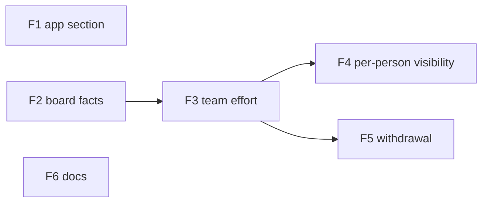

# Tracker delivery metrics — plan

## Objective

Implement `docs/spec/daemon/tracker-delivery-metrics.md`. B, D, C and gate numbers refer to
that spec. Work goes on `feature/delivery_metrics` (cut from `feature/sdlc_metrics`, B7);
rebase onto develop when the SDLC PR lands.

Layers, bottom-up: **DDL (sensei + dojo) → daemon (`sdlc/`, `tracker/`, `tasks/dojo_sync`,
`db::pg_store`) → Dōjō API (`dojo/src/routes/v1/you/delivery`) → Dōjō reads and view → app.**
Every feature is test-first (phase A disabled tests, then green), adds its own DDL and runs
`make test-template` (brew Postgres; build with `-j 2`).

**Before any feature:** re-run the spec's claims ledger. Before F2, settle the one unchecked
claim: two installs record the same `board_ref` for one Jira board. A `FALSE` stops the build.

## Features

### F1 · Delivery Metrics section in the app (D2, B1–B3, B5)
- **Issue:** #351
- **Layers:** `packages/glyphs` → app route + state → Tickets screen → screen spec doc
- **Depends on:** none
- **Work:**
  - `納` + icon in `KANJI_ICONS`; `{ id: 'delivery', … }` after `tickets` in `SECTIONS`.
  - `(workspace)/workspace/[id]/delivery/+page.svelte` + `delivery-state.svelte.ts`, reading
    the existing `/trackers` and `/sprints` through `api.ts`'s `try*` wrappers.
  - Remove `[data-sdlc-lane]` and `sdlcRow` from Tickets; move the figure formatters
    (`sprintSdlcFigures`, `projectSdlcFigures`) to a shared module both screens import.
  - `workspace-tickets.md`: drop the lane-row element and gates; add a Delivery Metrics screen
    spec (or section) with its done and wrong gates.
- **Acceptance criteria:** gates 1–5.
- **Test scenarios:**
  ```gherkin
  Given a workspace with one board and two sprints
  When I open Delivery Metrics
  Then each sprint shows its seven SDLC ratios and "Your sessions" active time equal to GET …/sprints
  And a null figure shows its reason summary, never "0"
  And no request goes to a Dōjō origin

  Given GET …/sprints answers 500
  When I open Delivery Metrics
  Then the daemon-error state shows, not an empty table

  When I open Tickets
  Then there is no "This sprint" SDLC row, and the sprint filter and ticket SDLC group remain
  ```

### F2 · Board facts travel to the Dōjō and show there (D3 facts part, D4 one copy, D5)
- **Issue:** #352
- **Layers:** DDL (`dojo.delivery_boards|sprints|tickets`, `sensei.tracker_push_marks`;
  `tracker_tasks.summary` comment, B12) → daemon (eligibility, `board_key`, facts payload,
  watermark, new step in the `dojo_sync` tick) → Dōjō `POST /v1/you/delivery` (contract, consent
  re-check via `my_repositories`, workspace resolution, one-copy order) → reads
  `workspace_delivery_boards|sprints|tickets` (facts only) → Dōjō Delivery view (facts columns,
  titles) and a link from the workspace page.
- **Depends on:** none (F1 independent)
- **Acceptance criteria:** gates 6, 7, 8, 10, 12, 13; gate 17's 403 part; gate 18 for facts and
  titles. The effort part of the payload is sent empty (`effort: null`) until F3.
- **Test scenarios:**
  ```gherkin
  Given a workspace whose repositories are not in plan.allowed
  When the dojo_sync tick runs
  Then nothing is posted and tracker_not_shared is logged

  Given allowed repositories in two tenants
  Then nothing is posted and tracker_workspace_ambiguous is logged

  Given tracker (jira, https://acme.atlassian.net, 42)
  When it is pushed
  Then board_key = sha256("jira\nhttps://acme.atlassian.net\n42") and the body never contains acme.atlassian.net

  Given a stored complete copy
  When a copy with pending_tickets > 0 arrives with a later history_at
  Then the stored copy is kept and the response is "stale"

  Given nothing changed since the last pass
  Then the next pass posts nothing
  ```

### F3 · Team effort merges in the Dōjō (D1, D3 effort part, D4 merge)
- **Issue:** #353
- **Layers:** daemon `sdlc/ticket.rs` exposes the ✚ numerators (`build_ok`, `build_fail`,
  `recovery_ms_sum`, `recovery_n`, `execution_ms`) → provable-session filter (#240) applied to
  sprint `linked_sprint` usage, project tokens/prompts and ticket figures for the push only →
  DDL `dojo.delivery_effort` → `POST` effort part with replace-the-caller's-rows → reads merge
  per D1 (sums, min/max, recompute, partial, `no_contributor_value`) → view shows "Team"
  columns, "from N contributors · last report", explainers (escape limit, own-rate cost).
- **Depends on:** F2
- **Acceptance criteria:** gates 9, 14, 15, 16; gate 8's "no rate, no `minutes_per_point`"
  part; gate 18 for "from 2 contributors". Reads return merged values only to every reader
  (per-person rows come in F4).
- **Test scenarios:**
  ```gherkin
  Given sessions from a repository another persona also elected, and sessions with no repository
  When effort is pushed
  Then those sessions are absent from effort and counted in held_back_sessions

  Given A and B report effort on T-1 and A alone on T-2
  Then T-1 worked_minutes = A+B, work_started_at = min, build_failure_rate = (fA+fB)/(runsA+runsB)×100
  And contributors are 2 and 1

  Given A reports ai_token_cost null and B reports 3.0
  Then the merged value is 3.0 with partial 1, and cost_per_prompt_cycle is null

  Given A pushed T-1 and T-2, then pushes T-1 only
  Then A's T-2 row is gone
  ```

### F4 · Per-person visibility and staleness (D4 "who sees", staleness)
- **Issue:** #354
- **Layers:** reads gain per-person rows through `can_read_repository_metric` over every
  `repository_ids` entry → 7-day staleness → view: per-person rows in an expanded ticket and
  sprint for allowed readers; "includes stale data" for others.
- **Depends on:** F3
- **Acceptance criteria:** gate 17 in full.
- **Test scenarios:**
  ```gherkin
  Given A's effort row from repository R
  When A reads it, or a tenant admin, or a maintainer on R, or A's team lead
  Then the per-person row is returned
  When a plain workspace member or a workspace viewer reads
  Then only merged values return, with no principal_id and no per-contributor time
  ```

### F5 · Withdrawal (B13)
- **Issue:** #355
- **Layers:** DDL `sensei.delivery_withdrawals` → daemon queues on tracker delete (same
  transaction, before the cascade) and on a pushed board turning ineligible; the tick sends
  them → Dōjō `DELETE /v1/you/delivery/{board_key}` (204 / 404) → effort and, when the caller
  reported it, the board copy go.
- **Depends on:** F3
- **Acceptance criteria:** gate 11; a withdrawn board copy is restored by another
  contributor's next push.
- **Test scenarios:**
  ```gherkin
  Given a pushed tracker
  When it is deleted locally
  Then one DELETE is sent next tick, and the queue row is gone after 204

  Given a pushed board whose workspace loses its allowed repository
  Then one DELETE is sent
  ```

### F6 · Docs (P-DOCS)
- **Issue:** #356
- **Layers:** docs only
- **Depends on:** may run any time; must be done before merge
- **Work:** `decisions.md` row (B9/B12 override of the confidential-title rule; B13; B14);
  `backlog.md` (this slice in progress); spec status → built; the parent spec's "Dōjō rollups"
  out-of-scope line points here.
- **Acceptance criteria:** the doc-link guard passes; every surface the spec's Overrides list
  names is updated.

## Dependency graph



F1 and F2 can run in parallel. F4 and F5 can run in parallel after F3. F6 any time.

## Out of scope

Pulling team figures into the app (B5); other tracker adapters; a Dōjō UI for choosing a
tenant when B8 blocks a board; reconstructing cross-person escapes (spec D1 known limit).
