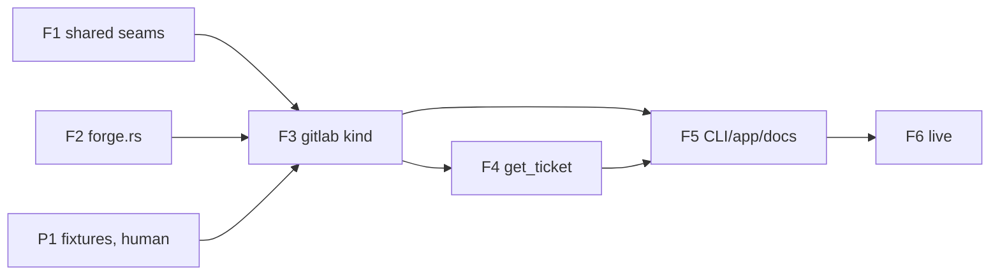

# GitLab tracker adapter — plan

## Objective

Implement `docs/spec/daemon/tracker-gitlab.md` (G1–G10), slice 1 of the forge-trackers
analysis. G, D (done gate) and C (claims) numbers refer to that spec. The order follows the
spec's "Build order". Work goes on `feature/forge-trackers`.

Layers: **DDL + staging → daemon (`net/`, `tracker/`, `db::pg_store`, `api/`) → MCP
(`get_ticket`) → CLI → app**. DDL changes run `make test-template` (brew Postgres; build
with `-j 2`).

**Scope:** a GitLab is a public `https://` endpoint on :443, with no subpath and no
private-network hosts (user, 2026-11-06).

**Before starting any feature,** re-run the claims ledger (C1–C34). Any `FALSE` stops the
build.

## Prerequisites (block build, not planning)

- **P1 · Recorded fixtures (human).** Record and scrub responses with `curl` into
  `crates/senseid/tests/fixtures/gitlab/`:
  - **Free:** a gitlab.com Free group. It must include a merge request, an undated
    milestone, a parent-group milestone on a subgroup issue, and a `task`-type issue.
  - **Premium:** a gitlab.com Premium/Ultimate trial group with iterations, one of them
    untitled.
  - Never hand-write these (see the Wrong gate). F1 and F2 do not need them. F3 does.
## Features

### F1 · Shared seams: header auth, network policy, capabilities (G2, G5, G8)
- **Issue:** #364
- **Layers:** `net/addr.rs` (new; `is_public_ip` moved from `indexer/lib_indexer.rs:250`
  with the stricter ranges), `tracker/transport.rs`, `runtime.rs`, `http.rs`,
  `tracker/mod.rs`, `tracker/connect.rs`, `tracker/sync.rs`, `tracker/history.rs`,
  `writeback.rs`, `sdlc/*`, `api/handlers/trackers.rs`, `reason_codes.jsonl`.
- **Depends on:** none.
- **Nothing GitLab-specific.** No `TrackerKind::Gitlab` yet. Jira is the only adapter.
- **Acceptance criteria:**
  - `AuthScheme::Header{name}` exists. The token header is sensitive, and its `Debug` is
    redacted (D19, first part).
  - `ReqwestRaw` itself uses a resolver that refuses every non-public address, and calls
    `.no_proxy()`, so all 5 `TransportFactory` sites get it with no parameter (C34). D13
    passes through the production `ReqwestRaw` with a stub resolver.
  - The shared `normalize_base_url` refuses a trailing-dot host (`localhost.`, `x.local.`).
  - The indexer's existing `is_public_ip` tests (`lib_indexer.rs:1170-1190`) pass against
    the moved function.
  - `Validated` gains `account`, `board_ref` and `params`, and connect uses them. The owner
    check runs after validate. `Snapshot.params_extra` merges into the existing sync patch.
  - `capabilities()` exists, and Jira returns `{history:true, writeback:true}`. The §G8
    guards key off the capability, never off the kind's name. The `unsupported_by_tracker`
    row is in `reason_codes.jsonl`, and `make test-template` is re-run.
  - D1: the whole Jira suite passes unmodified.
- **Test scenarios:**
  - Given a stub resolver returning `169.254.169.254`, when `ReqwestRaw` sends, then the
    request is refused before connecting.
  - Given `HTTPS_PROXY` points at a stub, when a request is sent, then the stub receives
    nothing.
  - Given a host resolving to `10.0.0.5` or `100.100.100.200`, then the request is refused.
  - Given a fake adapter with `capabilities = {false,false}`, when PATCH sets
    `writeback_enabled:true`, then the response is 409 `writeback_unsupported`.

### F2 · `tracker/forge.rs`: provider-neutral keys and links (G6)
- **Issue:** #365
- **Layers:** `tracker/forge.rs` (new, pure).
- **Depends on:** none (it can run in parallel with F1).
- **Acceptance criteria:**
  - The path character class is `[A-Za-z0-9_.\-/]`. An empty, `.` or `..` segment is not a
    key.
  - A full ref (`group/project#n`) matches anywhere and is lowercased by path.
  - A bare `#n`, and a branch starting `n-`, resolve only when `scope == repo_key`. A NULL
    `repo_key` resolves nothing.
  - `unknown_keys` returns full refs only.
  - D11 passes.
- **Test scenarios:**
  - Given two repos that each have `#12`, when a session in repo A mentions `#12`, then only
    A's task links.
  - Given the text `#123`, then no link to `#12` is made.
  - Given the branch `12-fix` in the matching repo, then `#12` links.

### F3 · The `gitlab` kind: DDL, adapter, registration (G1, G3, G4, G7)
- **Issue:** #366
- **Layers:** DDL `enum/sensei/tracker_kind.ddl` + `make test-template`;
  `database/design.dbml`; `TrackerKind::Gitlab`; `tracker/gitlab.rs`; `adapters()`.
- **Depends on:** F1, F2, P1.
- **Lands as one unit:** the DDL value, the variant, the adapter, the registration, and the
  replacement of the Rust "gitlab is unsupported" tests (`mod.rs:1274`,
  `api/handlers/trackers.rs:998-1003`).
- **Acceptance criteria:**
  - D2 (`connect_params`): typed paths, `host_not_confirmed` 422, the `invalid_base_url`
    cases, `token_required`.
  - D3 (validate): an encoded path, project, then group, then `board_not_found`; at most 5
    requests.
  - D4: the board is keyed by numeric id, so a renamed path in another workspace returns
    `board_already_connected`.
  - D5 (probes): 200 means iteration; 403 or 404 means milestone; a 500 or a timeout fails
    the snapshot with no `removed_at` change.
  - D6 (sprint mapping), D7 (Free fixture), D8 (Premium source switch), D9 (no sprints).
  - D15 (pagination cap at 201 pages).
  - D12, Rust half: the positive `gitlab` cases;
    `every_registered_kind_is_a_label_of_the_ddl_enum` is green.
  - D10: the guards from F1 apply to a real GitLab tracker.
- **Test scenarios:**
  - Given the Free fixture, when a snapshot runs, then the sprints are the distinct
    milestones (the ancestor milestone included), and the merge request is not a task.
  - Given a milestone snapshot and then an iteration snapshot with a colliding id 53, then
    two sprint rows exist, the milestone row has `removed_at` set, and
    `params.sprint_source_changed_at` is set.
  - Given an iterations probe that times out, then the sync fails and every sprint row is
    unchanged.

### F4 · `get_ticket` for GitLab keys (G9)
- **Issue:** #367
- **Layers:** `tracker/ticket.rs` (`GitlabTicketReader`), `targets/http.rs`, MCP
  `get_ticket`.
- **Depends on:** F3.
- **Acceptance criteria:**
  - Forge keys are not upper-cased.
  - A bare `#n` resolves via folder → repository → `repo_key_for_repository`.
  - The tracker chosen is the longest `full_path` prefix.
  - The fetched project must be contained in the board's current `full_path` before
    anything is returned.
  - D14 passes.
- **Test scenarios:**
  - Given a key whose project is outside the board, when it is fetched, then the response is
    404 `ticket_not_found`, and the body has no title.
  - Given `acme/../x#1`, then the response is 404 and no request is sent.

### F5 · CLI, app, kind-aware copy, docs (G10)
- **Issue:** #368
- **Layers:** `crates/cli/src/tracker.rs`; `app/` Integrations and Tickets screens,
  `tracker-errors.ts` and the state files; `scheduled_tasks.rs:67`; the parent and sibling
  specs, the screen specs, `tracker-levels.md`, `backlog.md`.
- **Depends on:** F3, F4.
- **Acceptance criteria:**
  - `sensei tracker connect gitlab --workspace --level --board-url --confirm-host` exists. It reads the token from `SENSEI_GITLAB_TOKEN`, else
    from stdin, and uses a 180 s timeout.
  - The GitLab radio is enabled. Its form has the board URL, confirm host and token. The screen shows `Sprints: iterations|milestones`, the
    14-day source-change notice, and "Write-back: not available for GitLab yet".
  - **Replace token** re-sends the stored host and path.
  - Every shared string listed in G10 is kind-aware. D16: a GitLab tracker renders no
    "Jira".
  - D12, app half: `IntegrationsScreen.spec.svelte.ts:94-98` becomes a positive case.
  - Every doc line listed in G10 is updated.
  - D17: `make test-fast`, the app tests and clippy are green.
- **Test scenarios:**
  - Given a GitLab tracker in the `unauthorized` state, when Integrations renders, then the
    copy names GitLab and links to GitLab's token page.

### F6 · Live verification (D18)
- **Issue:** #369
- **Depends on:** F1–F5, P1 (the same Free and Premium groups).
- **Acceptance criteria:**
  - D18: after one sync, the count of non-removed sprints equals GitLab's UI for both
    groups.
  - A Claude session on branch `12-…` links to `#12`.
  - MCP `get_ticket` on that key returns it.
  - The `done-gate-verifier` and `wrong-gate-hunter` agents run, and their results are
    recorded.

## Dependency graph

F1 and F2 can run in parallel and need nothing from the user. F3 is blocked on P1.
