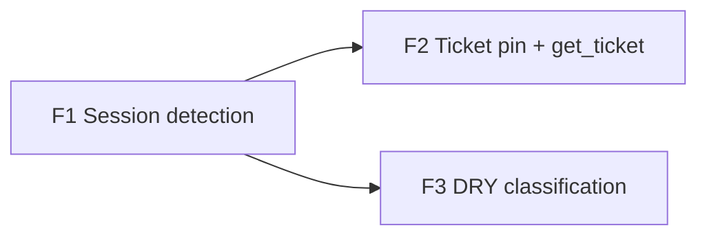

# Ticket SDD framework

## Objective

Implement [the blueprint](../blueprints/2026-11-10-ticket-sdd-framework.md): detect the third-party SDD framework
(OpenSpec, Spec Kit, Kiro, BMAD) each session works in, scoped to its repo, and pin the first one seen onto every
tracker ticket it is linked to, set once and never overwritten. Branch: `feature/ticket-sdd-framework`.

## Features

### Feature 1: Session SDD-framework detection

- **Issue:** #390
- **Layers:** DDL (`sensei.sdd_framework` enum; `activity.sessions.sdd_framework`, `sdd_framework_source`) →
  `sdlc/framework.rs` (signature table + pure `detect`) → `tasks/session_signals.rs` (detect + store in the same
  per-session transaction)
- **Depends on:** none
- **Acceptance criteria:**
  - `detect` returns `openspec` / `spec_kit` / `kiro` / `bmad` for each row of the blueprint's signature table, from
    behavioural evidence alone (a slash command, a Skill call, or an Edit/Write path).
  - Behavioural wins over static: a session with a `/speckit.*` prompt in a repo holding `openspec/` stores
    `spec_kit`, `behavioural`.
  - When a session matches two frameworks, the earliest-`ts` event decides.
  - With no behavioural hit, a single repo marker gives `static`. Two or more markers give the first in order
    `openspec, spec_kit, kiro, bmad` with `static_ambiguous`.
  - No match stores `NULL` and `NULL` source. sensei's own `docs/spec`, plan graph and `/sensei:*` commands never
    produce a value (B3).
  - A repo-marker read failure is an `Err`: the session is counted `failed` in `PassReport`, and its framework columns
    are not written as `NULL`.
  - Sessions already derived before this ships are re-derived once (the derivation mark is invalidated) so existing
    rows get a value.
  - `make test-template` is run after the DDL change; `make test-fast` is green.
- **Test scenarios:**
  ```gherkin
  Given a session whose first prompt is "/opsx:apply add-auth"
  When the session-signals pass runs
  Then activity.sessions.sdd_framework = 'openspec' and sdd_framework_source = 'behavioural'

  Given a session with no framework commands or paths, in a repo containing .specify/
  When the pass runs
  Then sdd_framework = 'spec_kit' and source = 'static'

  Given a session in the sensei repo that ran /sensei:plan and update_task_status
  When the pass runs
  Then sdd_framework IS NULL

  Given a session whose repo folder cannot be read and no behavioural hit
  When the pass runs
  Then the pass reports 1 failed and the session's sdd_framework is unchanged
  ```

### Feature 2: Pin the framework onto tickets (first wins) and expose it

- **Issue:** #391
- **Layers:** DDL (`sensei.tracker_tasks.sdd_framework`, `sdd_framework_session_id`, `sdd_framework_at`) →
  `pg_store/trackers.rs` `pin_ticket_frameworks` (called in both `write_links` transactions and after a session's
  framework is stored) → `get_ticket` MCP response carries `sdd_framework`
- **Depends on:** #390 (Feature 1)
- **Acceptance criteria:**
  - A ticket with `sdd_framework IS NULL` and at least one linked session holding a framework gets the framework of
    the earliest-`started_at` such session, with `sdd_framework_session_id` and `sdd_framework_at` set.
  - A ticket that already has a value is never updated, whether by a later session, a different framework, or an
    earlier session linked by a later sync (B1).
  - A relink that removes the provenance session's link leaves the ticket's value as it is.
  - Deleting the provenance session sets `sdd_framework_session_id` to `NULL` and keeps `sdd_framework`.
  - Pinning runs in the same transaction as `write_links`: if the relink rolls back, no pin persists.
  - `get_ticket` returns `sdd_framework` (string or `null`) for the fetched ticket.
- **Test scenarios:**
  ```gherkin
  Given ticket AUTH-1 linked to session S1 (openspec, started 09:00)
  When the tracker sync relinks
  Then AUTH-1.sdd_framework = 'openspec' and sdd_framework_session_id = S1

  Given AUTH-1 is pinned to 'openspec'
  And a later sync links session S0 (spec_kit, started 08:00)
  When the sync relinks
  Then AUTH-1.sdd_framework is still 'openspec'

  Given ticket AUTH-2 whose linked sessions all have sdd_framework NULL
  When the sync relinks
  Then AUTH-2.sdd_framework IS NULL

  Given AUTH-1 is pinned
  When an assistant calls get_ticket("AUTH-1")
  Then the response includes "sdd_framework": "openspec"
  ```

### Feature 3: One signature table for code/doc classification (DRY)

- **Issue:** #392
- **Layers:** `sdlc/framework.rs` table → `sdlc::signals::is_code` (`NOT_CODE_DIRS`) →
  `indexer::doc_indexer` spec/design path rules
- **Depends on:** #390 (Feature 1)
- **Acceptance criteria:**
  - `is_code` no longer has a hard-coded `"openspec"` literal. It reads the framework dirs from the signature table,
    and `.specify`, `.kiro` and `_bmad` / `.bmad-core` paths are now not code.
  - `doc_indexer` classifies `.kiro/specs/*/requirements.md` and `specs/NNN-*/spec.md` the way it already classifies
    `openspec/specs/`.
  - All existing `is_code` and `doc_indexer` tests stay green unchanged. New table-driven cases cover each framework.
  - `grep -rn '"openspec' crates/senseid/src` finds only the signature table.
- **Test scenarios:**
  ```gherkin
  Given an Edit of "/r/.kiro/specs/auth/tasks.ts"
  When signals are derived
  Then no code_edit signal is emitted

  Given a repo with specs/001-auth/spec.md
  When the doc indexer classifies it
  Then it gets the same classification as openspec/specs/auth/spec.md
  ```

## Dependency graph



F2 and F3 are independent of each other once F1 lands.

## Open check (resolve at F1 build start)

- How the session-signals pass invalidates already-derived sessions (`SignalMark`). If the mark has no derivation
  version, F1 adds one; that is the backfill.
