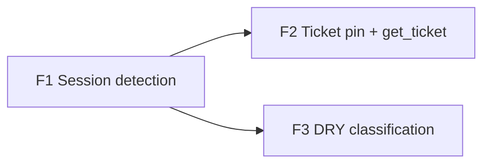

# Ticket SDD framework

## Objective

Implement [the blueprint](../blueprints/2026-11-10-ticket-sdd-framework.md): detect the third-party SDD framework
(OpenSpec, Spec Kit, Kiro, BMAD) each session works in, scoped to its repo, and pin the first one seen onto every
tracker ticket it is linked to, set once and never overwritten. Branch: `feature/ticket-sdd-framework`.

## Features

### Feature 1: Session SDD-framework detection

- **Issue:** #390
- **Layers:** DDL (`sensei.sdd_framework` enum; `activity.sessions.sdd_framework`, `sdd_framework_source` + pair check;
  `activity.session_signal_marks.derive_version not null default 0`) → `SignalEvent` gains `prompt` + `skill` →
  `sdlc/framework.rs` (signature table; pure `behavioural` / `from_markers`; thin `repo_markers`) →
  `tasks/session_signals.rs` (selection order, bounded probe, one-transaction store) → docs (`tracker-sdlc-metrics.md`
  S2, `design.dbml`, `docs/database/activity.md`, column comments)
- **Depends on:** none
- **Acceptance criteria** (blueprint B4–B12):
  - Behavioural detection per framework from each evidence kind in the blueprint's signature table: prompt prefix,
    skill name (with or without a `plugin:` prefix), repo-relative path, Bash command word.
  - Paths are repo-relative (B4): `/r/b/openspec/x.md` in a session of repo `/r/a` is not evidence; `/r/a/openspec/x.md`
    is. A session with no repo has no path evidence.
  - `specs/002a-x/spec.md` and `specs/107917-y/plan.md` are Spec Kit; `docs/specs/001-z/a.md` and
    `spec/models/user_spec.rb` are not.
  - Path evidence is `PostToolUse` of Edit/MultiEdit/Write/NotebookEdit only; a lone `PreToolUse` is not evidence.
  - Bash: `cd x && openspec new change y` is OpenSpec; `grep -i openspec f` is not.
  - Prompts (B8): `<ide_opened_file>…</ide_opened_file>\n/opsx:apply x` is OpenSpec; a prompt starting
    `<agent-message` or `<task-notification` that quotes `/opsx:apply` is not evidence; `/bmad-agent-dev` is BMAD;
    `/speckit-plan` is Spec Kit; `/sensei:plan` is nothing (B3).
  - The earliest matching event by `(ts, id)` decides; behavioural beats static.
  - Static: one distinct framework → `static`; `{_bmad, .bmad-core}` → `bmad`/`static`; `{openspec, bmad}` →
    `openspec`/`static_ambiguous`; none → `NULL`/`NULL`. Repo dir missing or folder row gone → no markers (B6).
  - A probe permission error or a probe exceeding 5 s → `NULL`/`probe_failed`; the session's signals and mark are stored
    as usual, `PassReport.failed` is not incremented, and a second pass with no new events does not select it (B10).
  - The probe runs at most once per repo per pass, off the async runtime.
  - B12: a session stored `spec_kit`/`static` keeps it when re-derived with its repo dir removed or unreadable.
  - B9: a pre-existing mark (version 0) is re-selected once; every mark write (success and failure) stores the current
    version; with `limit = 1`, an unmarked new session is taken before a version-stale one.
  - A session deleted mid-pass is skipped, not failed.
  - The DDL rejects a source without a framework (other than `probe_failed`) and a framework without a source.
  - `grep derive_version` hits `docs/spec/daemon/tracker-sdlc-metrics.md` and `database/design.dbml`.
  - `make test-template` run after the DDL change; `make test-fast` green.
- **Test scenarios:**
  ```gherkin
  Given a session whose first prompt is "/opsx:apply add-auth"
  When the session-signals pass runs
  Then activity.sessions.sdd_framework = 'openspec' and sdd_framework_source = 'behavioural'

  Given a session in repo /r/a whose only evidence is an edit of /r/b/openspec/changes/x/tasks.md
  When the pass runs
  Then sdd_framework IS NULL

  Given a session with no behavioural evidence, in a repo containing .specify/
  When the pass runs
  Then sdd_framework = 'spec_kit' and source = 'static'

  Given a session in the sensei repo that ran /sensei:plan and update_task_status
  When the pass runs
  Then sdd_framework IS NULL

  Given a session with no behavioural evidence whose repo folder cannot be read
  When the pass runs twice with no new events
  Then the session has sdd_framework NULL, source 'probe_failed', its signals are kept,
  And the first pass reports 0 failed and the second pass does not select it

  Given a session stored 'spec_kit'/'static' whose repo was since deleted
  When it is re-derived
  Then it is still 'spec_kit'/'static'
  ```

### Feature 2: Pin the framework onto tickets (first wins) and expose it

- **Issue:** #391
- **Layers:** DDL (`sensei.tracker_tasks.sdd_framework`, `sdd_framework_session_id`, `sdd_framework_at`) →
  `pg_store/trackers.rs` `pin_ticket_frameworks` (called in both `write_links` transactions and after a session's
  framework is stored) → `get_ticket` MCP response carries `sdd_framework`
- **Depends on:** #390 (Feature 1)
- **Acceptance criteria:**
  - A ticket with `sdd_framework IS NULL` and at least one linked session holding a `behavioural` or `static` framework
    gets the framework of the earliest-`started_at` such session, with `sdd_framework_session_id` and `sdd_framework_at` set.
  - A ticket that already has a value is never updated, whether by a later session, a different framework, or an
    earlier session linked by a later sync (B1).
  - A session whose source is `static_ambiguous` or `probe_failed` is never pinned (blueprint B11).
  - A relink that removes the provenance session's link leaves the ticket's value as it is.
  - Deleting the provenance session sets `sdd_framework_session_id` to `NULL` and keeps `sdd_framework`.
  - Pinning runs in the same transaction as `write_links`: if the relink rolls back, no pin persists.
  - The session-signals pass pins in its per-session transaction; a pin error rolls back the whole session write and
    the session is retried.
  - `get_ticket` returns `sdd_framework` (string or `null`) for the fetched ticket.
- **Test scenarios:**
  ```gherkin
  Given ticket AUTH-1 linked to session S1 (openspec, started 09:00)
  When the tracker sync relinks
  Then AUTH-1.sdd_framework = 'openspec' and sdd_framework_session_id = S1

  Given AUTH-1 is pinned to 'openspec'
  And a later sync links session S0 (spec_kit, started 08:00)
  When the sync relinks
  Then AUTH-1.sdd_framework is still 'openspec'

  Given ticket AUTH-2 whose linked sessions all have sdd_framework NULL
  When the sync relinks
  Then AUTH-2.sdd_framework IS NULL

  Given AUTH-1 is pinned
  When an assistant calls get_ticket("AUTH-1")
  Then the response includes "sdd_framework": "openspec"
  ```

### Feature 3: One signature table for code/doc classification (DRY)

- **Issue:** #392
- **Layers:** `sdlc/framework.rs` table → `sdlc::signals::is_code` (`NOT_CODE_DIRS`) →
  `indexer::doc_indexer` spec/design path rules
- **Depends on:** #390 (Feature 1)
- **Acceptance criteria:**
  - `is_code` no longer has a hard-coded `"openspec"` literal. It reads the framework dirs from the signature table,
    and `.specify`, `.kiro` and `_bmad` / `.bmad-core` paths are now not code.
  - `doc_indexer` classifies `.kiro/specs/*/requirements.md` and `specs/NNN-*/spec.md` the way it already classifies
    `openspec/specs/`.
  - All existing `is_code` and `doc_indexer` tests stay green unchanged. New table-driven cases cover each framework.
  - `grep -rn '"openspec' crates/senseid/src` finds only the signature table.
- **Test scenarios:**
  ```gherkin
  Given an Edit of "/r/.kiro/specs/auth/tasks.ts"
  When signals are derived
  Then no code_edit signal is emitted

  Given a repo with specs/001-auth/spec.md
  When the doc indexer classifies it
  Then it gets the same classification as openspec/specs/auth/spec.md
  ```

## Dependency graph



F2 and F3 are independent of each other once F1 lands.

## Build-start corrections (2026-11-10/11)

Found by checking F1 against the code and live DB, then by the pre-implementation audit (spec-conformance,
data-correctness, failure-mode reviewers; 7 HIGH). Recorded in the blueprint as B4–B12; user decisions on B10, B11,
B12 (2026-11-11).
