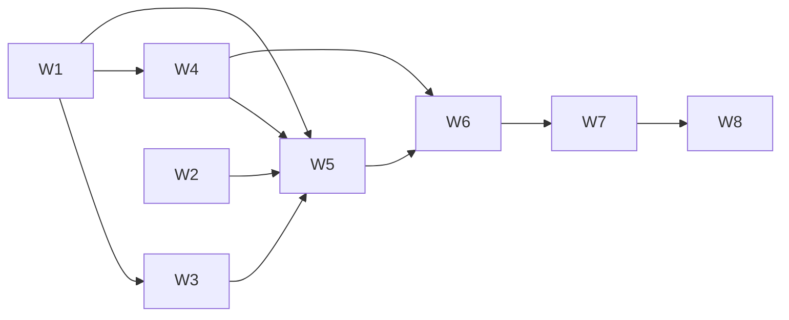

# Comment write-back for GitLab and GitHub — plan

## Objective

Implement `docs/spec/daemon/tracker-forge-comment-writeback.md` r4 (F1–F11). GitLab and
GitHub trackers get the comment surface. Fields stay Jira-only. Sensei never comments in a
public or internal repository or project, and checks a ticket's identity before adopting
or creating a comment. F, gate and C numbers refer to that spec. Work goes on
`feature/forge-comment-writeback`.

**How to run things:**
- Build with `-j 1` in the background.
- Run `make test-template` after any `database/` change.
- Run the full senseid suite only with `RUST_TEST_THREADS=2`, under a `systemd-run`
  `MemoryMax=10G` cap.

**Before starting any feature,** re-run the claims ledger (C1–C33). Any `FALSE` stops the
build.

**One rule spans W1 to W5:** the forge adapters keep `comment: false` until W5 implements
their comment methods. Flipping it earlier would let the pass reach the
`UnsupportedTracker` stubs.

## Features

### W1 · Seams, with Jira unchanged (F1, F2, F3)
- **Issue:** #436
- **Layers:**
  - `tracker/mod.rs`: `Capabilities`, `TaskRef`, `is_numeric_id`, the
    `gitlab_like` fake
  - `tracker/{jira,gitlab,github}.rs`: signatures
  - `tracker/writeback.rs`: guard, `TaskRef` built in `write_comment`
  - `db/pg_store/trackers.rs`: `WritebackTask.key`
  - `api/handlers/trackers.rs`: `toggle_refusal`, `fields_refusal`, `fields_unsupported`
  - `tracker/history.rs`, `sync.rs`, `connect.rs`: literals
- **Depends on:** none.
- **Acceptance:**
  - `Capabilities { history, comment, fields }`, with `writeback` removed. Jira is
    `{true,true,true}`. GitLab and GitHub are `{false,false,false}` here; W5 sets
    `comment: true`. `gitlab_like` is `{true,true,true}`.
  - Gate 1: a recorded Jira pass sends the identical request sequence, and the existing
    write-back tests pass with only signature edits.
  - Gate 2: `cargo build --tests -p senseid` is clean, and the kind-name `rg` returns 0 hits.
  - `PUT /fields` on a forge gives 409 `fields_unsupported`, for both `[]` and one entry,
    with 0 requests and 0 rows. A malformed body still gives 422. Handler test `:1376`
    changes to match; `:899-908` is rewritten for the two refusal functions.
  - **Amended at build (2026-11-14):** `WriteMethod::Patch` and gate 11 moved to W5.
    Clippy `-D warnings` rejects a variant nothing constructs until GitHub's comment
    PATCH exists, and suppressing the lint would be a workaround.
  - `is_jira_id` is gone; `jira.rs` calls `is_numeric_id`.
- **Test scenarios:**
  - Given a Jira tracker with an assigned ticket, when the pass runs before and after this
    change, then the recorded request sequences are equal.
  - Given a GitLab tracker, when `PUT /fields` is sent `[]`, then the response is 409
    `fields_unsupported`, and the fake transport and `tracker_fields` are untouched.

### W2 · Markdown renderer (F4)
- **Issue:** #437
- **Layers:** `tracker/writeback.rs`: `COMMENT_MARKER`, `markdown`, `is_marked`, and a pure
  sanitiser.
- **Depends on:** none (it can run beside W1).
- **Acceptance:** gate 4 exactly:
  - checked-in golden strings for golden 1 and golden 2
  - the escaping rules
  - newline → space, and `/close` stays inline
  - `@team` → `\@team`
  - the U+2028, `\t`, `&123`, `{+x+}` case
  - `is_marked`
- **Test scenarios:**
  - Given golden report 2, when it is rendered, then the output contains
    `cache read 900000 \[2 of 3 sessions\]` and starts with `<!-- sensei:writeback -->`.

### W3 · Write-error mapping (F8, F6a)
- **Issue:** #438
- **Layers:**
  - `tracker/transport.rs`: `RawResponse.rate_exhausted`, `ReqwestRaw::execute`,
    `map_write_response`
  - the 4 `RawResponse` literals
  - `tracker/writeback.rs`: `write_comment`, where a create 404 goes to `issue_exists`
- **Depends on:** W1 (`TaskRef` in `write_comment`).
- **Acceptance:**
  - Gate 9: these writes give `rate_limited`: 403 with `retry-after`, 403 with
    `x-ratelimit-remaining: 0`, 403 whose body names a secondary rate limit. A bare write 403
    gives `forbidden`. A read 403 with either header gives `Forbidden`.
  - Gate 7, through a fake adapter: create 404 then issue 200 gives `forbidden`; issue 404
    gives `not_found`. The update-404 rules are unchanged.
  - Jira's request sequence is still unchanged (gate 1 re-run).
- **Test scenarios:**
  - Given a write that answers 403 with no headers and body
    `{"message":"You have exceeded a secondary rate limit"}`, when it is mapped, then the
    result is `RateLimited`.

### W4 · Never comment on a public or internal ticket (F7)
- **Issue:** #439
- **Layers:**
  - `database/ddl/enum/sensei/tracker_writeback_status.ddl`: `not_private` and the new
    comments
  - `database/apply/before/sensei_tracker_writeback_status_not_private.sql`, registered in
    `database/design.yaml`
  - `database/design.dbml`
  - `tracker/writeback.rs`: `WritebackStatus::NotPrivate`, `WriteOp::Audience` arms, the
    per-pass audience cache and check
  - `tracker/mod.rs`: `Audience`, and trait methods `audience_key` and `audience`. Jira
    returns `None` and `UnsupportedTracker`.
  - **Amended at build (2026-11-14):** the forges' `audience_key` and `audience` (one GET
    each, via the shared `forge::audience_of`) land here, not in W5. Clippy rejects
    `Audience` variants that nothing constructs, and the forges are what construct them.
    They stay inert until W5 sets `comment: true`.
  - The check runs once `writeback_target` returns `Go` (spec F7 amended).
  - `github::is_repo_name` now refuses `.` and `..`, found by the new visibility test.
  - `db/pg_store/trackers.rs`: `writeback_counts` returns 3 values
  - `api/handlers/trackers.rs`: the card gains `not_private`
  - `make test-template`
- **Depends on:** W1.
- **Acceptance:** gate 10, through a fake adapter with an audience:
  - **Public repo:** one cached GET serves two tickets, there are 0 comment requests, and
    both tickets are `not_private`. `internal` gives the same result.
  - **Audience errors:** 404 → `not_found`, 403 → `forbidden`, 429 → `rate_limited`, a bad
    body → `error`. Each makes 0 comment requests.
  - **Private again:** a repo switched back to private gets its comment on the next pass.
  - **Counts:** `not_private` is in its own count, not in `failing`.
  - **Enum:** the DDL labels equal `ALL`, with `not_private` last.
  - **Upgrade hook:** it adds the value to an older enum and is a no-op otherwise, using the
    `mod.rs:1641-1670` pattern.
- **Test scenarios:**
  - Given two assigned tickets in one public repository, when the pass runs, then exactly
    one visibility GET is made, no comment request is made, and both tickets read
    `not_private`.

### W5 · GitLab and GitHub comments (F5, F6, F6b, the F7 adapters)
- **Issue:** #440
- **Layers:**
  - `tracker/gitlab.rs`: notes, `audience` via `GET {API}/projects/{encoded}`,
    `audience_key`, F6b identity, `comment: true`
  - `tracker/github.rs`: REST comments, the page scan, `audience` via `GET /repos/o/r`,
    `audience_key`, F6b, `comment: true`
  - recorded fixtures under each adapter's test fixtures. These are hand-built from the
    documented response shapes and scrubbed (`fixtures_are_scrubbed`).
  - module doc comments (`gitlab.rs:5`, `github.rs:5`)
  - `tracker/mod.rs` `WriteMethod::Patch`, and the `ReqwestRaw` PATCH verb
    (`transport.rs`), moved here from W1
- **Depends on:** W1, W2, W3, W4.
- **Acceptance:**
  - Gate 3: PATCH `writeback_enabled: true` gives 200 on GitLab and GitHub. Handler tests
    `:1101` and `:1366` change to match.
  - Gates 5 and 6: the full request sequences, including the audience and identity GETs
    and the update sequences.
  - Gate 7 on each forge.
  - Gate 8: shape refusals make 0 requests.
  - Gate 11: `ReqwestRaw` sends `PATCH` to a local listener (moved from W1).
  - The pass hands each adapter the row's `key` in `TaskRef.key`. This is proved by the
    forge request paths in gates 5 and 6, which are built only from the key (W1 review,
    LOW 4).
  - Gate 14: `UnsupportedTracker` remains only on `check_fields`, `field_in_use` and
    `write_fields`, and the stale module docs are gone.
- **Test scenarios:**
  - Given a GitLab issue whose GET returns an `id` other than the stored `external_id`,
    when the pass runs, then the status is `not_found` and no notes GET or POST is made.
  - Given a GitHub issue with 120 comments and a marked owner comment on page 2, when the
    pass runs, then it GETs pages 3 and 2 and PATCHes that comment.

### W6 · API and app (F10)
- **Issue:** #441
- **Layers:**
  - `api/handlers/trackers.rs`: card `writeback.supports`
  - `api/handlers/scheduled_tasks.rs:71`
  - `crates/cli/src/tracker.rs`: token copy
  - `app/src/lib/types.ts`: `TrackerWriteback`, `TrackerWritebackStatus`
  - `app/src/lib/tracker-errors.ts`: `fields_unsupported`, `writebackStopped(code, kind)`,
    token copy
  - `integrations-state.svelte.ts`: `writebackText` takes `kind`
  - `IntegrationsScreen.svelte`: the `supports` gating, label, description, the `active`
    count, the `not_private` sub-line, token notes
  - `TicketsScreen.svelte:50`
  - the specs F10 lists
- **Depends on:** W4 (for `not_private`) and W5.
- **Acceptance:**
  - Gate 12: `supports` and `not_private` are in the card.
  - Gate 13: forge cards show the toggle and no `[data-action="fields"]`. No forge card text
    matches `/Jira/`. The GitHub `rate_limited` stop text has no "Jira". The Tickets
    sub-line is kind-neutral. The Jira card is unchanged. The write-back block has no
    `kind ===` test.
  - App unit tests and svelte-check are green.
- **Test scenarios:**
  - Given a GitLab card with `supports.comment` true, when it renders, then
    `[data-action="writeback"]` is present, `[data-action="fields"]` is absent, and the
    card text contains no "Jira".

### W7 · Docs (F11)
- **Issue:** #442
- **Layers:**
  - the parent spec: Out of scope, W5, W7, W8, W9, W10, W11, W-UI, gate 13
  - `tracker-jira-linkage.md`, `tracker-gitlab.md`, `tracker-github.md`
  - `decisions.md`: D93, and amendment notes on D50, D91 and D92
  - `workspace-integrations.md`, `workspace-tickets.md`
  - `docs/backlog.md`: the slice entry
- **Depends on:** W6. The docs describe what was built.
- **Acceptance:** gate 15's `rg` checks pass, and D93 exists.

### W8 · Live check after merge (human)
- **Issue:** #443
- **Depends on:** W7, merged to develop.
- **Acceptance:** with test projects on gitlab.com and github.com, X2, X3 and X5 are run.
  Their outcomes are written into the spec's Probes table. If X2 fails, apply the spec's
  fallback for the visible marker.

## Dependency graph

W1 and W2 can start in parallel. W3 and W4 can run in parallel once W1 lands.
