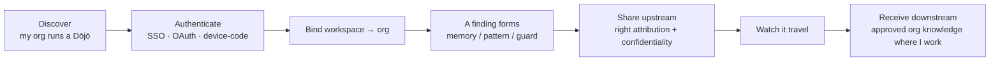
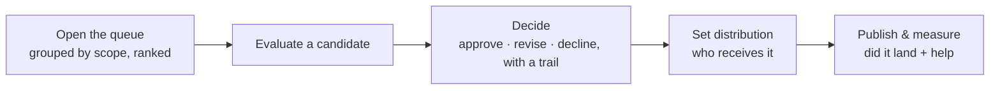
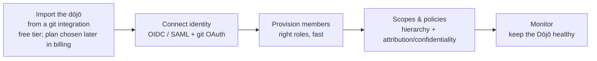
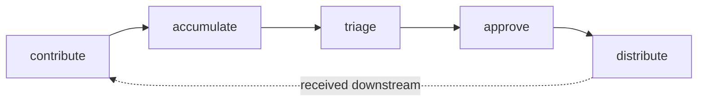

# Objectives

> The **WHAT**, broken down. Each objective states the outcome and how we know
> it's met — never the implementation. Architecture
> ([`architecture/`](../architecture/README.md)) maps each to a layer; the
> contracts land in the module specs under [`modules/`](modules/README.md)
> (legacy tree: [`spec/`](../spec/README.md)).
> Traces back to [`01-vision.md`](01-vision.md).
>
> **Moved here from `docs/02-objectives.md` in the 2026-10-13 reorg.**

Objectives are grouped by the four personal segments plus the cross-cutting
Dōjō layer. Every one is judged against the north-star: **does it move FTR, or
expose why it moved?**

---

## 01 · Bootstrap 支

**Reach a working, trustworthy environment without thinking about toolchains.**

| # | Objective | Met when |
|---|---|---|
| B1 | Verify what's already present before changing anything | Homebrew · Postgres · Ollama · daemon are probed and reported, no blind installs |
| B2 | Bring every prerequisite up **green** | A single status surface shows all deps healthy or the exact remediation |
| B3 | Never leave the user stuck | Every red state names the fix (and, where safe, offers to run it) |

## 02 · First run &amp; Preferences 名

**Point sensei at real folders, watch workspaces appear, then tune what defaults got wrong.**

| # | Objective | Met when |
|---|---|---|
| F1 | **Value before setup** (theme 1) | First interaction shows the user's own discovered workspaces — not a wizard |
| F2 | Discover real workspaces from real folders | Pointing at `~/Developer` yields correctly-classified repos (one repo = one workspace = one owner) |
| F3 | Tuning is available, never blocking | Every default (scan roots, assistants, providers, inference, libraries) is adjustable in a searchable Preferences surface |

## 03 · Observatory — daily use 家

**Walk in, learn the one thing that needs me today, act on it, stay in control of what leaves my machine.**

| # | Objective | Met when |
|---|---|---|
| O1 | Surface *today's one thing* | The landing shows a single highest-value action with its receipt, not a wall of metrics |
| O2 | One decision, one default (theme 2) | Insights/traceability/libraries/upgrades all use **Apply · Review · Dismiss** |
| O3 | Every claim carries a receipt (theme 4) | FTR chips, confidence, before/after — the user can verify, not trust |
| O4 | The user controls what leaves the machine (theme 5) | Nothing is shared without an explicit Dōjō membership + preview |
| O5 | The module loops each offer an action | Security · Architecture · Testing · Style · Memory · Traceability · Impact · Libraries · Insights each observe → find → offer one action |

## 04 · The workspace window 雲

**Work inside one workspace end-to-end and trust what sensei learned here before any of it travels.**

| # | Objective | Met when |
|---|---|---|
| P1 | A trustworthy per-workspace overview | Overview shows FTR, top recommendation, memory/drift counts — all real, no fabricated numbers |
| P2 | Learned knowledge is inspectable | Memories, patterns, traceability, libraries, impact are all viewable with provenance |
| P3 | Nothing travels unseen | Sharing a finding upstream always previews what leaves and what's stripped |

---

## Dōjō — the cross-cutting team layer

**Extend the same retrospective loop across a team without leaking client work.**
The Dōjō is not a linear "segment 5" — it threads through the Observatory and the
workspace window (the developer's flows live **in the Observatory**) and adds a web
**console**. **Every user logs into the Dōjō** — contributor · maintainer · lead ·
admin (D1); the team benefit is primary, but a developer in multiple teams gets a
contributor console view too. The web Dōjō keeps **Relay and an inbox for contributors**:
tickets assigned to you in the tracker mirror sit under the relay session that carries
their key, and tickets with no session yet are listed below them. The Dōjō is a **hosted
service** — there is no self-hosting (Q14). A dōjō comes from a git integration — a GitHub or Azure DevOps organization, or another provider — and an import may land as workspaces in one dōjō (D20). Its core principles (from the journey map):
**identity is the discovery · pull never push · never blind, always preview ·
one universal strip · specificity wins conflicts.**

**Membership contexts** — one developer, many orgs: *Employer · Client orgs ·
Communities · Personal.* The org boundary is the **membership**, with
client-precedence as the tiebreaker.

### Developer (in-app)

### Maintainer (console)

### Org admin (console)

### Client work — no section of its own (D34)

> A client is just another dōjō (#307 R7, D34, 2026-10-22): there is no
> engagement register, incident list or client audit. A dōjō's work is its Epics,
> Sprints and Tasks from its integrations, and the lesson travels while the
> source never does on every publish (DJ4), whoever's dōjō it is.

### Dōjō lifecycle — what flows through it

| # | Objective | Met when |
|---|---|---|
| DJ1 | Personal sensei works with **no** Dōjō | Every local capability functions with zero memberships |
| DJ2 | The org boundary is exact (theme 5) | A lesson from a client's dōjō never leaves without anonymization + preview |
| DJ3 | Pull, never push | Downstream knowledge arrives by opt-in pull, never forced |
| DJ4 | Attribution + confidentiality are automatic | One universal strip runs on every client lesson; a lesson that can't be stripped doesn't leave |
| DJ5 | Distribution respects priority ladders, not a rigid hierarchy | Specificity wins conflicts; memberships route by precedence |

---

## Relay — supervising long runs from anywhere

**Make multi-agent, away-from-keyboard work legible and controllable, without
leaking code.** A cross-cutting capability: a **coordinator** (in the daemon), a
**zero-knowledge relay**, and a **mobile companion** — plus a modular **planner**.
Visual: [`journeys/relay.md`](../journeys/relay.md).

| # | Objective | Met when |
|---|---|---|
| R1 | Plan a long run **modularly** | a workspace has one active plan = **phases → features · checkpoints · gates** |
| R2 | Runs are **non-blocking** (auto mode) | development proceeds without waiting; the human is pulled in only at a gate or a stall |
| R3 | Status is legible **remotely** | workspace-level *done · doing · next* on the phone; a stalled track **nudges** |
| R4 | Human-in-the-loop is **minimal + exact** | a gate shows the **exact command** to approve, or a **decision as 3–4 options + a free reply** |
| R5 | **Zero-knowledge** by construction | agents run on the user's hardware; the coordinator publishes only *filtered status* through the relay — never code or transcripts |
| R6 | **Secure pairing + permissions** | an encrypted pairing round-trip; explicit, revocable permissions bound what the relay can do |
| R7 | **Multi-agent, multi-machine** | Claude Code · Codex · OpenCode · Aider across machines, grouped by machine |
| R8 | Team relay routes to **on-call** (Dōjō) | org gates fan into one shared queue; each decision carries attribution and lands in the Dōjō record |

## Cross-cutting (apply to every objective)

- **Insight copy from the model** (theme 6) — user-facing strings route through `insight-copy`.
- **Discoverability of depth** (theme 3) — nothing important hidden behind a one-liner.
- **The pair goes both ways** — objectives capture human-side signal (sparse instructions, wrong assumptions), not only assistant errors.

## Read next

- [`../roadmap/README.md`](../roadmap/README.md) — how far the implementation is from these objectives, by module.
- [`../architecture/README.md`](../architecture/README.md) — the layers that deliver them.
