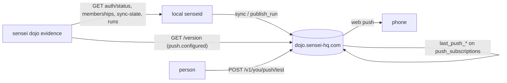

# Design: production verification of the dōjō plane (#314)

## Context
Everything #314 names is built and was verified on the local dōjō:
- **Sync.** Repositories, metrics and graph push from `dojo_sync`; per-entity verdicts land in
  `sensei.sync_state` and are read by `GET /api/dojo/sync-state` (`crates/senseid/src/api/routes.rs:611`,
  handler `crates/senseid/src/api/handlers/dojo.rs:34`). Local cycle of 2026-10-21 (#301):
  `mapped=56 allowed=31 pushed=198`, 37 projects filed (#299).
- **Relay.** `publish_run` federates `activity.runs` to `dojo.relay_sessions` and stores the cloud id
  in `activity.runs.dojo_session_id` (`crates/senseid/src/tasks/handlers/publish_run.rs:138-154`);
  the field is serialized on `Run` (`crates/senseid/src/runs.rs:156`) and listed by `GET /api/runs`
  (`routes.rs:492`).
- **Push.** The session and inbox routes fire `sendRelayPushFromEnv` on crash / approval / decision /
  stall (`dojo/src/routes/v1/t/[origin]/[org]/relay/session/+server.ts:73-85`, `…/relay/inbox/+server.ts:62`).
- **Deploy.** `release.yml`'s `deploy-worker` deploys the Worker and checks `/version`'s `gitSha`
  (`.github/workflows/release.yml:474-509`), so the July blocker (unpromoted Worker versions) is gone.

What is missing is observability of push in production and one place that gathers the evidence.

## Decisions
1. **Push readiness on the public `/version`.** It is the route the release already probes and the
   CLI can read without a token. It reports only a boolean, never key material.
2. **Record each send's outcome on the subscription row** (`last_push_at`, `last_push_status`,
   `last_push_error`), not a new log table. One row per device is the question the person asks
   ("did my phone get it?"); a history table is not needed for #314. Written by the service-role
   send path; RLS stays own-rows read (`database/policies/dojo/push_subscriptions.sql`).
3. **A test push bypasses prefs and quiet hours, never zero-knowledge.** The payload is a fixed
   `{title: "sensei", body: "Test notification", url: "/you", tag: "sensei-test"}`. It is the
   person's explicit request, so a disabled `crashed`/`approvals` opt-in must not hide it.
4. **The test push fails loudly.** Relay-triggered pushes stay fail-open (a push must never break
   a raise). The test route answers 503 `push_not_configured` without VAPID, and returns the counts
   otherwise; zero subscriptions is a 409 `no_subscription` with the remedy "turn on Notify me".
5. **Evidence is a CLI subcommand, not a script.** It reuses the CLI's daemon client and is unit
   testable against a stub server. It is read-only.
6. **The relay leg is the run bridge.** Relay crews in the dōjō are epic #427 and not built; the
   existing `publish_run` path is what "a relay run appears" means for #314.

## Decisions defaulted (user may override)
- **Public `/version` carries `push.configured`.** Alternative: an authenticated-only status. Chosen
  because it lets the release job and the CLI check it without a session; it leaks only whether
  push is set up.
- **`release.yml` warns, not fails, when push is not configured.** Setting VAPID secrets is the
  user's step; failing would block every release until then.
- **Evidence prints counts only; repository keys only with `--show-keys`.** #314 is on a public
  repo and employer-org repository names must not be posted.
- **Evidence passes when each leg has ≥1 recent synced row attributable to the host:** the daemon's
  sync target (`GET /api/auth/status` → `dojo`, from `dojo_client::settings::dojo_url()`) is the
  host; for the `persona_slot` of a connection whose `dojo_url` is on the host, ≥1 row in state
  `synced` with `synced_at` within `--since` (default 24h) for each of `dojo_sync_plan`,
  `repository`, `repository_metric`, `repository_graph`; and ≥1 run with `dojo_session_id` set,
  created within `--since`, whose publish could only reach the host — its workspace is bound to a
  connection on the host, or (unbound runs broadcast to every enabled connection,
  `resolve_run_memberships`, `publish_run.rs:231`) every enabled connection is on the host.
  Why: `sync_state` has no host column (primary key `(entity, entity_key, direction)`), so rows a
  previous local-dōjō sync wrote stay `synced`; and `dojo_session_id` is stored from the first
  membership that acks, so it does not name a host. Push
  passes when `/version` says configured and the person confirms arrival (a phone cannot be read
  from the CLI); the CLI prints the last `last_push_status` only when given a token, otherwise a
  "confirm on the phone" line.
- **Default host `dojo.sensei-hq.com`**, overridable with `--host` (the local dōjō for tests).

## Risks
- `push_subscriptions` gains columns: the daemon converges to released DDL at startup, but this is a
  dōjō-scope table deployed by `scripts/deploy-dojo-db.sh`; additive columns need `dbd reconcile`
  (run twice if dbd#121 bites).
- A test push to an expired endpoint disables the subscription (existing 404/410 rule) — the UI
  must then say "this device's registration expired, turn Notify me on again".
