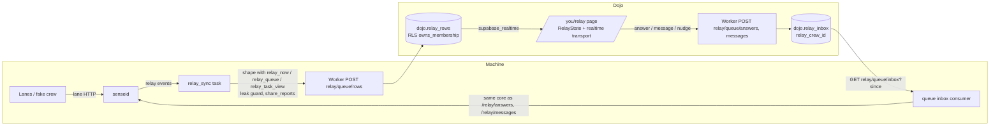

# Design: Relay in the dōjō over Supabase realtime (#427)

Sources: issue #427; `docs/design/2026-11-12-relay-screen-rebuild.md` §2b, §2c, §4; and, outside this repository in
the `sensei-hq/coord` folder beside it: `coord/mockups/relay-lanes/CONTRACT.md` §1 ("one screen, two places"), §1g
(dōjō footer), §3j (rules); `coord/briefs/Design-relay-lanes.md` ("Not shared from the desktop").

## What is already done on develop

| Piece | State | Where |
|---|---|---|
| Relay schema deployed in the dōjō scope | done, unused | `database/design.yaml:118-134` |
| The realtime seam in `@sensei/state` | done (interface + canned double) | `packages/state/relay/sources/realtime.ts:28-56` |
| `RelayState` applies row events and re-reads on id-only ones | done | `packages/state/relay/relay-state.svelte.ts:292-314` |
| Person routes take `surface: dojo` and `nudge: true` | done (#419) | `crates/senseid/src/relay/mod.rs:198`, `api/handlers/relay.rs:840-852` |
| Leak guard (kinds only, fail closed) | done | `crates/senseid/src/relay/mod.rs:349` |
| Rows written to the dōjō, RLS by membership, publication, dōjō screen, answers back | not started | — |

Depends on #414 (`update-shared-state-sources`), which lands first: `StateStream`, `RelayTaskSource`,
`relayRealtimeTaskSource`, `realtimeChannel` + `fromPostgresChange`, and the dōjō `@sensei/state` alias. This change
builds the dōjō transport on those and does not re-add them.

## The fact that changes the issue's step 1–2

The issue (and design §4.4) maps `postgres_changes` `new` straight to the stream's `data`, "so the sub-states and
selectors do not change". That holds only if the dōjō rows have the stream's shape. They do not, if we copy the base
tables: a Now lane row nests its task, lease, step counters and last nudge (`database/ddl/view/relay/now.ddl:11-40`);
decisions and person messages are derived from `relay.actions`; and `relay_now` adds crews, facets, run tasks and
receipt writes in Rust (`crates/senseid/src/db/pg_store/relay.rs:7092-7510`). Copying base tables would force a second
shaper in TypeScript on the Worker, duplicating ~300 lines of Rust with side effects (the project's DRY hard rule) and
drifting from the desktop.

Replacement: publish **shaped entity rows** into one dōjō table. The daemon remains the only shaper. The membership
bridge, RLS, publication, Worker-only writes and answers back from the issue all stay; only the storage shape changes.

## Decisions

1. **One table, `dojo.relay_rows`.** Columns: `membership_id uuid not null` (FK `dojo.memberships`), `source text not
   null`, `entity text not null` (check list below), `id text not null`, `crew_id uuid`, `data jsonb not null`,
   `removed boolean not null default false`, `synced_at timestamptz not null default now()`; PK `(membership_id,
   source, entity, id)`. It lives in the `dojo` schema so its function-calling policy file applies only in the dōjō
   scope (`database/policies/README.md`). Entities: `crew`, `lane`, `run`, `run_task`, `task` (floating review or
   completed today, with `section`), `decision`, `message`, `item`, `task_view`, `summary` (facets, triage, today).
   Desktop-only `resources` is not published.
2. **`source` is opaque.** `relay.daemon_user` never leaves the machine (`database/ddl/table/relay/daemon_user.ddl:4-9`).
   `source` = hex sha256 of `daemon_user.user_id || membership_id`, so one person's machines do not collide and the
   local id is not disclosed.
3. **Soft delete.** Supabase Realtime does not apply RLS to DELETE events. A row the daemon no longer has is UPDATEd to
   `removed = true` (RLS-filtered); reads skip removed rows; a later sweep may hard-delete removed rows older than a day.
4. **Event mapping in the realtime transport.** For `lane`, `run`, `decision`, `message`, `item`: `{action: add|update
   (removed → remove), entity, data: new.data}` — the SSE shape. For `crew`, `run_task`, `task`, `summary`: an id-only
   `{entity: 'relay', data: {op: 'sync'}}` so `RelayState.apply` re-reads (coalesced). For `task_view`: `{entity:
   'task', data: {op: 'sync', task_id}}` so the open task view re-reads. The subscription reuses #414's
   `realtimeChannel(client, spec)` (structural client, status mapping, teardown). #414's default mapper
   `fromPostgresChange` maps one table per entity; `dojo.relay_rows` is one table with an `entity` column, so this
   change adds a pure `fromRelayRow(payload)` mapper and optional `map` (default `fromPostgresChange`) and
   `filter` (a `membership_id=eq.<id>` row filter; RLS still decides) fields on `realtimeChannel`'s spec. That is additive; #414's behaviour and specs are unchanged.
5. **Reads in the browser, writes through the Worker.** The dōjō page reads `dojo.relay_rows` with supabase-js as the
   signed-in user (RLS) and assembles `RelayNow` / `RelayQueue` / the task view with a pure `assembleNow` in
   `@sensei/state` (grouping only, no rules). Writes go only through Worker routes; no browser code writes either table.
   `RelayState` takes a `RelaySource` (`relayRealtimeSource(transport)` builds one). `RelayTaskState` takes a
   `RelayTaskSource` and a `surface` option once #414 (`update-shared-state-sources`) lands, which also adds
   `readTask` to `RelayRealtimeTransport` and `relayRealtimeTaskSource(transport)`. The transport therefore reads the
   task view (`assembleTaskView`) as its `readTask`, and the dōjō's task route builds
   `RelayTaskState(reads, relayRealtimeTaskSource(transport), crew, task, {surface: 'dojo'})`. No `RelayApi` adapter.
6. **Contract fixture.** A Rust DB-backed test writes the published rows for a seeded crew and the `RelayNow` the
   desktop serves to `packages/state/relay/fixtures/dojo-rows.contract.json`; the TS test asserts
   `assembleNow(rows)` deep-equals that `RelayNow`. Either side drifting fails a test.
7. **Shaping without side effects.** `relay_now` writes `delivered`/`read` receipts while reading
   (`crates/senseid/src/db/pg_store/relay.rs` person-message loop). It is split: `relay_now_shape` (read only) and the
   receipt step, which the HTTP handler keeps. The publisher calls the shape only.
8. **Membership routing.** Same rule as runs (`resolve_run_memberships`,
   `crates/senseid/src/tasks/handlers/publish_run.rs:231`): the crew's workspace membership
   (`sensei.workspaces.dojo_id`) if it is bound and still enabled (a disabled binding publishes nothing, never a
   broadcast), else every enabled membership. That function takes a `Run`; the rule is factored to take a
   `workspace_id` so runs and crews share it. The publisher then skips a membership whose persona has no live session
   (`live_access_token` fails) and records that as `skipped`, not an error.
9. **Answers back through `dojo.relay_inbox`.** `session_id` becomes nullable; new `relay_crew_id uuid`; check exactly
   one of the two is set. New route `GET relay/queue/inbox?since=` returns crew rows only; the existing
   `GET relay/inbox` filters `session_id is not null` so `poll_inbox` never decodes a row without a `run_id`. The
   daemon cursor is `sensei.sync_state` (`entity = relay_inbox`, key = persona slot, `remote_version` = last seq).
10. **Consume once.** After applying a row the daemon POSTs `relay/queue/inbox/{id}/consumed` with `ok` (status
    `answered`) or `refused` + reason (status `superseded`, reason in `reply`). The page shows a refused answer's
    reason on its decision card.
11. **Freshness.** Every row carries `synced_at`; the dōjō footer reads the newest `summary` row: "Updated from the
    desktop at 10:42". No rows at all reads "Not synced from the desktop yet" (honest empty); a failed read is an
    error notice (D83).
12. **Components shared, not copied.** View components move to `packages/ui/relay/` behind an `@sensei/ui/relay`
    alias in both `app/svelte.config.js` and `dojo/svelte.config.js`. The dōjō's `@sensei/state` alias is added by #414.
    The moved set includes what #389 (`DecisionForm.svelte`), #455 (the AddMember picker) and #398 land in
    `app/src/lib/relay` first; inventory the directory at slice C time, not from this list. The
    components' app-only imports (inventoried with rg over `app/src/lib/relay`) are replaced as follows:
    `$lib/relay-api.js` (type-only; it re-exports `@sensei/state`) → `@sensei/state`; `$lib/api.js` `failureReason`
    (itself from `@sensei/state`) → `@sensei/state`; `$lib/glyphs` `useGlyphMode`/`setGlyphMode` (re-exported from
    `@sensei/ui`) → `@sensei/ui`; `$lib/glyph-vocabulary` (re-exports `@sensei/glyphs`) → `@sensei/glyphs`;
    `$lib/open-external.js` `externalClick` (Tauri opener, used by `QueueRow`, `TaskHeader`) → a host-provided link
    handler (context or prop; the dōjō uses a plain `target=_blank` link); `lane-view-store.ts` (imports
    `$lib/storage-keys.js`) stays in the app: the host already injects it as `RelayState`'s `options.laneView`, and the
    dōjō passes its own. `$app/navigation`
    and `$app/state` (`RelayScreen`, `RelayRunScreen`) work in both SvelteKit hosts. Desktop-only files stay in the app:
    `catalogue.ts` (imports `$lib/preview/catalogue.js`), and the specs' harness `$lib/test-mount.js` and
    `$lib/test-stubs/relay-fixtures.js` move with the specs or to `packages/ui/relay` test helpers.

## Decisions defaulted (user may override)

- **Storage shape:** shaped entity rows in `dojo.relay_rows` instead of copying `relay.*` base tables (reason above).
  The `relay` schema stays in the dōjō scope, unused; removing it is a follow-up.
- **Report bodies:** a new `relay.crews.share_reports boolean not null default false`; while false the task view's
  report body reads "Not shared from the desktop" with how to share. No UI toggle in this change (follow-up); the
  flag is settable through the daemon only.
- **Dōjō writes:** answer, message and nudge only. Run create/start/cancel and backlog edits are hidden on the dōjō
  surface (`surface === 'dojo'`), not refused at click time.
- **Writes as the caller.** Worker routes write with the caller's JWT (`callerDb`, the #236 precedent) under
  insert/update policies on `dojo.owns_membership`, rather than the service role.
- **Several machines:** rows from every machine of the membership are merged; facets are unioned, today's counts summed.
- **Inbox poll cadence:** 5 s while the daemon has an open crew and a signed-in membership; a daemon realtime
  subscription may replace it later without changing the contract.
- **Publisher cadence:** a relay event marks the person dirty; publish after 1 s of quiet; a 60 s sweep catches misses.
- **Leak-guard hit:** the whole row is withheld (fail closed); `sync_state` goes `partial` with the kinds only.
- **Live e2e auth:** the `relay-dojo` e2e project signs a seeded `sensei.test` relay user into local Supabase and stores the
  session in a dedicated Keychain slot named by the e2e persona row; teardown removes it. No product auth seam.
- **Dōjō viewing writes no receipts.** Reading a person message on the dōjō does not mark it read on the desktop.

## Risks
- Realtime RLS cost: `dojo.owns_membership` runs per change per subscriber; one person's rows only, so small.
- Contract drift between Rust shaping and `assembleNow` is caught by the shared fixture, not by review.
- The Tauri `relay-dojo` project needs local Supabase and wrangler; it runs under its own make target so the default
  e2e run does not depend on them.
