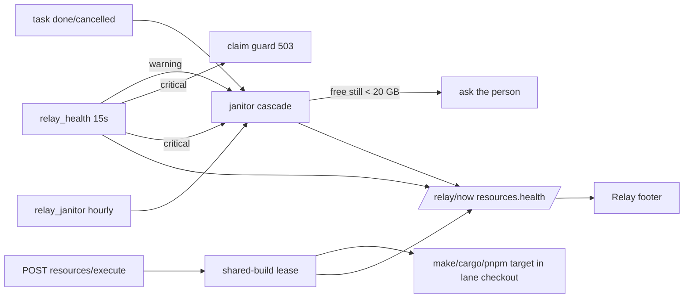

# Design: relay host ops (#444)

## Context
§10 of the queue design describes three broker jobs. The grant-time disk/swap floors and the resource lease
queue already exist (see proposal). This change adds the periodic and reactive parts and the broker build.

## Decisions

### D1. Health state lives in the daemon, not the database
A `HostHealth` value (level, readings, `checked_at`) sits behind an `RwLock` in `SharedState`
(`crates/senseid/src/api/state.rs`). The sentinel writes it; claim handlers and `GET /relay/now` read it.
A restart re-probes on the first tick (15 s). Nothing about host health leaves the machine.

### D2. Pure classifier, injectable readings
`classify(readings, watermarks) -> Level` is pure and unit-tested at every boundary. Readings come through a
`HostProbe` trait (`StatvfsProbe` for real, a fake in tests), in the house seam style of `GateRunner`
(`relay/gate.rs`). An unknown reading never raises the level, matching the existing grant rule
(`decide_resource_grant`, `relay/mod.rs:1134-1157`: "unknown readings never refuse").

### D3. Swap is measured as used percent
§10.1 states swap thresholds as used percent. `vm.swapusage` gives `xsu_total` and `xsu_used`; used percent is
`used / total`. Total 0 (no swap file yet) reads as 0 %. Linux reports unknown (as `swap_free_gb` does today).

### D4. Watermarks are config keys, defaults from §10.1
`relay.health.disk_warn_gb` (25), `relay.health.disk_critical_gb` (15), `relay.health.swap_warn_pct` (60),
`relay.health.swap_critical_pct` (80), `relay.health.recover_gb` (20). `config_value_is_valid`
(`api/handlers/config.rs:68`) sees one key and value only, so it checks "positive integer" per key. The
warn-above-critical pair rule needs the other key's value: `set_config_handler` checks it before writing, against
the PUT body merged over the stored values (defaults where unset). A blank value clears a key, as today. A test
that raises critical must raise warn with it. This is also the e2e seam: a test
raises the watermarks above the machine's real free disk to drive warning and critical without faking a
reading.

### D5. Throttling refuses all three claim routes
`claim_next` also hands out reviews, so refusing it while leaving `claim_review` open would be inconsistent.
All three answer 503 with code `relay_host_disk_exhausted` (new `RelayError::HostExhausted`, status 503 in
`RelayError::status`, `relay/mod.rs:1068`; code in `RelayError::code`, `:1087`; and a message arm in the handler
`err` mapper, `api/handlers/relay.rs:85`, so the short reading reaches the wire). Checkpoints, reports, reviews already claimed and releases stay
open so lanes can finish and free space.

### D6. Escalation is one open ask per active crew
When the emergency janitor leaves free disk below `recover_gb`, the broker files an `asked` action with
`asked_of: "person"` in each crew that has a live lane, using the gate's ask shape
(`pg_store/relay.rs:3706-3735`). While that ask is open it is not filed again. Options: "I freed space" (the
next probe decides). When a later probe reads normal or warning, the broker answers its own open asks
("space recovered") so Needs you clears without the person.

### D7. Janitor safety: never delete work
- Worktrees: only `relay.lanes.worktree` paths of unregistered lanes, only when `git status --porcelain` is
  empty and the branch has no commits absent from its upstream or the base branch. A dirty or unmerged
  worktree is reported in the run record, never removed. Then `git worktree prune` in the base checkout.
- Scratch: only sensei-owned paths. No `~/.sensei/scratch/` exists in code today (§10.2 names it, nothing
  writes it), so scratch means the gate's verify worktrees left behind: `std::env::temp_dir()/sensei-gate-*`
  (`relay/gate.rs:268`) older than 24 h, removed with `git worktree remove --force` then `prune`. Nothing else
  in the temp dir is touched.
- Incremental caches: `target/*/incremental/*` entries older than 24 h in known checkouts.
- Manifest targets: only an allow-list of non-destructive names (`clean-temp`, `clean-test`, `clean-cache`)
  found in the checkout's Makefile, plus `pnpm store prune` when `pnpm-lock.yaml` is present. Never `make
  clean` or a whole `cargo clean`.
- Logs: execute logs (D9) older than 7 days.

### D8. Makefile targets come from a manifest parser
No adapter parses Makefiles today (`crates/senseid/src/adapters/manifest/` has none). Add
`adapters/manifest/make.rs` with a pure `parse_make_targets(content) -> Vec<DiscoveredCommand>` reusing
`DiscoveredCommand` and `command_category::categorise`. Janitor and execute both use it, and `package.json`
scripts come from the existing `npm.rs` `parse_commands`. Registering it as a full `ManifestAdapter` for the
index is a follow-up (it would change `folder_commands` for every repo).

### D9. Execute streams over SSE and records in the lease
`POST /api/relay/resources/execute {lane_id, manifest, target}` resolves the lane's own checkout
(`relay.lanes.worktree`, else `repo`) — the caller cannot name another path. The target must be one the
manifest parser lists. The broker takes the `shared-build` lease (queues behind a holder up to `timeout_ms`,
default 120 000), runs the command line under its own supervisor, and answers
`text/event-stream`: `line` events, then one `done` event with `exit_code`, `duration_ms`, `max_rss_kb`.
`agent_spawn::run_agent` (`agent_spawn.rs:144`) cannot be reused as is: it buffers stdout/stderr until exit
and reaps through tokio's `Child::wait`, which exposes no rusage. The execute supervisor keeps its rules
(timeout, kill and reap, `kill_on_drop`) but reads lines as they arrive and reaps with `libc::wait4` to get
`ru_maxrss` (bytes on macOS, KiB on Linux; normalise to KiB). The shared timeout/kill logic is extracted,
not copied. A queued request does not get notified today (`relay_release_resource` grants the next waiter at
`pg_store/relay.rs:2309` but tells no one), so execute polls its lease row until granted or `timeout_ms`.
Lines pass the secret scan and are capped at 600 chars each. Full output goes to
`~/.sensei/relay/exec/<lease_id>.log`; the lease `props` keep the summary. The lease is released on exit,
on error and on client disconnect.

### D10. Shared cache only for broker builds
Broker-executed cargo targets get `CARGO_TARGET_DIR=<main checkout>/target/shared` (the git common dir's
parent) and `RUSTC_WRAPPER=sccache` when `which_binary("sccache")` finds it. pnpm's store is global already;
nothing to set. Lane-run builds are untouched: rewriting each worktree's cargo config would change the user's
files.

## Decisions defaulted (user may override)
1. Swap thresholds use used percent of `vm.swapusage` total (D3), as §10.1 states, not free GB.
2. "Recovers ≥ 20 GB" means free disk after cleanup is at least 20 GB, not 20 GB reclaimed (D6).
3. Critical refuses `claim_review` too (D5), not only the two routes §10.1 names.
4. Watermarks are config keys with §10.1's numbers as defaults (D4).
5. The janitor never removes a dirty or unmerged worktree; it reports it (D7).
6. `cargo clean -p` is not run; stale incremental scavenging plus `clean-cache` covers the same ground
   without guessing which crates are "localized".
7. Execute output streams as SSE; the MCP tool collects it and returns the summary plus the last 600 chars.
8. The shared `CARGO_TARGET_DIR` applies only to broker-executed builds (D10).
9. Stage-4 compaction targets execute logs; `relay.actions` stores no raw stdout today, so there is nothing
   else to compact.
10. A level rises to critical only after two consecutive critical probes (30 s); it falls at once.

## Risks
- macOS dynamic swap makes used percent jumpy at low totals. Mitigation: a level change needs two
  consecutive probes (30 s) before it throttles.
- A janitor run in a large `target/` can take time; it runs on its own task, never inside a request, and one
  run at a time (advisory lock).
