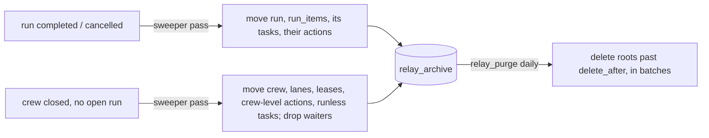

# Design: relay run archive and 30-day purge

## Context
`relay` holds open and ended work side by side. Grounding (develop @ `c25d1a930`):

| Fact | Where |
|---|---|
| The sweeper completes runs in place (`state = 'completed'`) | `crates/senseid/src/db/pg_store/relay.rs:5008-5029`, called at `relay.rs:6864` |
| Cancel stamps `cancelled` + `completed_at` in place | `relay.rs:4720-4735` |
| Crew close sets `status = 'closed'` in place (coordinator and person paths) | `relay.rs:6024-6074`, `relay.rs:6082-6140` |
| Past runs list = ended rows of `relay.run_list`, newest first | `relay.rs:4741-4758` |
| Run detail reads `relay.tasks`, `relay.lanes`, `relay.actions` | `relay.rs:4767-4890` |
| `delete_after = completed_at + 30 days` already served | `database/ddl/view/relay/run_list.ddl:20-21` |
| UI banner promises a daily delete job | `packages/state/relay/crew-selectors.ts:200-201` |
| Any `run` event re-reads the run list (no refresh needed) | `packages/state/relay/relay-state.svelte.ts:295` |
| `RunChange::Archived` / `Deleted` exist, unused | `crates/senseid/src/api/events.rs:218-219,358-359` |
| Unmet deps treat a missing dep as satisfied, at four sites | `unmet_deps` `relay.rs:1128-1148` (report gate `relay.rs:2891`, task header `relay.rs:7621`); inline in `relay_claim_next` `relay.rs:4153-4155` and the sweeper's broker-gate pick `relay.rs:6852-6855`; `database/ddl/view/relay/task_queue.ddl:26-36` |
| The `relay` schema also deploys to the dōjō scope (listed by name) | `database/design.yaml:118-134`; a new schema is not reached unless listed or FK-pulled |
| No relay DDL may call `now()` (dbd resolves it to the `relay.now` view) | `make check-no-now-relay`, `scripts/check-no-now-relay.py` (scans `relay` files only) |
| Live FKs that would block a move | `relay/items.ddl:24` (`added_by` → lanes), `relay/actions.ddl:26` (`reply_to` → actions) |
| No table outside `relay` references `relay` | `rg "references relay\." database/ddl` (relay files only) |
| No relay row syncs to the dōjō | no relay table read in `crates/senseid/src/dojo/*` |
| Schedules: code list + staging seed + descriptions | `crates/senseid/src/tasks/schedule.rs:23-42`, `database/import/staging/schedules.jsonl`, `crates/senseid/src/api/handlers/scheduled_tasks.rs:66` |

## Goals / Non-goals
- Goals: `relay` holds only open work; ended work stays readable for 30 days; then it is gone.
- Non-goals: archiving backlog items (`relay.items` is the person's backlog, not run rows);
  dōjō-side archive; a UI to restore an archived run.

## Decisions

### D1. Archival roots: the run and the crew

A run is the archival unit for work (issue comment, 2026-11-12). A crew spans runs, so its lanes
stay live until the crew closes. Lanes of a live crew are not copied when one of its runs archives:
run detail reads members from live lanes, then archived lanes.

### D2. Archive shape
`relay_archive.<table>` mirrors `relay.<table>` column for column and reuses the `relay` enum types,
so a move is `insert … select … ; delete …`. Each table adds `archived_at timestamptz not null`.
`relay_archive.runs` and `relay_archive.crews` add `delete_after timestamptz not null`. Primary keys
match the live keys. There are no foreign keys: purge deletes children by root id, in dependency
order, in one transaction. RLS is enabled with an owner-read policy and a select grant to
`authenticated`, as `database/policies/relay/actions.sql`; no write grant, and no schema USAGE for
the API roles (no `apply/after` grant file, unlike `relay_api_grants.sql`), so the archive stays
daemon-local. Defaults use `current_timestamp`, never `now()`: the search path includes `relay`,
where `now()` resolves to the `relay.now` view.

Tables: `crews`, `lanes`, `leases`, `runs`, `run_items`, `tasks`, `actions`. Not archived:
`lane_waiters` (a live wait, deleted on close), `items`, `finding_classes`, `daemon_user`.

### D3. Two live FKs become plain ids
`relay.items.added_by` and `relay.actions.reply_to` lose their FKs. A backlog item outlives the crew
whose lane added it, and a live action may reply to one that moved. Moving the reply closure instead
would drag another run's history along. An idempotent `apply/before` hook drops each constraint
(`alter table … drop constraint if exists`) because dbd reconcile does not reliably drop
constraints (dbd reconcile gaps). Readers tolerate a missing target: `added_by` is read as a raw
id (`added_by_you = added_by.is_none()`, `relay.rs:1462`), and `reply_to` is matched by correlated
subqueries (`now.ddl:51,92,107`) or by the inner join in the lane inbox (`relay.rs:6271`), which
simply omits an answer whose ask has moved.

### D4. When archival runs
A step at the end of each `relay_lease` sweep pass (60 s), after the sweep's own transaction
commits. One transaction per root. Inside it the root row is locked (`for update`) and re-checked:
a run must be `completed` or `cancelled`; a crew must be `closed` with no `draft`/`planning`/`active`
run bound to it. A root that fails the re-check is skipped. Child task rows are locked
`for update` before the delete, so a concurrent action insert waits and then fails its FK check.
The lane-facing write maps that to 404 `task not found`, never 500.

### D5. Reads span both schemas
Run list: live ended rows (none after the first pass) union archived runs, with the same columns
(`total_tasks`, `done_tasks`, `members`, `delete_after`). Run detail, task view and task history:
live first, then archive; an archived task view is read-only (the same body; every write route
answers 404 for it). Dependency checks (all four sites in the grounding table, through one shared
SQL predicate): a dep missing from `relay.tasks` is satisfied only when `relay_archive.tasks` holds
it as `done`. A cancelled archived dep stays unmet, matching "cancelled
is not done" (`relay.rs:1126`).

### D6. Purge
A new `relay_purge` schedule (daily, `interval_secs` 86400, seeded via `schedules.jsonl`, the staging
import path). Each batch deletes up to 100 roots whose `delete_after <= now`, children first, in one
transaction, and loops until none are due. Archive tables are never written by the broker, so
batches never contend with live traffic. Each deleted run emits `run.deleted`; the screen's run list
re-reads.

## Decisions defaulted (user may override)
1. **Purge date for runs is `completed_at + 30 days`**, not `archived_at + 30 days`. The app already
   shows that date (`run_list.ddl:21`, `crew-selectors.ts:200`); archival follows completion within
   one sweep pass, so the two differ by under a minute. Crews purge at `archived_at + 30 days`.
2. **Archival trigger is the sweeper**, not the completing request. One code path covers sweeper
   completion, person cancel, coordinator close and person close, and it retries on its own.
3. **`token_hash` is not archived** with a lane (column nullable in the archive, written null). A dead
   lane's credential hash has no reader.
4. **Backlog items stay live**, including `closed` ones. They are the person's backlog, outside #393's
   list (tasks, lanes, messages, answers, reviews, steps, events).
5. **Drop the two FKs (D3)** rather than move reply closures or null `added_by`.
6. **Batch size 100 roots per transaction**, a constant in code.

## Risks / Trade-offs
- Losing two FKs loosens integrity: a typo'd `reply_to` is no longer refused. The daemon is the only
  writer and sets both from rows it just read.
- Readers that union two schemas cost one extra query for ended work only; open-work reads are
  unchanged.
- dbd reconcile may need two runs (dbd#121) when the new schema lands on an existing database.

## Migration
Additive schema plus two dropped constraints. On first pass after upgrade, the sweeper archives
every already-ended run and closed crew in batches of one root per transaction. Rollback is not
offered: archived rows stay readable through the same routes.
