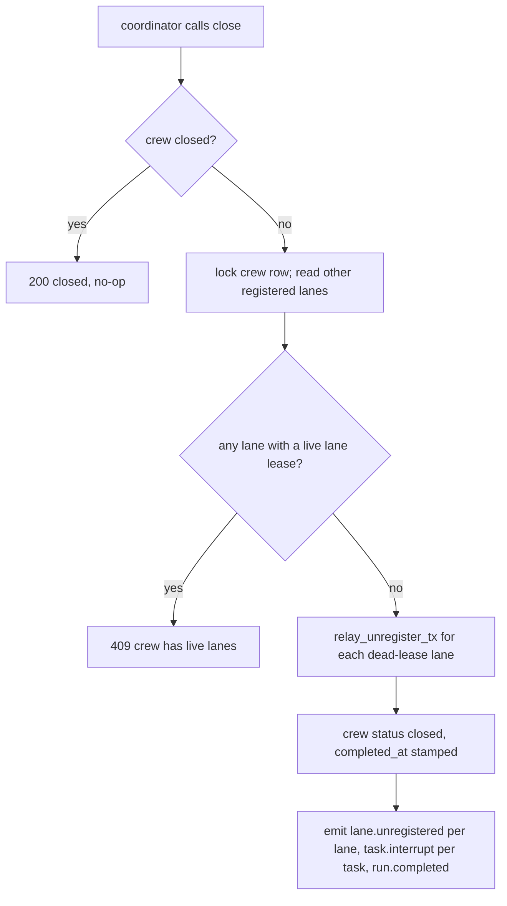

# Design: close tolerates dead-lease lanes

## Context
Two close paths exist:

| Path | Who | Lanes today | Run guard |
|---|---|---|---|
| `POST /api/relay/crews/{id}/close` | coordinator lane | refuses on any `unregistered_at is null` lane besides the caller | none |
| `POST /relay/crews/{id}/close` | person (#419) | unregisters every registered lane | refuses a planning/active run |

Only the lane path is wrong. It reads the registration flag where the rest of Relay reads the lease.

## Decisions
1. **Liveness = a live lane lease.** The predicate Relay already uses in five places (waiter grant `relay.rs:1019`,
   assign `2505`, claim `3776`, run start `4599-4605`, handover `5765`): a `kind = 'lane'`, `state = 'granted'` lease
   with `expires_at` after now. The crew-wide form close needs is run start's (`relay_start_run_tx`, `4599-4605`):
   registered lanes of the crew joined to a granted, unexpired lane lease, here also excluding the caller. Extract that crew-wide query into one
   helper (taking the instant and an optional lane to exclude) used by both run start and close, rather than a sixth
   inline copy. Run start passes its fed `now`; close takes no fed `now`, so it passes the transaction's clock
   (`current_timestamp`), as handover compares against. The four per-lane copies are not
   refactored in this slice.
2. **Close releases the dead lanes, not just skips them.** Leaving `unregistered_at is null` rows in a closed crew
   would let a revived session heartbeat back into a closed crew (the heartbeat regrants a lapsed lease,
   `relay.rs:1745-1780`, and checks only `unregistered_at`). Releasing through `relay_unregister_tx` reuses the
   person close's path and gives the revived session `410` then `409 crew is closed`, as `lanes.md:60-61` states.
3. **Lock order.** Close takes `select ... from relay.crews ... for update`, then the dead lanes `order by id for
   update`, matching the person close (`relay.rs:6089`, `6116-6121`), so two closes serialize. A register-join,
   reregister, plan, assign or claim passes `relay_require_crew_open`, which reads the crew `for share` (PR #502
   review): a close racing one of them serializes with it, and the gate sees the status the close committed, so a
   closed crew never gains a lane or a lease. A contributor that names no crew (#402) reads the user's open crews
   `for share` too, all of them, not `limit 2`: a crew a racing close holds drops out once the close commits, and the
   register answers `relay_no_active_crew` instead of joining it. The lease sweeper takes every open crew row `for key share` in id
   order before it expires leases or ends limit pauses (PR #502 review): a sweep that held a dead lane's lease while
   waiting on the lane row close holds would deadlock (`40P01`). `key share` waits only for a close, not for
   heartbeats or the open-crew gate. It then takes the lanes it will touch (a due limit pause or a lapsed lane lease)
   `for no key update` in id order, before their leases (PR #502 review): heartbeat (lane `for share`, then lease) and
   a lane's own unregister (lane, then lease) take that order, and a sweep that expired the lease first and then ended
   the lane's pause would deadlock with either. `no key update` lets task writes' foreign-key checks pass.
   A lane task write takes the crew row `for key share` before it touches a task (PR #502 review):
   `relay_hold_crew`, or `relay_hold_lane_crew`, which also re-reads the lane and answers `410` when a close
   released it meanwhile. Checkpoint, report, the holder's first-write start, review, release, ask, answer and
   hand-over do this. Each one updated the task first, then waited on the crew row for its `relay.actions` foreign
   keys, while close held the crew and waited on that task (`40P01`). Ask and hand-over also write only when the
   task is still in the state they read, so a task a close interrupted is refused (`409`), not overwritten. Single
   task updates with no later lock (step, cancel) and writes on tasks close never touches (merge and the gate
   outcome, on approved tasks) cannot close a cycle and keep their order. A lane's own unregister takes the crew
   row first too (PR #502 review): it took the lane and its task, then waited on the crew for its `interrupted`
   action's key while close held the crew and waited on the lane (`40P01`); one that waited behind a close answers
   `410`. A write never acts on a task state a racing writer (a person's `cancel_run`, a merge) moved on (PR #502
   review): the leave the close runs per dead lane, the sweep (expiry, limit pause, re-offer), report, review and
   answer read the task `for update`, so a cancelled task drops out or is refused; merge, task cancel and assign,
   which read before their transaction, write only from the state and holder they read (`409`), so a task a racing
   cancel moved on is never interrupted, re-offered, reviewed, merged or handed out over that state. A closed crew's
   task is never re-offered (PR #502 review): the sweep's re-offer skips closed crews, because no lane can claim
   there (`crew is closed`), so a task close interrupted stays `interrupted`, and the sweep never nudges a closed
   crew about a floating review. A sprint run on that crew stays open until the person cancels it, as it already did
   for its ready tasks (the lane close has no run guard, below). The gate still lands an approved task's merge:
   close never touches approved work.
4. **Heartbeat race.** A heartbeat that commits between the liveness read and the close's commit is still released
   by close (the lane row is locked and unregistered in the same transaction); its next call gets `410`. Heartbeat
   takes the same order as close (PR #502 review): it updates the crew row first, then reads the lane `for share`,
   then touches its leases. Renewing the lease before the crew row would hold the lease close releases while
   waiting on the crew row close holds, a deadlock (`40P01`). A heartbeat that waited behind close sees the lane
   unregistered and answers `410` instead of granting a fresh lease on a released lane.
5. **Events.** The handler emits what the person close emits, so the screen drops the lanes from the stream without
   a re-read: `lane.unregistered` per released lane, `task.interrupt` per interrupted task, then `run.completed` with
   the crew id (existing).
6. **Answer shape.** `RelayCloseOutput` gains `released: Vec<(Uuid, Option<Uuid>)>` (lane, interrupted task), and the
   JSON answer gains `released: [lane_id…]`. Additive; existing fields unchanged.

## Decisions defaulted (user may override)
- **Which of the issue's three options:** close tolerates dead-lease lanes (option 1), per the issue's 2026-11-12
  comment. No coordinator evict route (option 2) and no sweep-side horizon unregister (option 3): a lane that lapses
  briefly (laptop sleep) keeps its registration and can heartbeat back until someone closes the crew.
- **Lane close stays coordinator-only.** A crew with no coordinator closes from the person route (#419), which
  already tolerates dead lanes. Opening the lane route to contributors would let any lane end the crew under the
  others; not asked for.
- **No run guard added to the lane close.** The person close refuses an open run; the lane close never did and the
  issue does not ask for it. Unchanged.
- **No grace on "dead".** A lease past `expires_at` is dead for close at once (the lease TTL, 300 s, is already the
  grace), matching handover and assign.

## Risks
- A coordinator that closes while a contributor is merely late on its beat (lease just lapsed) releases it. That lane
  was already suspended by the sweeper with its task interrupted; close only makes the release final.
