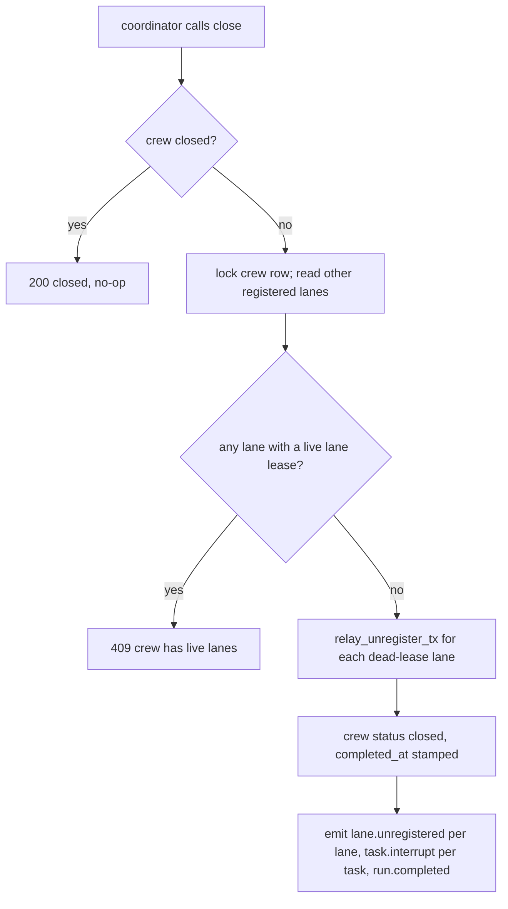

# Design: close tolerates dead-lease lanes

## Context
Two close paths exist:

| Path | Who | Lanes today | Run guard |
|---|---|---|---|
| `POST /api/relay/crews/{id}/close` | coordinator lane | refuses on any `unregistered_at is null` lane besides the caller | none |
| `POST /relay/crews/{id}/close` | person (#419) | unregisters every registered lane | refuses a planning/active run |

Only the lane path is wrong. It reads the registration flag where the rest of Relay reads the lease.

## Decisions
1. **Liveness = a live lane lease.** The predicate Relay already uses in five places (waiter grant `relay.rs:1019`,
   assign `2505`, claim `3776`, run start `4599-4605`, handover `5765`): a `kind = 'lane'`, `state = 'granted'` lease
   with `expires_at` after now. The crew-wide form close needs is run start's (`relay_start_run_tx`, `4599-4605`):
   registered lanes of the crew joined to a granted, unexpired lane lease, here also excluding the caller. Extract that crew-wide query into one
   helper (taking the instant and an optional lane to exclude) used by both run start and close, rather than a sixth
   inline copy. Run start passes its fed `now`; close takes no fed `now`, so it passes the transaction's clock
   (`current_timestamp`), as handover compares against. The four per-lane copies are not
   refactored in this slice.
2. **Close releases the dead lanes, not just skips them.** Leaving `unregistered_at is null` rows in a closed crew
   would let a revived session heartbeat back into a closed crew (the heartbeat regrants a lapsed lease,
   `relay.rs:1745-1780`, and checks only `unregistered_at`). Releasing through `relay_unregister_tx` reuses the
   person close's path and gives the revived session `410` then `409 crew is closed`, as `lanes.md:60-61` states.
3. **Lock order.** Close takes `select ... from relay.crews ... for update`, then the dead lanes `order by id for
   update`, matching the person close (`relay.rs:6089`, `6116-6121`), so two closes and a close racing a register
   serialize.
4. **Heartbeat race.** A heartbeat that commits between the liveness read and the close's commit is still released
   by close (the lane row is locked and unregistered in the same transaction); its next call gets `410`. Heartbeat
   takes the same order as close (PR #502 review): it updates the crew row first, then reads the lane `for share`,
   then touches its leases. Renewing the lease before the crew row would hold the lease close releases while
   waiting on the crew row close holds, a deadlock (`40P01`). A heartbeat that waited behind close sees the lane
   unregistered and answers `410` instead of granting a fresh lease on a released lane.
5. **Events.** The handler emits what the person close emits, so the screen drops the lanes from the stream without
   a re-read: `lane.unregistered` per released lane, `task.interrupt` per interrupted task, then `run.completed` with
   the crew id (existing).
6. **Answer shape.** `RelayCloseOutput` gains `released: Vec<(Uuid, Option<Uuid>)>` (lane, interrupted task), and the
   JSON answer gains `released: [lane_id…]`. Additive; existing fields unchanged.

## Decisions defaulted (user may override)
- **Which of the issue's three options:** close tolerates dead-lease lanes (option 1), per the issue's 2026-11-12
  comment. No coordinator evict route (option 2) and no sweep-side horizon unregister (option 3): a lane that lapses
  briefly (laptop sleep) keeps its registration and can heartbeat back until someone closes the crew.
- **Lane close stays coordinator-only.** A crew with no coordinator closes from the person route (#419), which
  already tolerates dead lanes. Opening the lane route to contributors would let any lane end the crew under the
  others; not asked for.
- **No run guard added to the lane close.** The person close refuses an open run; the lane close never did and the
  issue does not ask for it. Unchanged.
- **No grace on "dead".** A lease past `expires_at` is dead for close at once (the lease TTL, 300 s, is already the
  grace), matching handover and assign.

## Risks
- A coordinator that closes while a contributor is merely late on its beat (lease just lapsed) releases it. That lane
  was already suspended by the sweeper with its task interrupted; close only makes the release final.
