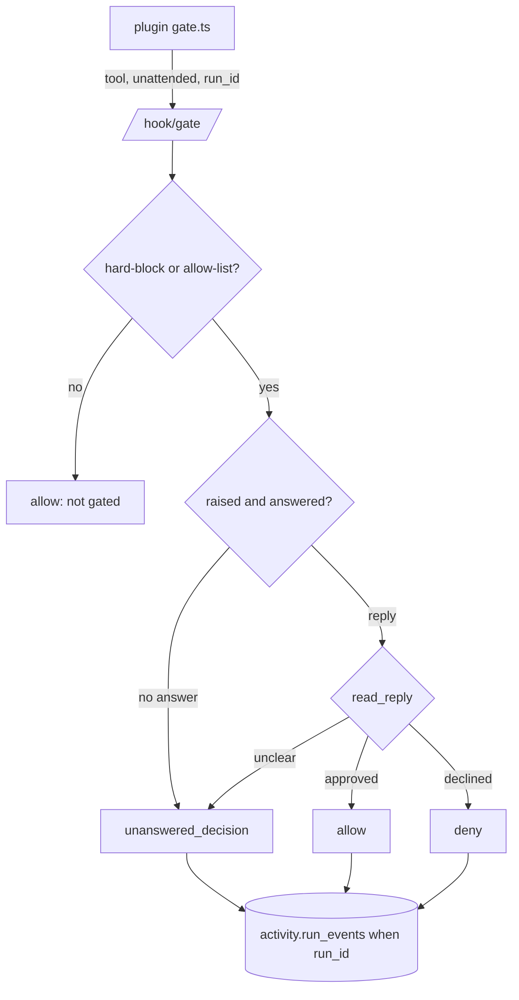

# Design: unclear replies and a run record for the relay gate (#312)

## Context
What is already on develop (verified at `c25d1a930`):

| Piece | Where | State |
|---|---|---|
| D28 decision: unanswered hard-block in an unattended run is denied | `crates/senseid/src/dojo/gate.rs:64-76` (`unanswered_decision`) | done, tested (`gate.rs:717-739`) |
| `/hook/gate` uses it on every no-answer path (non-uuid session, membership read error, no dōjō, session update error, raise error, timeout, await error) | `crates/senseid/src/api/handlers/sessions.rs:511-622` | done, router tests `sessions.rs:918-975` |
| Claude driver marks its step with `SENSEI_RUN_ID` (the `activity.runs` id) | `crates/senseid/src/relay_drivers/claude.rs:44-52`, `crates/senseid/src/tasks/handlers/advance_run.rs:344-345` | done |
| Plugin sends `unattended` | `marketplace/plugins/sensei/hooks/gate.ts:32` | done, `gate.test.ts:102+` |
| Answered reply → allow/deny | `gate.rs:40-54`, used at `sessions.rs:614-617` | **fails open on any non-deny shape** |
| Gate outcome in the run's activity | none; only `tracing` | **missing** |
| Plugin sends the run id | none | **missing** |

## Decisions
1. **Reply reading is a three-way pure function.** `read_reply(&Value) -> Reply { Approved, Declined, Unclear }`
   replaces `decision_from_reply`. Approved: `verdict` equals `approve` (case-insensitive) or `approve: true`.
   Declined: `verdict` equals `deny` or `approve: false`. A reply carrying both an approval and a decline is
   Declined (a decline always wins). Everything else is Unclear.
2. **Unclear goes through `unanswered_decision`** with why = `"the reply was not a clear approve or deny"`. That
   keeps D28 in one place: unattended hard-block denies, everything else allows.
3. **The run record reuses existing event kinds.** No new enum values, so no DDL hook and no KindInfo/`ALL` pin
   change (`crates/senseid/src/runs.rs:57-80`).
   - `gate_raised`: the gate was put to a phone. The dōjō projection already shows it as Blocked
     (`crates/senseid/src/dojo/relay_run_project.rs:195`).
   - `gate_passed`: a person approved (`outcome: "approved"`).
   - `flagged`: declined (`outcome: "declined"`), unanswered and denied (`outcome: "denied"`), or unanswered and
     let through (`outcome: "allowed"`). `allowed` is flagged, not passed, because nobody approved it.
   - `detail`: `{ via: "hook_gate", tool, category?, outcome, why?, reason }`. `reason` is the daemon-owned
     phrase already returned to Claude. Never the command text or tool input (D10).
   - No event for an ungated call (`not gated`): that is ordinary progress and would flood the feed.
   - **Gate records are not agent progress.** The watchdog's stall clock (`last_progress_at`) skips events
     whose `detail.via` is `"hook_gate"`. A step that keeps retrying a denied `make deploy` writes one record
     per try; counted as progress, the run would never stall and the dōjō would show "last progress just now".
4. **The record never changes the decision.** The run id must parse as a uuid; a failed append is logged with
   `tracing::warn!` (the no-silent-errors rule) and the hook answer is returned unchanged. A gate must not
   block or unblock because the activity write failed.
5. **The plugin sends `run_id`** from `SENSEI_RUN_ID`, else from the run drive's stored `runId`
   (a new `drivenRunId($)` beside `isDriven` in `drive.ts`). Absent means no record, as for interactive work.

## Decisions defaulted (user may override)
- **Free text from the phone counts as unclear.** The dōjō turns a typed answer into `{ text }`
  (`relay-inbox-map.ts:138-140`). In an unattended run a hard-block then denies. Recommended because only a tap
  on approve is a deliberate approval; the alternative (any non-deny reply approves) is the hole #312 names.
- **Fail-open outcomes are recorded too**, as `flagged` with `outcome: "allowed"`. The issue says "say which
  happened"; an allowed-without-answer hard-block is exactly what a reviewer needs to see.
- **No plugin-side fail-closed when the daemon is unreachable.** The daemon owns the classifier; the plugin
  cannot know a call is a hard-block without it. A daemon-spawned step runs `claude -p` with no permission
  bypass (`claude.rs:44-52`), so the engine's own verdict already refuses tools that need a prompt. A driven
  interactive session gets the engine's prompt, which waits.
- **No app UI in this change.** The desktop app does not render `activity.run_events` today (no `api/runs`
  reader under `app/src`). The record is read through `GET /api/runs/{id}` (`crates/senseid/src/api/handlers/runs.rs:45-70`),
  MCP `run_status`, and the dōjō run projection. A run-activity screen is outside #312.

## Verification
- Pure tests in `gate.rs` for every reply shape × attended/unattended × hard-block/allow-list.
- Router tests in `sessions.rs` (`hook_gate_tests`) with a real run row: the deny path appends a `flagged`
  event with the outcome and reason; a bad run id leaves the decision unchanged.
- Plugin tests: `run_id` sent from `SENSEI_RUN_ID` and from the drive; absent otherwise.
- Tauri e2e `app/e2e/tests/relay-gate.spec.ts` against the e2e daemon (no dōjō enrolled, so every gate is
  unanswered): creates a run via `POST /api/runs`, posts an unattended `make deploy` to `/hook/gate` with the
  run id, asserts deny with the reason, then `GET /api/runs/{id}` lists a `flagged` event with
  `outcome: "denied"`; an interactive call is allowed and recorded as `outcome: "allowed"`; `cargo test` with
  the run id records no gate event.
- The e2e daemon's `advance_run` scheduler ticks every active run (15 s, `sensei.schedules`) and appends a
  `housekeeping` event per tick (`crates/senseid/src/tasks/handlers/advance_run.rs:205-227`), and
  `GET /api/runs/{id}` returns only the newest 20 events (`RUN_EVENTS_LIMIT`). So the spec counts only events
  whose `detail.via` is `"hook_gate"`, never the raw event count, and reads the run right after each post.
- The answered paths (approved/declined/unclear) need a dōjō reply; they are covered by the pure tests, since
  the e2e harness must never raise to a real dōjō.
