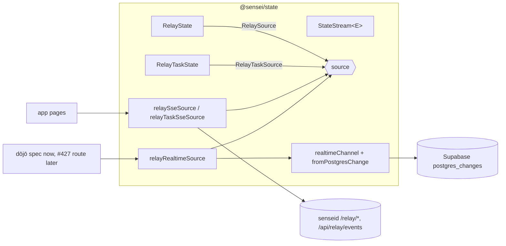

# Design — shared state sources (#414 remainder)

## Context

The relay domain lives in `@sensei/state` and the app runs off it (see proposal). What is left is the part that lets a
second plane use the same state: the task view's source, the realtime channel adapter, and the dōjō import. Design
reference: `docs/design/2026-11-12-relay-screen-rebuild.md` §2b (states, sources) and §4 (the dōjō, step 4).

## Decisions

### D1. One stream contract at the root: `StateStream<E>`

`packages/state/source.ts` exports
`type StateStream<E> = (on: (event: E) => void, onOpen: () => void) => () => void`. It is exactly today's
`RelaySource['events']` shape (`relay-state.svelte.ts:66,71`), so this is a rename with a type parameter, not a new
behaviour. `RelayEvents` stays as an alias (`StateStream<RelayStreamEvent>`) so call sites do not churn. `sseEvents`
and `realtimeEvents` become generic over `E`. Health and wizard adopt the same type when they move (D5).

### D2. The task view gets its own source, not the full `RelaySource`

`RelayTaskSource { readTask(crewId, taskId); answer(body); events: StateStream<RelayStreamEvent> }`. The task view
needs three calls; giving it the whole `RelaySource` would make every task-page spec fake ten methods.

- SSE: `relayTaskSseSource(api, stream)` maps `readTask` → `api.tryGetTask`, `answer` → `api.tryAnswerDecision`,
  `events` → `sseEvents(stream)`.
- Realtime: `RelayRealtimeTransport` gains `readTask`; `relayRealtimeTaskSource(transport)` builds the same shape;
  `cannedRealtime` gains a `task` read (503 "not synced" when absent, as its other reads do,
  `realtime.ts:83`).
- `RelayTaskState(reads, source, crewId, taskId, options?)` with `options.surface` (default `'desktop'`), the same
  option `RelayState` already takes (`relay-state.svelte.ts:96,191`). This removes the hard-coded
  `surface: 'desktop'` (`task-state.svelte.ts:74`).

### D3. The realtime mapper is pure and shaped like the daemon's event

`fromPostgresChange(payload, tables)` where `payload = {schema, table, eventType: 'INSERT'|'UPDATE'|'DELETE', new, old}`
and `tables` maps a table name to an entity (`lanes→lane, tasks→task, runs→run, items→item, decisions→decision,
messages→message`). Output: `{action: add|update|remove, entity, data}` with `data = new` (or `old` on DELETE), plus
the id key the daemon names that entity by (`task_id` for a task, `lane_id` for a lane, `run_id` for a run), because
`RelayTaskState.apply` reads `data.task_id` (`task-state.svelte.ts:98-100`) and `RelayState.apply` strips the daemon's
event keys (`relay-state.svelte.ts:111-117`). A table not in the map returns `null` and is logged by the caller, never
dropped silently. `tables` is a parameter and `RELAY_TABLES` only its default: today's `relay` schema
(`database/ddl/table/relay/`) has `lanes`, `tasks`, `runs` and `items` but no `decisions` or `messages` table (both
are `relay.actions` kinds), so the dōjō table names for those two are #427's publisher's to fix, and it passes its own
map. The specs build both the SSE event and the `postgres_changes` payload from the same row builders the SSE specs
use (`relay/fixtures.ts`), so "the state cannot tell the two apart" is a test, not a comment.

### D4. The package takes a structural client, not supabase-js

`realtimeChannel(client, {topic, schema, tables})` uses only `client.channel(topic).on('postgres_changes', filter,
cb).subscribe(statusCb)` and `client.removeChannel(channel)`. It is typed by a local interface. The package stays
dependency-free (`packages/tsconfig.json` header: "source only: no build, no dependencies of its own"); the dōjō hands
in its supabase-js client. Status strings map to `RelayChannelStatus` (`realtime.ts:25`), so `realtimeEvents` keeps
treating each `SUBSCRIBED` as an open.

### D5. Migration order and checklist live with the package

`packages/state/README.md` records the order and the checklist; the same text is posted as a comment on #414.

Order (by what has a stream and a second-plane need first):

1. Relay — done (#421, #484, this change).
2. Scan — already on `ReactiveStageContext` + `EventManager`; move `ScanState` and its source into the package.
3. Health — `health-state` has a `HealthTransport` seam (`app/src/lib/health-state.svelte.ts:7`); adopt
   `StateStream`.
4. Wizard — depends on health and scan (`wizard-state.svelte.ts:20-21`).
5. Dōjō domain states (library, rulepacks, delivery, you) — only when a desktop screen shares them.

Per-screen checklist:

- [ ] Each entity is a `ReactiveStageContext<T>`; a composite state owns UI state and `apply(event)`.
- [ ] The state is built with a source injected at construction; the page never fetches.
- [ ] The stream is a `StateStream<E>`; each open re-reads (no replay on a broadcast).
- [ ] Selectors are pure functions in the package with unit specs.
- [ ] State specs drive `apply` with canned events and assert on data, no DOM.
- [ ] A Tauri e2e pins a no-refresh update on the screen.

## Decisions defaulted (user may override)

1. **#414 closes when this change merges; the dōjō screen acceptance moves to #427 step 4.** The issue's first
   acceptance line ("relay screen runs … with the realtime adapter in Dojo") needs the dōjō `relay.*` publisher, RLS
   and publication, which #427 owns. This change delivers everything on the state side and proves it in a dōjō spec;
   the closing comment links #427 step 4 as the remaining screen half. Alternative: keep #414 open until #427 step 4
   ships.
2. **Health, scan and wizard migrations are follow-up issues, not this change.** The issue says "relay first, then
   health/scan/wizard"; the workflow scope is relay. The order and checklist are recorded (D5) and one issue per
   domain is filed at close.
3. **No dōjō page in this change.** A preview page would duplicate the route #427 builds. The dōjō proof is a vitest
   spec plus the dōjō build, not a dōjō Playwright run.

## Risks

- Changing the `RelayTaskState` constructor touches both app task pages and their specs; the relay Tauri e2e
  (`relay-run.spec.ts`, `relay-timeline.spec.ts`) is the regression proof.
- `EventManager` drops a payload that fails to parse without logging (`packages/state/event-manager.ts:79-81`). It is
  the shared SSE adapter; task 1.6 makes it report the failure through an injected `onError` (no silent errors).
