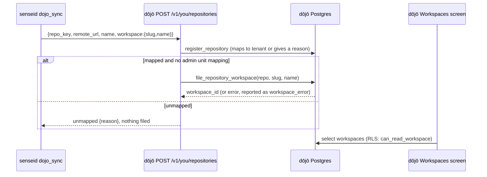

# Design: verify-dojo-sync-files-workspaces

## Context

#299 went through three model corrections by the user (all on 2026-10-20, in the issue comments). The final
model, which the code implements:

- A workspace (then "project") is ONE shared item, the same in sensei and the dōjō. It lives in one dōjō,
  keyed `(tenant_id, slug)`, and has no owner (`database/ddl/table/dojo/workspaces.ddl:3-16`).
- The sync creates it (`file_repository_workspace`); so does an admin's unit mapping (#308 R5a,
  `database/ddl/function/dojo/map_forge_unit.ddl:105`). A relay run only attaches to it (`attach_run_to_workspace`), moving `last_run_at` and
  the constitution.
- Read access follows repository access: a person may read a workspace when they may read one of its
  repositories, or they are its viewer, or they administer its dōjō
  (`database/ddl/function/dojo/can_read_workspace.ddl:19-24`).
- A personal dōjō holds only workspaces under the owner's own GitHub account; an org dōjō holds the org's.

## Decisions

1. **Identity: one dōjō workspace per sensei workspace** (user, 2026-10-20). A workspace spanning several
   repositories is listed once; its repositories link under it in `dojo.repositories_in_workspaces`, one
   workspace per repository per tenant. A re-file moves the link
   (`file_repository_workspace.ddl:71-73`).
2. **No guess.** The daemon offers a workspace only when the repository is in exactly one sensei workspace
   and that workspace has a `workspace` namespace (the slug comes from the namespace via
   `WORKSPACE_NAMESPACE_JOIN`; `crates/senseid/src/db/pg_store/sync.rs:939-967`). Otherwise it sends none and
   nothing is filed.
3. **An admin's unit mapping wins.** When `register_repository` already filed the repository by an admin
   mapping (#308 R5a), the daemon's workspace is not filed, so the mapping is not undone
   (`dojo/src/lib/server/repositories.ts:193-197`).
4. **Filing failure is reported, not thrown.** The registration stands and the daemon records the error as
   a `partial` sync state (`crates/senseid/src/tasks/dojo_sync.rs:474-478`, `:599`).
5. **No conversion migration** (user, 2026-10-20). Old relay-created per-user rows were dropped by
   `dbd reconcile --allow-destructive`; sync and relay repopulate.

## Decisions defaulted (user may override)

- **"A denied repository files nothing" means a repository the dōjō refuses to map**, not one that is mapped
  but not elected for metrics sync. Filing happens at registration, before the sync plan, for every mapped
  repository. Under the user's final model the workspace is a shared item whose visibility follows repository
  access, and election governs what metrics are pushed, not whether the workspace exists. A repository
  refused as `no_connection`, `not_a_member`, `ambiguous` or `unknown_host` files nothing
  (`dojo/src/lib/server/repositories.spec.ts:214-221`; non-member refusal in
  `database/tests/dojo/repository_workspace_filing.sql:107-113`). Recommended: keep this.
- **Verification is local first, production by runbook.** The dōjō has no committed Playwright suite (only
  `app/e2e` has a config), so the local dōjō check is a Playwright walkthrough per the dōjō local Playwright
  recipe, recorded as an issue comment, not a new committed suite. Recommended: keep this; a committed dōjō
  e2e harness is its own change.
- **Run status visibility stays the runner's team (#252)**, as taken in the issue's S1 plan.

## Risks

- The issue text says "project"; the code says "workspace" since #307 D12
  (`database/apply/before/dojo_workspaces_renamed.sql`). The closing comment must name both so the evidence
  maps to the issue.
