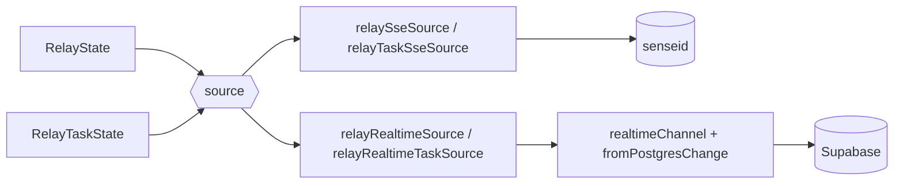

# @sensei/state

Domain state shared by the desktop app (`app/`) and the dōjō (`dojo/`). Source only: no build and no
dependencies of its own. Each host aliases it (`svelte.config.js`, `vitest.config.ts`) and compiles it as its
own code.

## What it holds

| Part | Files | What it is |
|------|-------|------------|
| Entity state | `stage.svelte.ts` | `ReactiveStageContext<T>`: rows keyed by `id`, changed by `apply(event)` |
| Event shape | `events.ts` | `StateEvent`: `{action: add\|update\|remove\|set, entity, data}` |
| Stream contract | `source.ts` | `StateStream<E>`, `sseEvents`, `realtimeEvents` |
| SSE socket | `event-manager.ts` | `EventManager`: one socket, parse failures reported to `onError` |
| Results | `result.ts` | `ApiResult`, `ApiError`, `failureReason` |
| Relay | `relay/` | `RelayState`, `RelayTaskState`, six entity states, selectors, sources |

## The source contract

A state never fetches. It is built with a source, and the page builds the source.

- A source has the reads and writes the state needs, and `events`, a `StateStream<E>`.
- `StateStream<E>` is `(on, onOpen, onFault?) => teardown`. `on` gets every event. `onOpen` runs on every open: the
  first, and each reconnect. A broadcast has no replay, so the state re-reads on each open. `onFault` gets the reason
  the stream went down (a realtime `CHANNEL_ERROR`, `TIMED_OUT` or `CLOSED`, with the supabase-js error). The relay
  states hold it as `streamFault` until the next open; a screen shows it, since stale data is a fault (D83).
- The desktop builds sources over the daemon: `relaySseSource`, `relayTaskSseSource`.
- The dōjō builds them over Supabase realtime: `relayRealtimeSource`, `relayRealtimeTaskSource`, on a transport
  whose `subscribe` is `realtimeChannel(client, {topic, schema, crewId, tables})`. Each subscription opens its own
  channel (`<topic>:<n>`): supabase-js reuses the channel it holds for a topic, and a listener added after
  `subscribe()` throws. The topic scopes nothing; `crewId` does. With a crew, each crew-scoped table asks the
  server for `crew_id=eq.<crewId>`, and any row that names another crew is dropped. `null` means every crew the
  person can see. `fromPostgresChange` maps a `postgres_changes` payload to the daemon's event.
- `RELAY_TABLES` lists only tables the relay DDL has: `lanes`, `leases`, `tasks`, `actions`, `runs`, `items`. Realtime
  joins every listener at once, and one missing table fails the whole channel. Decisions and messages are
  `relay.actions` rows, so an action names its task (none: Now re-reads). A lease is a lane's presence, so it names
  its lane. A table row is not the screen's row: it maps to the entity's id key alone and the state re-reads. A table
  declared `{entity, screenRow: true}` carries its row and applies with no re-read. The client is any
  object with the supabase-js `channel` / `on` / `subscribe` / `removeChannel` shape.

## Migration order

Domains move into the package in this order. A domain moves when it has a stream and a second plane needs it.

1. **Relay** — done (#421, #484, #414).
2. **Scan** — already on `ReactiveStageContext` and `EventManager`. Move `ScanState` and its source here.
3. **Health** — `app/src/lib/health-state.svelte.ts` has a `HealthTransport` seam. Adopt `StateStream`.
4. **Wizard** — depends on health and scan (`app/src/lib/wizard-state.svelte.ts`).
5. **Dōjō domain states** (library, rule packs, delivery, you) — only when a desktop screen shares them.

## Per-screen checklist

- [ ] Each entity is a `ReactiveStageContext<T>`; a composite state owns UI state and `apply(event)`.
- [ ] The state is built with a source injected at construction; the page never fetches.
- [ ] The stream is a `StateStream<E>`; each open re-reads (no replay on a broadcast).
- [ ] Selectors are pure functions in the package with unit specs.
- [ ] State specs drive `apply` with canned events and assert on data, no DOM.
- [ ] A Tauri e2e pins a no-refresh update on the screen.

## Tests

The package has no vitest config. `app/vitest.config.ts` runs its specs (`cd app && bun run test:unit`); the
dōjō's `src/lib/relay/shared-state.spec.svelte.ts` runs the relay state over the realtime sources
(`cd dojo && bun run test`).
